4Google

# Omnimatte3D: Associating Objects and their Effects in Unconstrained Monocular Video

Erika Lu⁴   
Leonid Sigal1,2,3   
Zhengqi Li⁴ Noah Snavely⁴   
Forrester Cole⁴

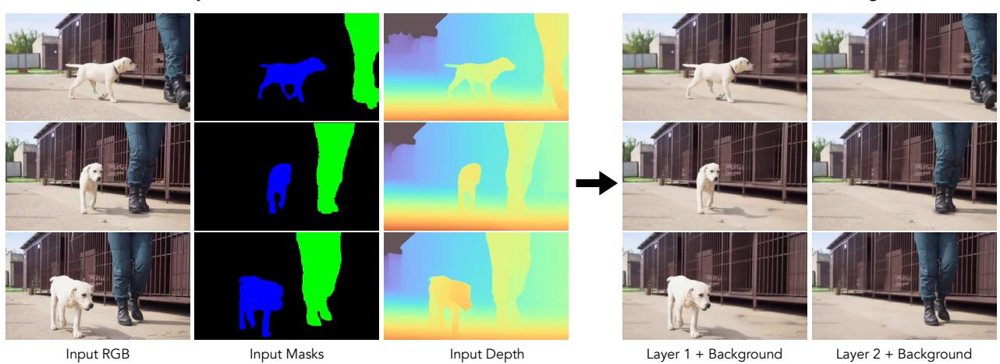  
Figure 1. Layer decomposition under strong camera parallax. Given an input video with unconstrained camera motion and approximate object masks and depth (left), our method estimates a layered representation composed of a background layer and object layers containing the subjects of interest and their associated effects (e.g. shadows). Results of combining object layers and background are shown on right

## Abstract

We propose a method to decompose a video into a background and a set of foreground layers, where the background captures stationary elements while the foreground layers capture moving objects along with their associated effects (e.g. shadows and reflections). Our approach is designed for unconstrained monocular videos, with an arbitrary camera and object motion. Prior work that tackles this problem assumes that the video can be mapped onto a fixed 2D canvas, severely limiting the possible space of camera motion. Instead, our method applies recent progress in monocular camera pose and depth estimation to create a full, RGBD video layer for the background, along with a video layer for each foreground object. To solve the underconstrained decomposition problem, we propose a new loss formulation based on multi-view consistency. We test our method on challenging videos with complex camera motion and show signiicant qualitative improvement over current approaches

## 1. Introduction

Decomposing a video into meaningful layers (as show in Fig. 1) is a long-standing and complex problem [42] that has seen a recent surge in progress with the application of deep neural networks [17,24, 25,46]. A challenging variant of layer decomposition is the omnimatte [25] task, which aims to separate an input video into a background and multiple foreground layers, each containing an object of interest along with its correlated effects such as shadows and reflections, thus enabling video editing applications such as object removal, background replacement and retiming. The original work on omnimatte [24,25] introduced a self-supervised approach for decomposing a video by assuming the background can be unwrapped onto a single static 2D background canvas using homography warping. Following work [17,46] relaxed the homography restriction, but maintained the necessity of unwrapping onto a 2D canvas.

This 2D modelling, however, limits the applicability of these methods to camera motions that have limited or zero parallax; intuitively, only panning camera motions are allowed. If the camera's center of projection moves a significant distance over the video, 2D methods are unable to learn an accurate background and are forced to place the background detail in a foreground layer (Figure 2). Since camera parallax is quite common, 2D methods are severely restricted in practice.

To handle camera parallax, we exploit another recent line of work on estimating 3D camera position and depth maps from casually-captured video with moving objects [18,26, 48, 49]. Instead of a 2D layer decomposition, we propose to learn a 3D background model that varies per-frame and includes inpainted RGB and depth in the regions occluded by the foreground. Allowing the background to vary perframe, rather than assuming a global, static canvas, creates an ill-posed decomposition problem, as variation in each input pixel could be explained by a foreground object, background, or both. To resolve this ambiguity, we enforce that the background varies slowly over time with 3D multi-view constraints using dense depth and camera pose estimates [48]. As shown in Fig. 2, our model can successfully separate the layers obtaining a clean background RGB whilst capturing only the person and their shadow in the foreground layer.

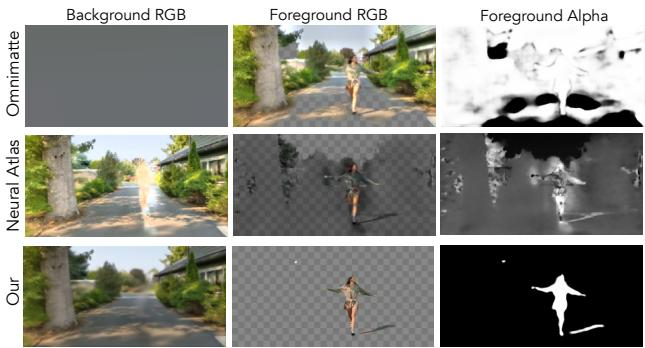  
Figure 2. Existing methods fail on scenes with parallax. Top row: Omnimatte [25] fails due to inaccurate homography registration, reconstructing the majority of the video in the foreground layer. Middle row: Neural-Atlas [17] incorrectly places trees in the foreground layer and struggles to inpaint the person region. Bottom row: Our method obtains a clean background and captures the person and their shadow in the foreground layer.

Contributions. Our main contribution is a novel video decomposition method capable of accurately separating an input video with complex object and camera motion (e.g., parallax) into a background and object layers. To address the ill-posed decomposition problem, we design regularization terms based on multi-view consistency and smoothness priors. The resulting model produces clean decompositions of real-world videos where previous methods fail.

## 2. Related Work

Layered video representations. There is a large body of work on decomposing videos into layers based on appearance and motion cues [4,8, 16,20,36, 42]. Layered video representations have proven useful for a variety of applications, including view synthesis for static scenes [39, 50], reflection removal [1, 2], segmentation [9], game deconstruction [38], and text-based video editing [3]. Recently, Omnimatte [24,25] aimed to decompose a video into layers that group objects with their correlated effects, allowing the user to perform editing tasks such as object removal and retiming. However, as discussed in Section 1, these works use a constrained background model which limits their use case to panning camera motions only. Subsequent work [17, 46] relaxes this assumption using general image warps, instead of homographies, but still cannot handle significant parallax; moreover, their goal is to learn a per-frame mapping to global sprites to enable applying consistent edits (e.g. style transfer) rather than targeting object removal or video stabilization.

Monocular video depth. Multi-view stereo based methods [23,40] incorporate motion estimation and multi-view reconstruction to predict depth by combining information from multiple reference frames. Hybrid depth methods combine single-view depth estimates from a pretrained network with geometric reasoning to obtain coherent depth predictions. With depth maps from monocular video as initialization, these methods use correspondence to enforce consistency by either assuming static regions [26] or by modeling the scene flow [49]. Recent methods simultaneously estimate depth maps and camera poses [19, 48], exploiting the depth prior to resolve camera motion ambiguities. We rely on Casual-SAM [48] to obtain camera poses and initial depth estimates as their method performs well on casually captured video.

Video completion and object removal. Patch-based methods for video inpainting [7, 12, 14, 28, 43] complete the missing regions by borrowing pixels from other frames, relying on correspondence estimated by homography or optical flow. Learning-based works have explored the use of 3D convolutions [5,41], attention mechanisms [21,30,47] and flow-based methods [10, 45] to achieve more realistic and consistent inpainting. These methods assume that the entire region to inpaint is specified by an input mask, whereas our method jointly learns where to inpaint the background while separating foreground objects and their correlated effects.

NeRF for dynamic scenes. With the recent success of neural fields [29,44] for view synthesis of static scenes, there has been interest in their adoption for dynamic scenes [11,22,27]. These works learn two NeRF models that decompose a scene into a static and dynamic region. However, these methods only support a single foreground layer and do not account for correlated effects such as shadows. ST-NeRF [15] proposed to learn separate NeRFs for each person to obtain an editable neural representation. Their method, however, requires each frame in the video to be captured from 16 different viewpoints simultaneously. Unlike NeRF methods, our method represents the video with multi-layer mesh geometry where object layers include associated effects, allowing editing as well as fast rerendering of the scene.

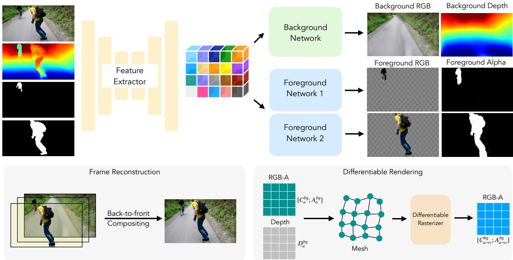  
Figure 3. Model Overview. Given a frame from the video along with an input mask, disparity and known camera pose, we first extract features by stacking the input and passing them though a 2D UNet architecture. These features are input to the background and foreground networks. The background network predicts the inpainted background RGB and disparity. The foreground networks predict an RGB-A image for each foreground layer. For scenes with multiple layers, the RGB-A image for each layer is predicted using independent networks.

## 3. Method

Given an input video, with known camera poses and initial depth estimates, the goal is to predict a per-frame layer decomposition consisting of a background layer and $N$ foreground layers encompassing objects of interest along with their associated effects. To this end, we propose a new method that predicts a layered separation of an input video without relying on a 2D background canvas, thereby allowing for greater flexibility of camera motion. We show an overview of our model in Figure 3. We optimize our model to output layers that reconstruct a single target video subject to a projection consistency loss. For each frame in the video, we estimate a layered representation consisting of background and foreground object layers where the contents of the object layers are conditioned on their corresponding input mask. Post-optimization, depth for foreground objects can be extracted from the input depth to produce a Layered Depth Image (LDI). Unlike prior works that rely on deep priors for inpainting the depth and color of occluded regions in the background, our method relies on multi-view consistency losses to steer the inpainting process.

## 3.1. Layer Decomposition Networks

We represent a frame at time a in the video as $\begin{array} { l l } { F _ { a } } & { = } \end{array}$ $\left( I _ { a } , D _ { a } , \{ M _ { a } ^ { i } \} _ { i = 1 } ^ { N } \right)$ , where $I _ { a }$ is the RGB frame, $D _ { a }$ is the disparity, and $\{ M _ { a } ^ { i } \} _ { i = 1 } ^ { N }$ are the input masks for N objects in the video. We denote the camera extrinsics for the frame $F _ { a }$ as $[ R _ { a } \ t _ { a } ]$ where $R _ { a }$ is the rotation matrix and $t _ { a }$ is the translation vector. The camera intrinsics are denoted as $K _ { a } = [ f _ { x } , f _ { y } , c _ { x } , c _ { y } ]$ where $f _ { x }$ and $f _ { y }$ are the focal lengths and $c _ { x } , c _ { y }$ is the principal point.

For each frame $( F _ { a } )$ in the input video, our method first extracts features by passing it to a feature extractor network modeled using a 2D UNet [35] architecture. The input to the feature extractor is constructed by concatenating input masks with the masked frame RGB and disparity along the channel dimension. The masked RGB and disparity are obtained as

$$
\tilde { Y _ { a } } = [ Y _ { a } \odot M _ { a } ^ { b g } \parallel Y _ { a } \odot M _ { a } ^ { 1 } \parallel . . . \parallel Y _ { a } \odot M _ { a } ^ { N } ]\tag{1}
$$

where $Y _ { a }$ is the concatenated RGB-D, $M _ { a } ^ { b g } = 1 - \bigcup _ { i = 1 } ^ { N } M _ { a } ^ { i }$ is an approximate mask for the background and  is the concatenation operation. These features act as input to both the background and foreground object networks.

The background network (shown in green in Fig. 3) consists of a 2D UNet and a convolutional neural network (CNN) that predicts the inpainted background color $( \mathcal { C } _ { a } ^ { b g } )$ and depth $( \mathcal { D } _ { a } ^ { b g } )$ respectively. The foreground networks are separate CNNs that predict RGB $( \mathcal { C } _ { a } ^ { i } )$ and alpha $( A _ { a } ^ { i } )$ images for each foreground layer independently. These predicted outputs, along with the input disparity, are combined to form an LDI (see supplement for details).

The feature extractor and background RGB UNets consist of five down-sampling and up-sampling layers with three residual blocks at every resolution. The background disparity and foreground layer prediction networks are comprised of single convolutional layers.

## 3.2. Differentiable Rendering

In addition to a reconstruction loss, our method relies on a projection consistency term (described in Section 3.3) that requires differentiable projections and renderings of the predicted background layer to different time steps. We achieve this using a differentiable rasterization framework [6].

To project the predicted background layer from a source time step a to target time step $b ,$ we first construct a mesh $\mathcal { M } _ { a } = ( \mathcal { V } _ { a } , \mathcal { F } _ { a } )$ , where $\gamma _ { a }$ and ${ \mathcal { F } } _ { a }$ are the mesh vertices and faces. Each vertex in the mesh corresponds to an image pixel. To obtain the vertex coordinate for a pixel, we unproject its homogeneous coordinates $x = [ i , j , 1 ] \in \mathbf { R P } ^ { 2 }$ using the predicted disparity as

$$
V _ { a } ^ { x } = d _ { i j } \left( \frac { \left( i - c _ { x } \right) } { f _ { x } } , \frac { \left( j - c _ { y } \right) } { f _ { y } } , 1 \right)\tag{2}
$$

where $d _ { i j }$ is the depth at pixel $( i , j )$ . The attributes for the vertices are composed of the predicted RGB, an alpha masking consisting of all ones, and the pixel coordinates. The faces for the mesh are constructed by adding an edge between vertices of neighboring pixels (bottom right in Fig. 3). The view-projection matrix to render the predicted background from a target camera is computed as

$$
H _ { a  b } = P _ { a } [ { \begin{array} { c c } { R _ { a } ^ { T } R _ { b } } & { R _ { a } ^ { T } ( t _ { b } - t _ { a } ) } \\ { \mathbf { 0 } } & { 1 } \end{array} } ]\tag{3}
$$

where $P _ { a }$ is the perspective matrix that maps camera-space to clip space. The view-projection matrix along with the estimated mesh is passed through a differentiable rasterizer that returns an $\mathrm { R G } \mathbf { \dot { B } } \mathbf { - A } ( \mathcal { C } _ { a  b } ^ { b g } , \mathbf { \check { A } } _ { a  b } ^ { b g } )$ image corresponding to the projection of the background to the target time step.

## 3.3. Losses

The total loss to train our model is:

$$
\mathcal { L } _ { t o t a l } = \lambda _ { I } \mathcal { L } _ { r e c o n } + \lambda _ { 2 } \mathcal { L } _ { p r o j } + \lambda _ { 3 } \mathcal { L } _ { m a s k } + \lambda _ { 4 } \mathcal { L } _ { d i s p } + \lambda _ { 5 } \mathcal { L } _ { r e g }\tag{4}
$$

We describe each loss term in the following sections. Please see the supplement for values of the scalar weights λ.

## 3.3.1 Reconstruction Loss

For a source frame $F _ { a }$ we reconstruct the image from the predicted background RGB and foreground RGBA layers using back-to-front compositing [33] (bottom left in Fig. 3). During training, we minimize the $\mathcal { L } _ { 2 }$ loss between the original RGB image and the reconstruction.

$$
\mathcal { L } _ { r e c o n } = \| ( I _ { a } - f \left( \mathcal { C } _ { a } ^ { b g } , \{ \mathcal { C } _ { a } ^ { i } , \mathcal { A } _ { a } ^ { 1 } \} _ { i = 1 } ^ { N } \right) \| _ { 2 }\tag{5}
$$

where f is the back-to-front over-compositing function.

A large number of layer decompositions can reproduce the original frame and minimize the reconstruction loss. To guide the foreground layers to be semantically meaningful, we incorporate an $\mathcal { L } _ { 1 }$ loss between the predicted foreground alphas and the input masks.

$$
\mathcal { L } _ { m a s k } = \frac { 1 } { N } \sum _ { i = 1 } ^ { N } \lVert M _ { a } ^ { i } - \mathcal { A } _ { a } ^ { i } \rVert _ { 1 }\tag{6}
$$

Since we want the foreground alphas to be able to capture effects beyond the input mask, the weight for this loss is decayed as described in Sec. 3.4.

## 3.3.2 Projection Consistency Loss

The reconstruction loss on the over-composited image does not provide any gradients for the occluded region in the background. Prior works overcome this challenge by learning a background model that maps from a static 2D canvas. However, since our model predicts the background for each frame independently, we require additional regularization to prevent random artifacts or foreground details from appearing in occluded regions. We thus introduce a projection consistency loss on the background prediction. Each batch in our input is composed of three frames from the video. We denote these frames as $F _ { a } , F _ { b }$ and $F _ { c } .$ The frames $F _ { a }$ and $F _ { b }$ act as source images for the target frame $F _ { c } .$ The criteria used for selecting the frames is described in Section 3.4.

To estimate the projection consistency loss, we project the predicted background RGBs $( \mathcal { C } _ { a } ^ { b g }$ and $\mathcal { C } _ { b } ^ { b g } )$ for the two source frames, $F _ { a }$ and $F _ { b }$ , using the method described in Sec. 3.2. We use the predicted disparities $( \mathcal { D } _ { a } ^ { b g }$ and $\mathcal { D } _ { b } ^ { b g } )$ to construct the mesh and set the alpha values to one for all pixels. We then apply an $\mathcal { L } _ { 2 }$ loss between the projected source backgrounds and the predicted target background.

$$
\mathcal { L } _ { p r o j } ^ { r g b } = \frac { 1 } { 2 } \sum _ { k \in \{ a , b \} } \Vert \mathcal { A } _ { k  c } ^ { b g } \odot ( \mathcal { C } _ { k  c } ^ { b g } - \mathcal { C } _ { c } ^ { b g } ) \Vert _ { 2 }\tag{7}
$$

where $\odot$ denotes element wise multiplication. We mask the loss using the projected alphas $( \mathcal { A } _ { k  c } ^ { b g } )$ to prevent noisy gradients from the boundaries of projection.

Similarly, to encourage consistent inpainting of depth we apply a similar projection loss,

$$
\mathcal { L } _ { p r o j } ^ { c o o r d } = \frac { 1 } { 2 } \sum _ { k \in \{ a , b \} } \Vert \mathcal { A } _ { k  c } ^ { b g } \odot ( \mathcal { X } _ { k  c } ^ { b g } - \mathcal { X } _ { c } ^ { b g } ) \Vert _ { 2 }\tag{8}
$$

where $\mathcal { X } _ { c }$ are the world coordinates for pixels in the frame $F _ { c }$ obtained using the predicted background disparity $\mathcal { D } _ { c } ^ { b g }$ $\mathcal { X } _ { k  c } ^ { b g }$ are the projections of the world coordinate from frame $F _ { k }$ to $F _ { c }$ and $\mathcal { A } _ { k  ( } ^ { b g }$ are the projected alphas. The projection loss $\mathcal { L } _ { p r o j }$ is the sum of $\mathcal { L } _ { p r o j } ^ { r g b }$ and $\mathcal { L } _ { p r o j } ^ { c o o r d }$

## 3.3.3 Alpha Regularization

While the projection loss encourages the background predictions to be consistent across frames, it can also lead the model toward undesirable or degenerate solutions. For example, a model that predicts a constant color at every pixel for every frame will yield a projection loss of zero and essentially force the background to be captured in foreground layers to minimize the reconstruction loss. To prevent such solutions, we regularize the foreground alphas with an $\mathcal { L } _ { 1 }$ and approximate- ${ \bf \nabla } \cdot \mathcal { L } _ { 0 }$ term as in [25].

$$
\mathcal { L } _ { s p } = \frac { 1 } { N } \sum _ { i = 1 } ^ { N } \| \mathcal { A } _ { a } ^ { i } \| _ { 1 } + \gamma \| \boldsymbol { 2 } \cdot \sigma ( 5 \cdot \mathcal { A } _ { a } ^ { i } ) - 1 \| _ { 1 }\tag{9}
$$

where σ is the sigmoid function and $\gamma$ control the relative weight between the two loss terms.

Additionally, we regularize the foreground alphas with a smoothness term to discourage them from capturing sharp details in the background which would otherwise arise due to the effects of depth imprecision or splatting in the rasterizer. The smoothness loss $( \mathcal { L } _ { s } ^ { a l p h a } )$ is computed using an $\mathcal { L } _ { 1 }$ loss on the second order gradients of the predicted alphas.

## 3.3.4 Disparity Loss

To distill the available depth information into our model, we apply an $\mathcal { L } _ { 2 }$ loss on the predicted background disparity.

$$
\mathcal { L } _ { d i s p } = \Vert M _ { a } ^ { b g } \odot ( D _ { a } - D _ { a } ^ { b g } ) \Vert _ { 2 }\tag{10}
$$

where $M _ { a } ^ { b g } \ : = \ : 1 \ : - \ : \bigcup _ { i = 1 } ^ { N } M _ { a } ^ { i }$ is the mask indicating the approximate unoccluded background region. Additionally, to encourage smoothness in the depth inpainting we add an $L _ { 2 }$ loss $( \mathcal { L } _ { s } ^ { d i s p } )$ on the second-order gradients of the predicted disparity similar to $\mathcal { L } _ { s } ^ { a l p h a }$ . The sum of the losses $\mathcal { L } _ { s p } , \mathcal { L } _ { s } ^ { a l p h a }$ and $\mathcal { L } _ { s } ^ { d i s p }$ forms the regularization loss $\mathcal { L } _ { r e g }$

## 3.4. Frame Selection

The prediction/inpainting of the background RGB and disparity is guided by the projection consistency loss. Intuitively, the source and target frames should be such that regions that are occluded in one are visible in the other whilst having a large overlap in the static regions. To identify such frame pairs we use an approximate frame overlap metric. For two frames $F _ { a }$ and $F _ { b }$ we estimate the metric by projecting a mesh from $F _ { a }$ to $F _ { b }$ . The attributes of the mesh vertices is set using $B _ { a } = \cup _ { i } M _ { a } ^ { i }$ where for a $\mathrm { p i x e l } ( i , j )$ $B ( i , j )$ indicates if the pixel is occupied by a foreground or background as dictated by the input mask. The alpha value for the rasterizer input $\dot { A } _ { a } ^ { b g }$ are set to all ones. The frame overlap metric is then estimated as

$$
O _ { a  b } = \frac { \| A _ { a  b } \| } { H \cdot W } \cdot \frac { \| B _ { c } - A _ { a  b } \| } { \| B _ { c } \| + \| A _ { a  b } \| }\tag{11}
$$

For each frame in the video, we rank every other based on the frame overlap metric. During training, for a source frame $F _ { a }$ we choose the another frame $F _ { b }$ randomly from the top 10 frames that maximize the overlap metric. The target frame $F _ { c }$ is chosen to be midway between the two source frames.

## 3.5. Detail Transfer

The optimized layers $\mathcal { C } _ { k } ^ { b g }$ and $\mathcal { C } _ { k } ^ { i }$ may miss high-frequency details present in the input video. Detail may be directly recovered from the input video using the transfer approach of Layered Neural Rendering [24], where the transmittance defined by the alpha maps $\bar { \mathcal { A } } _ { k } ^ { i }$ controls the amount of detail transferred to each layer. In addition, the background depth map allows reprojection of detail from nearby frames, similar to [34], allowing some detail to be added in regions originally occluded by foreground elements. Figure 10 shows the effect of detail transfer on object removal.

## 4. Experiments

## 4.1. Training Details

Data preprocessing. We perform our experiments on videos from the DAVIS [32] dataset. We use Casual-SAM [48] to obtain camera poses and initial depth estimates. The input masks are estimated using MaskRCNN [13].

Training Schedule. During the warm-up stage, the model is trained using the disparity $( \mathcal { L } _ { d i s p } )$ and mask losses $( \mathcal { L } _ { m a s k } )$ along with the smoothness regularizers, for initialization purposes. After the warm-up stage, the weights for these loss terms are decayed using a cosine schedule to allow the model to inpaint missing depths and include effects such as shadows in the foreground alpha layers. All other loss terms use a linear schedule starting from 0 during the warm-up stage and remain constant for the remainder of training.

## 4.2. Layer Decomposition Results

Figure 4 shows examples of layer decomposition results for various real-world videos from the DAVIS [31] dataset. We show comparisons against Omnimatte [25] and Neural-Atlas [17] and observe clear improvements over these methods. On the Scooter-gray scene, the background predictions for the baselines are severely distorted due to complex camera motion. The incorrect background forces these methods to compensate by reconstructing the background details in the foreground layer. Our method is able to generate an accurate background and predict a much cleaner foreground layer, which includes the shadow. Similarly, on the Snowboard scene, inaccurate homography registration leads to incorrect background prediction by Omnimatte, particularly in the rocks in the upper right corner. Neural-Atlas shows some improvement in the background predictions but loses the rock texture and is unable to capture the shadow in the foreground layer. Our method successfully captures the shadow in the foreground layer while accurately predicting the background color. The last row shows an example video (Longboard) with two object layers. For this scene, we compare against Omnimatte as Neural-Atlas does not support multi-layer decomposition. Omnimatte's foreground layer for the cyclist contains significant pollution from background elements. Additionally, despite severe occlusion, our method is able to plausibly inpaint the background as compared to Omnimatte. We provide additional results in the supplementary material.

Snowboard  
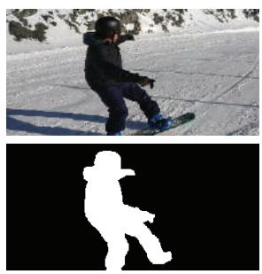

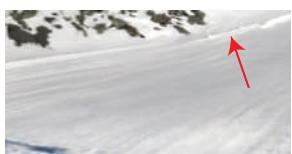

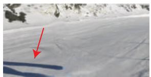

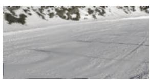

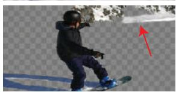

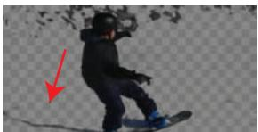

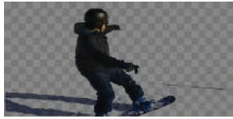

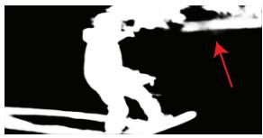

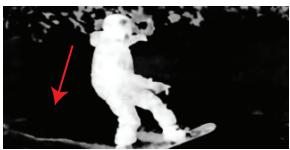

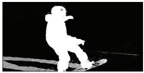

Scooter-gray  
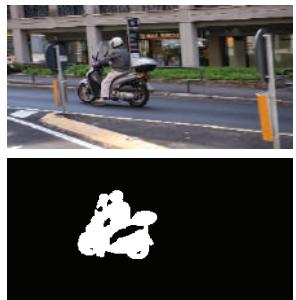  
(a) Input RGB and Mask

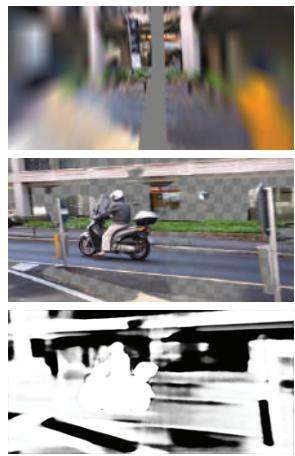  
(b) Omnimatte [Lu, et al.]

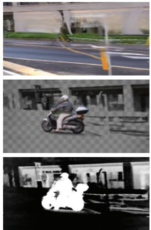  
(c) Neural Atlas [Kasten, et al.]

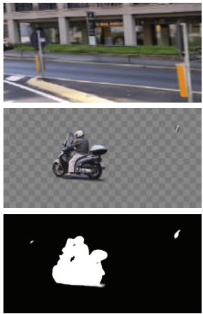  
(d) Ours

Longboard  
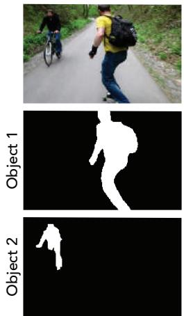  
(a) Input RGB and Masks

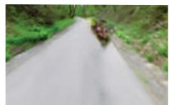

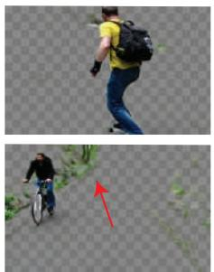

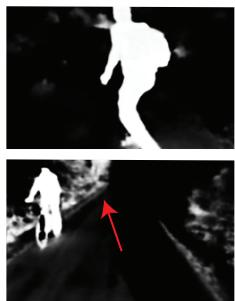  
(b) Omnimatte [Lu, et al.]

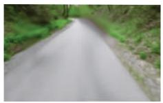

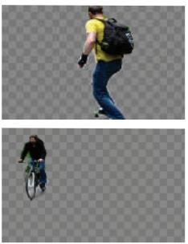

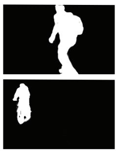  
(c) Ours  
Figure 4. Qualitative layer decomposition results on DAVIS. Top: examples of single-layer decomposition on Snowboard and Scooter-gray. For each example, we show the predicted background layer (row 1), predicted object layer RGBA (row 2), and alpha channel visualization (row 3). Bottom: example of multi-layer decomposition on the Longboard scene. On Longboard, we only compare against Omnimatte since Neural-Atlas does not support multi-layer decomposition. Our method produces stronger background inpainting results and more accurately disentangles the foreground objects and their effects from the background.

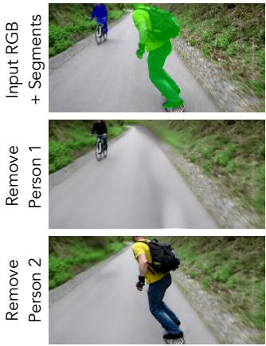  
Time T1

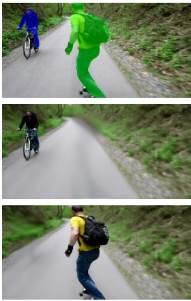  
Time T2  
Figure 5. Object removal. Top row shows the input frames with the input masks highlighted in blue and green. Subsequent rows show the result of removing the green and blue objects respectively.

## 4.3. Object Removal

Our predicted layers can be used to selectively remove some or all objects from a scene. Figure 5 shows an example of object removal using our layered representation on the Longboard video. Note that the input masks only account for the people and do not include attached objects such as the bicycle or longboard. Our method groups these objects with the correct person, allowing a user to easily remove different people from the scene without the undesirable effect of leaving behind attached objects.

## 4.4. Depth-based Applications

While our method does not directly produce foreground depth, the input depth can be transferred to the foreground layers using the predicted foreground mattes to construct a full Layered Depth Image (LDI) for each frame (see the supplement for details). This representation is useful for a variety of applications, including camera stabilization and synthetic defocus, which we show in the following sections.

Camera Stabilization. For an input video captured with a shaky camera, we can stabilize the camera path by rendering the scene from a stable camera viewpoint at each time-step. Figure 6 shows results on rendering the Dancing-person [37] scene from a stationary camera (for a moving camera path, see supp. material). The explicit mesh representation obtained from our model facilitates editing, as they can be used with commercial video editing tools.

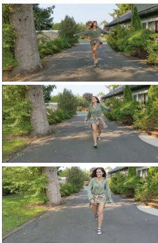  
Input Frames

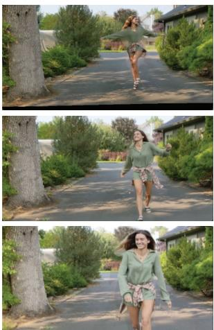  
Rerendering w/ stationary camera  
Figure 6. Camera stabilization. Our LDI representation can be re-rendered from new camera positions to produce stabilized or modified camera paths. Left: input video with camera dolly motion. Right: frames re-rendered from a stationary camera.

Synthetic Defocus. Our foreground matte can be used to create a synthetic defocus (bokeh) effect (Fig. 7). To create this effect, we blur the background based on the depth map computed by CasualSAM [48], then composite our foreground RGBA layer on top of the blurred background. The single-layer depth map alone cannot support this effect, as it is insufficiently accurate near the subject's boundary, causing important small features to be erroneously blurred (Fig. 7, bottom). The foreground matte from Omnimatte [25] is also insufficiently accurate, containing elements of the background that remain erroneously sharp when composited over the blurred background layer.

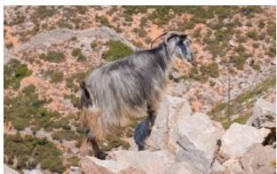  
Original

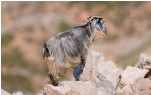

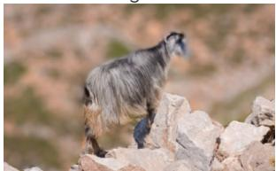

Ours  
  
CasualSAM [Zhang, et al.]  
Omnimatte [Lu, et al.]  
Figure 7. Synthetic defocus. Our foreground matte can enable a synthetic defocus effect (Ours). State-of-the-art single-layer depth maps (CasualSAM [48]) are not accurate near the subject's boundary, causing the goat's head to blur. The foreground matte from Omnimatte [25] contains background pixels, causing parts of the background to remain unblurred.

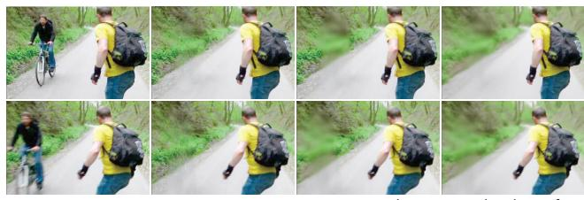

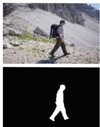  
(a) Input RGB and Mask

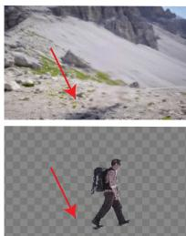  
(b) Random Frame Selection

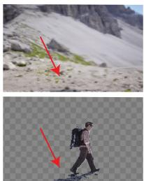  
(c) Our Frame Selection  
Figure 8. Frame Selection Ablation. Results from random frame selection instead of the proposed heuristic. Unlike the full method, the foreground layer does not accurately capture the shadow.

## 4.5. Ablations

Frame Selection. We ablate our frame selection method 3.4 by training a model using random frame sampling. For a source frame $F _ { a }$ , we randomly sample a shift value to obtain the second source $F _ { b }$ . The target frame (Fc) is then chosen mid-way between the source frames. Figure 8 shows results from a model trained using the random frame selection on the hike scene. Compared to the model trained with our frame selection heuristic, random selection leads to most of the shadow being erroneously captured in the background layer. While it is possible to select shift values that can generate desirable results, the proposed frame selection heuristic removes the need to search over this hyperparameter.

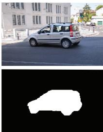  
(a) Input RGB and Mask

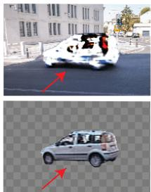  
(b) Without

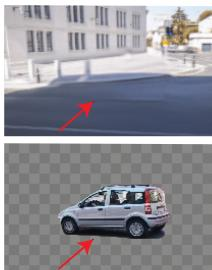  
Projection Consistency  
(c) Full Method  
Figure 9. Projection Loss Ablation. We show layer results from a model trained without the projection loss. The resulting background contains severe artifacts (column (b), top), and the foreground layer is missing the shadow of the car (column (b), bottom).  
Input  
Frames t, t-5, t+5  
Frame t only  
No detail transfer  
Figure 10. Detail Transfer Ablation. The background depth map allows reprojecting detail from nearby frames in time to further improve the visual quality of the predicted layers. From left to right: input frame, full result with detail transferred from frames t, t — 5, t + 5, ablated result with detail only from frame t (note blurry region under bicyclist), no background detail transfer.

Projection Consistency Loss. We ablate the projection consistency loss in Fig. 9. As shown in column (b), the inpainting of the unobserved region fails without the projection consistency term, as there is no reconstruction signal for that region. Additionally, the foreground layer is impacted due to the shadow being incorrectly placed in the background.

## 5. Discussion and Limitations

We present a new method for layer decomposition that separates a monocular video into a background and several object layers along with their associated effects. Unlike prior decomposition methods that rely on a static 2D background canvas, our method separates the video into layers on a per-frame basis, making it applicable to videos with unconstrained camera motion. To address the challenge of predicting a coherent background, we predict a 3D background and propose a multi-view consistency loss that enforces the background to only contain slowly moving or static details.

Our model can produce per-frame Layered Depth Images that allow for various depth-based editing applications.

A limitation of our method is shown in Figure 11. Unlike the background, foreground layers are not reprojected to nearby frames and thus foreground objects are not inpainted when occluded. This limitation could be addressed by adding a projection consistency loss similar to Eq. (7) for the foreground layers; however, reprojection of dynamic elements is challenging and requires modelling the sceneflow, which we leave for future work.

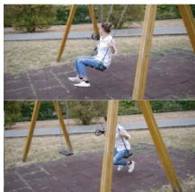  
Input Frames

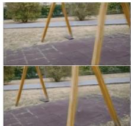  
Output Background

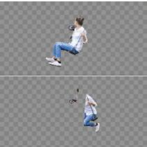  
Output Object Layer  
Figure 11. Limitation: object occlusions. While the background layer is inpainted using nearby frames, our method cannot inpaint the object layers. When an object passes behind the stationary background layer (middle), it is erased from the object layer (right).

## References

[1] Jean-Baptiste Alayrac, João Carreira, and Andrew Zisserman. The visual centrifuge: Model-free layered video representations. In CVPR, 2019. 2

[2] Jean-Baptiste Alayrac, Joao Carreira, Relja Arandjelovic, and Andrew Zisserman. Controllable attention for structured layered video decomposition. In ICCV, 2019. 2

[3] Omer Bar-Tal, Dolev Ofri-Amar, Rafail Fridman, Yoni Kasten, and Tali Dekel. Text2live: Text-driven layered image and video editing. arXiv preprint arXiv:2204.02491, 2022. 2

[4] Gabriel J Brostow and Irfan A Essa. Motion based decompositing of video. In ICCV, 1999. 2

[5] Ya-Liang Chang, Zhe Yu Liu, Kuan-Ying Lee, and Winston Hsu. Free-form video inpainting with 3d gated convolution and temporal patchgan. In ICCV, pages 9066–9075, 2019. 2

[6] Forrester Cole, Kyle Genova, Avneesh Sud, Daniel Vlasic, and Zhoutong Zhang. Differentiable surface rendering via non-differentiable sampling. In ICCV, pages 6088–6097, 2021.4

[7] Mounira Ebdelli, Olivier Le Meur, and Christine Guillemot. Video inpainting with short-term windows: application to object removal and error concealment. IEEE Transactions on Image Processing, 24(10):3034–3047, 2015. 2

[8] Matthieu Fradet, Patrick Pérez, and Philippe Robert. Semiautomatic motion segmentation with motion layer mosaics. In ECCV, 2008. 2

[9] Yossi Gandelsman, Assaf Shocher, and Michal Irani. "Double-DIP": Unsupervised image decomposition via coupled deepimage-priors. In CVPR, 2019. 2

[10] Chen Gao, Ayush Saraf, Jia-Bin Huang, and Johannes Kopf. Flow-edge guided video completion. In ECCV, 2020. 2

[11] Chen Gao, Ayush Saraf, Johannes Kopf, and Jia-Bin Huang. Dynamic view synthesis from dynamic monocular video. In ICCV, pages 5712–5721, 2021. 2

[12] Miguel Granados, James Tompkin, K Kim, Oliver Grau, Jan Kautz, and Christian Theobalt. How not to be seen—object removal from videos of crowded scenes. Computer Graphics Forum, 31(2pt1):219–228, 2012. 2

[13] Kaiming He, Georgia Gkioxari, Piotr Dollár, and Ross Girshick. Mask r-cnn. In ICCV, pages 2961–2969, 2017. 5

[14] Jia-Bin Huang, Sing Bing Kang, Narendra Ahuja, and Johannes Kopf. Temporally coherent completion of dynamic video. ACM Transactions on Graphics (TOG), 35(6):1–11, 2016.2

[15] Zhang Jiakai, Liu Xinhang, Ye Xinyi, Zhao Fuqiang, Zhang Yanshun, Wu Minye, Zhang Yingliang, Xu Lan, and Yu Jingyi. Editable free-viewpoint video using a layered neural representation. In ACM SIGGRAPH, 2021. 2

[16] Nebojsa Jojic and Brendan J Frey. Learning flexible sprites in video layers. In Proceedings of the 2001 IEEE Computer Society Conference on Computer Vision and Pattern Recognition. CVPR 2001, volume 1, pages I–I. IEEE, 2001. 2

[17] Yoni Kasten, Dolev Ofri, Oliver Wang, and Tali Dekel. Layered neural atlases for consistent video editing. ACM Transactions on Graphics (TOG), 40(6):1–12, 2021. 1, 2, 5

[18] Johannes Kopf, Xuejian Rong, and Jia-Bin Huang. Robust consistent video depth estimation. In CVPR, pages 1611– 1621,2021.2

[19] Johannes Kopf, Xuejian Rong, and Jia-Bin Huang. Robust consistent video depth estimation. In CVPR, 2021. 2

[20] M. Pawan Kumar, Philip H. S. Torr, and Andrew Zisserman. Learning layered motion segmentations of video. IJCV, 2008. 2

[21] Sungho Lee, Seoung Wug Oh, DaeYeun Won, and Seon Joo Kim. Copy-and-paste networks for deep video inpainting. In ICCV, pages 4413–4421, 2019. 2

[22] Zhengqi Li, Simon Niklaus, Noah Snavely, and Oliver Wang. Neural scene flow fields for space-time view synthesis of dynamic scenes. In CVPR, pages 6498–6508, 2021. 2

[23] Chao Liu, Jinwei Gu, Kihwan Kim, Srinivasa G Narasimhan and Jan Kautz. Neural rgb (r) d sensing: Depth and uncertainty from a video camera. In CVPR, pages 10986–10995, 2019.2

[24] Erika Lu, Forrester Cole, Tali Dekel, Weidi Xie, Andrew Zisserman, David Salesin, William T Freeman, and Michael Rubinstein. Layered neural rendering for retiming people in video. In SIGGRAPH Asia, 2020. 1, 2, 5

[25] Erika Lu, Forrester Cole, Tali Dekel, Andrew Zisserman, William T. Freeman, and Michael Rubinstein. Omnimatte: Associating objects and their effects in video. In Proceedings of the IEEE/CVF Conference on Computer Vision and Pattern Recognition (CVPR), pages 4507–4515, June 2021. 1,2, 5, 7, 8

[26] Xuan Luo, Jia-Bin Huang, Richard Szeliski, Kevin Matzen, and Johannes Kopf. Consistent video depth estimation. ACM Transactions on Graphics (ToG), 39(4):71–1, 2020. 2

[27] Ricardo Martin-Brualla, Noha Radwan, Mehdi SM Sajjadi, Jonathan T Barron, Alexey Dosovitskiy, and Daniel Duckworth. Nerf in the wild: Neural radiance fields for unconstrained photo collections. In CVPR, pages 7210–7219, 2021. 2

[28] Yasuyuki Matsushita, Eyal Ofek, Weina Ge, Xiaoou Tang, and Heung-Yeung Shum. Full-frame video stabilization with motion inpainting. IEEE Transactions on pattern analysis and Machine Intelligence, 28(7):1150–1163, 2006. 2

[29] Ben Mildenhall, Pratul P Srinivasan, Matthew Tancik, Jonathan T Barron, Ravi Ramamoorthi, and Ren Ng. Nerf: Representing scenes as neural radiance fields for view synthesis. Communications of the ACM, 65(1):99–106, 2021. 2

[30] Seoung Wug Oh, Sungho Lee, Joon-Young Lee, and Seon Joo Kim. Onion-peel networks for deep video completion. In ICCV, pages 4403–4412, 2019. 2

[31] F. Perazzi, J. Pont-Tuset, B. McWilliams, L. Van Gool, M. Gross, and A. Sorkine-Hornung. A benchmark dataset and evaluation methodology for video object segmentation. In CVPR, 2016. 5

[32] Jordi Pont-Tuset, Federico Perazzi, Sergi Caelles, Pablo Arbeláez, Alexander Sorkine-Hornung, and Luc Van Gool. The 2017 DAVIS challenge on video object segmentation. arXiv:1704.00675, 2017.5

[33] Thomas Porter and Tom Duff. Compositing digital images. SIGGRAPH Comput. Graph., 18(3):253–259, Jan. 1984. 4

[34] Xuejian Rong, Jia-Bin Huang, Ayush Saraf, Changil Kim and Johannes Kopf. Boosting view synthesis with residual transfer. CVPR, 2022. 5

[35] Olaf Ronneberger, Philipp Fischer, and Thomas Brox. U-Net: Convolutional Networks for Biomedical Image Segmentation. MICCAI, 2015. 3

[36] Jonathan Shade, Steven Gortler, Li-wei He, and Richard Szeliski. Layered depth images. In Proceedings of the 25th annual conference on Computer graphics and interactive techniques, pages 231–242, 1998. 2

[37] Zhenmei Shi, Fuhao Shi, Wei-Sheng Lai, Chia-Kai Liang, and Yingyu Liang. Deep online fused video stabilization. In Proceedings of the IEEE/CVF Winter Conference on Applications of Computer Vision, pages 1250–1258, 2022. 7

[38] Dmitriy Smirnov, Michael Gharbi, Matthew Fisher, Vitor Guizilini, Alexei Efros, and Justin M Solomon. Marionette: Self-supervised sprite learning. Advances in Neural Information Processing Systems, 34, 2021. 2

[39] Pratul P. Srinivasan, Richard Tucker, Jonathan T. Barron, Ravi Ramamoorthi, Ren Ng, and Noah Snavely. Pushing the boundaries of view extrapolation with multiplane images. In CVPR, 2019. 2

[40] Zachary Teed and Jia Deng. Deepv2d: Video to depth with differentiable structure from motion. arXiv preprint arXiv:1812.04605, 2018.2

[41] Chuan Wang, Haibin Huang, Xiaoguang Han, and Jue Wang. Video inpainting by jointly learning temporal structure and spatial details. In Proceedings of the AAAI Conference on Artificial Intelligence, volume 33, pages 5232–5239, 2019. 2

[42] John YA Wang and Edward H Adelson. Representing moving images with layers. IEEE transactions on image processing, 3(5):625–638, 1994. 1, 2

[43] Yonatan Wexler, Eli Shechtman, and Michal Irani. Space-time completion of video. PAMI, 2007. 2

[44] Yiheng Xie, Towaki Takikawa, Shunsuke Saito, Or Litany, Shiqin Yan, Numair Khan, Federico Tombari, James Tompkin, Vincent Sitzmann, and Srinath Sridhar. Neural fields in visual computing and beyond. Computer Graphics Forum, 2022. 2

[45] Rui Xu, Xiaoxiao Li, Bolei Zhou, and Chen Change Loy. Deep flow-guided video inpainting. In CVPR, pages 3723– 3732, 2019.2

[46] Vickie Ye, Zhengqi Li, Richard Tucker, Angjoo Kanazawa, and Noah Snavely. Deformable sprites for unsupervised video decomposition. In IEEE Conference on Computer Vision and Pattern Recognition (CVPR), June 2022. 1,2

[47] Kaidong Zhang, Jingjing Fu, and Dong Liu. Flow-guided transformer for video inpainting. In European Conference on Computer Vision, pages 74–90. Springer, 2022. 2

[48] Zhoutong Zhang, Forrester Cole, Zhengqi Li, Michael Rubinstein, Noah Snavely, and William T Freeman. Structure and motion from casual videos. In European Conference on Computer Vision, pages 20–37. Springer, 2022. 2, 5, 7

[49] Zhoutong Zhang, Forrester Cole, Richard Tucker, William T Freeman, and Tali Dekel. Consistent depth of moving objects in video. ACM Transactions on Graphics (TOG), 40(4):1–12, 2021.2

[50] Tinghui Zhou, Richard Tucker, John Flynn, Graham Fyffe, and Noah Snavely. Stereo magnification: Learning view synthesis using multiplane images. In SIGGRAPH, 2018. 2