# VidPanos: Generative Panoramic Videos from Casual Panning Videos

JINGWEI MA, University of Washington, United States of America

ERIKA LU, Google DeepMind, United States of America

RONI PAISS, Google DeepMind, Israel

SHIRAN ZADA, Google DeepMind, Israel

ALEKSANDER HOLYNSKI, University of California, Berkeley, United States of America and Google DeepMind, United States of America

TALI DEKEL, Weizmann Institute of Science, Israel and Google DeepMind, Israel

BRIAN CURLESS, University of Washington, United States of America and Google DeepMind, United States of America MICHAEL RUBINSTEIN, Google DeepMind, United States of America

FORRESTER COLE, Google DeepMind, United States of America

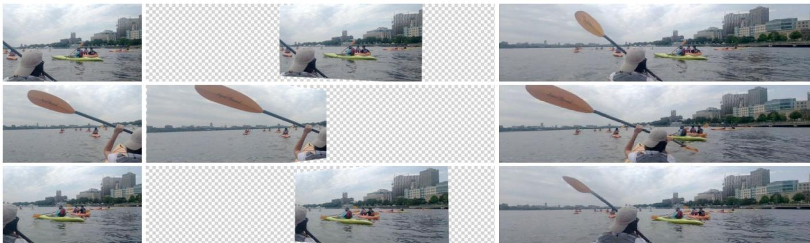  
Input Panning Video  
Input Projected to Panoramic Canvas  
Output Panoramic Video

Fig. 1. Given a casually-captured panning video, our method synthesizes a coherent panoramic video, depicting the full dynamic scene. Our framework projects the input video on top of a panoramic canvas and harnesses a generative video model to synthesize realistic and consistent dynamic content in the unknown regions. Note that the kayaker's paddle moves realistically, even when it is out of frame in the input video.

Panoramic image stitching provides a unified, wide-angle view of a scene that extends beyond the camera's field of view. Stitching frames of a panning video into a panoramic photograph is a well-understood problem for stationary scenes, but when objects are moving, a still panorama cannot capture the scene. We present a method for synthesizing a panoramic video from

Authors' Contact Information: Jingwei Ma, University of Washington, United States of America, jingweim@cs.washington.edu; Erika Lu, Google DeepMind, United States of America, erikalu@google.com; Roni Paiss, Google DeepMind, Israel, ronipaiss@ google.com; Shiran Zada, Google DeepMind, Israel, shiranz@google.com; Aleksander Holynski, University of California, Berkeley, United States of America and Google DeepMind, United States of America, holynski@google.com; Tali Dekel, Weizmann Institute of Science, Israel and Google DeepMind, Israel, tdekel@google.com; Brian Curless, University of Washington, United States of America and Google DeepMind, United States of America, curless@cs.washington.edu; Michael Rubinstein, Google DeepMind, United States of America, mrub@google.com; Forrester Cole, Google DeepMind, United States of America, fcole@google.com.

This work is licensed under a Creative Commons Attribution International 4.0 License.

a casually-captured panning video, as if the original video were captured with a wide-angle camera. We pose panorama synthesis as a space-time outpainting problem, where we aim to create a full panoramic video of the same length as the input video. Consistent completion of the space-time volume requires a powerful, realistic prior over video content and motion, for which we adapt generative video models. Existing generative models do not, however, immediately extend to panorama completion, as we show. We instead apply video generation as a component of our panorama synthesis system, and demonstrate how to exploit the strengths of the models while minimizing their limitations. Our system can create video panoramas for a range of in-the-wild scenes including people, vehicles, and flowing water, as well as stationary background features.

CCS Concepts: • Computing methodologies → Computer vision.

Additional Key Words and Phrases: Video panorama, video completion, space-time outpainting, generative video models.

## ACM Reference Format:

Jingwei Ma, Erika Lu, Roni Paiss, Shiran Zada, Aleksander Holynski, Tali Dekel, Brian Curless, Michael Rubinstein, and Forrester Cole. 2024. VidPanos: Generative Panoramic Videos from Casual Panning Videos. In SIGGRAPH Asia 2024 Conference Papers (SA Conference Papers '24), December 03–06, 2024,

Tokyo, Japan. ACM, New York, NY, USA, 11 pages. https://doi.org/10.1145/ 3680528.3687664

## 1 Introduction

When visiting a place, for example while traveling, we often want to capture the moment, to help us remember what it was like to be in that place. Most of us capture a handful of photos with our smartphones for this reason, but the sense of immersion is lost when played back as a sequence of stills – the sense of the scale of the space is missing. We can create a single view that extends beyond the field-of-view of the camera by stitching multiple exposures into a panoramic image. Many video cameras can automatically stitch the frames of a panning video into a panoramic still image, so long as the scene is static. While we can capture a space with an image panorama, however, the experience of the dynamic scene in the moment, filled with moving people, cars, trees, water, etc., is lost.

In this paper, we propose to construct panoramic videos from casually-captured panning video of general dynamic scenes, completing both the space and time spanned by the panoramic video volume. We take as input a video that can include not just a single pan, but multiple pans in one capture, e.g., panning from left to right and then back left again. In this more general multi-pan setting, we have both an opportunity to ground the video with knowledge of what happened later" as we pan back to a spatial location at a later time, but also the challenge of consistently interpolating across gaps in time to answer the question “what happened in between?"

Our approach is to register the input video frames into a single video volume, leaving space-time regions outside of the input unknown, then complete the unknown volume regions. This task is challenging since in a typical capture, the number of unknown pixels in this volume outnumbers the known pixels, and we cannot assume that the unknown regions are stationary. To solve this problem we need a powerful and realistic prior model of video, and a method to apply this prior to complete the video volume consistently. We demonstrate results with both a diffusion-based model (Lumiere [Bar-Tal et al. 2024]) and a token-based model (Phenaki [Villegas et al. 2022]). The main technical problem we address is how to constrain and condition these video generation models, which have limited context windows, to complete a panoramic video of arbitrary length and width. To tackle this challenge we apply coarse-to-fine synthesis and spatial aggregation techniques to realistically and consistently complete unknown regions of the video volume.

In summary, our contributions include:

• The first system for creating video panoramas from general, panning input videos that include moving people and objects.

• Adaptations of the base algorithm for diffusion- and token-based video generation models, and an analysis of their relative strengths and weaknesses.

• A new dataset of video panoramas (cropped from 360-degree videos) with synthetic panning camera motion.

## 2 Related Work

## 2.1 Image Panorama Stitching

A long line of work has focused on the problem of panorama stitching [Brown and Lowe 2007; Shum and Szeliski 1997; Steedly et al. 2005; Szeliski et al. 2007; Szeliski and Shum 2000; Xiong and Pulli 2010], i.e., simulating a wider field-of-view image from a set of images captured by a camera rotating in place. These methods typically involve a series of steps including (1) sparse feature-based or semi-dense registration [Lowe 2004], (2) rigid or depth-compensated alignment, and (3) image blending [Burt and Adelson 1987; Gracias et al. 2009; Pérez et al. 2023], to resolve seams and inconsistencies across observations. A major failure mode of image panorama acquisition is in scenes with dynamic objects—since significant scene motion can cause failures in both registration and compositing.

## 2.2 Video Panoramas

The limitation of image stitching in handling moving objects has been explored in a series of work expanding image panoramas to the video domain [Agarwala et al. 2005; Couture et al. 2011; Rav-Acha et al. 2007]. Commonly referred to as panoramic video textures these methods use a graph-cut formulation to solve the panorama blending problem across both spatially and temporally varying observations, and are able to produce panoramas with motion that can even loop seamlessly [Liao et al. 2015, 2013]. Still, these methods are restricted to modeling textural motion, e.g. shaking trees and flowing water, and cannot resolve inconsistencies resulting from transient objects, e.g. a person walking across the scene. This is largely due to the fact that these methods do not generate novel observations of the scene—rather, their goal is to consolidate existing observations into a consistent representation.

## 2.3 Video Completion

Video completion focuses on completing missing pixels given observed pixels as context. Many methods retrieve visual features (e.g. pixels, patches, segments, templates, proposals) from the observed regions to fill in the missing regions [Gao et al. 2020; Hu et al. 2020; Huang et al. 2016; Ilan and Shamir 2015; Li et al. 2022; Wexler et al. 2007; Zhou et al. 2023]. However, these methods tend to fail or produce low-fidelity results when the observation is sparse or incomplete (e.g. heavily-masked video, object insertion).

With recent advances in generative models [Bar-Tal et al. 2024; Blattmann et al. 2023a,b; Guo et al. 2023; Ho et al. 2022; Villegas et al. 2022; Zhou et al. 2022], many methods adapt pretrained generative models for the task of video completion [Bar-Tal et al. 2024; Zhang et al. 2023] or train versatile generative models on a suite of tasks, where video completion is one of them [Kondratyuk et al. 2024; Yu et al. 2023]. While the generative completion methods succeed on a broader range of scenarios (e.g. foreground/background replacement, transient motion), they fail on the task of panoramic video completion, which requires going beyond the model's temporal and spatial context window, interpolating temporally-distant observations and completing regions under a panning video mask.

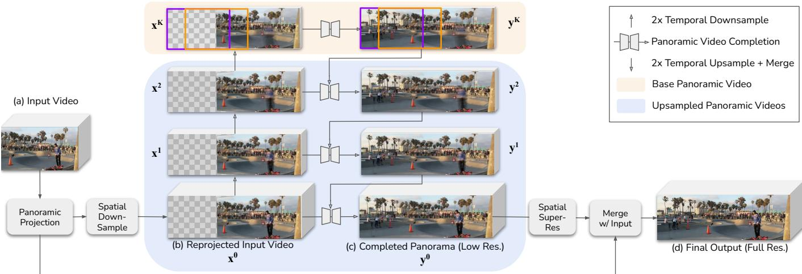  
Fig. 2. Temporal coarse-to-fine. The input video (a) is projected on to a unified panoramic canvas using estimated camera parameters. The reprojected input video (b) is temporally downsampled with temporal prefiltering. A base panoramic video is synthesized at the coarsest temporal scale (top), then gradually refined by temporal upsampling, merging, and resynthesis (c). Finally, a spatial super-resolution pass is applied and the original input pixels are merged with the result to produce the output video (d).

## 3 Method

The input to the method is a video captured with a panning camera that sweeps over a scene containing moving people and objects. The output is a complete panoramic video of the same duration as the input, but spatially wide enough to capture the entire sweep of the input camera (e.g., Fig. 1). The output panoramic video should match the input video in the known input regions, and should look realistic and consistent. Since the extent of the unknown content may span a significant portion of the video in both time and space, we harness the power of a generative video prior to synthesize the missing regions.

While existing text-to-video models encode powerful priors about our dynamic world, a pivotal challenge in utilizing them for our task is their limited spatio-temporal context window. We overcome this restriction by adopting a coarse-to-fine approach in the temporal dimension and mask-respecting aggregation in the spatial dimension (Fig. 2). To ensure consistent motion across time, we first temporally downsample the video to the model's context window length and complete a base panoramic video by aggregating the model predictions in sliding spatial windows (Sec. 3.3). We then progressively restore the temporal details by temporal upsampling, merging with the input video, and resynthesizing pixels outside the input regions (Sec. 3.4). Optionally, the model may be finetuned at test-time to further improve fidelity of the completed video (Sec. 3.5).

## 3.1 Preliminaries: Video Generation Models

To illustrate the generality of the method, we employ two video generation models in our experiments: Lumiere [Bar-Tal et al. 2024] and Phenaki [Villegas et al. 2022]. Lumiere is a space-time, pixeldiffusion model with a two-stage cascade: a base model that produces 80 frames of 128 × 128 pixels, followed by an upsampling stage to 1024 × 1024 pixels. Phenaki is a token-based model with an encoder/decoder pair to translate between pixels and the latent token space, as well as a two-stage cascade: first 11 frames of 160×96 pixels, then 320 × 192 pixels.

## 3.2 Video Registration and Setup

In the remaining sections we use the following notation for the intermediate variables:

<table><tr><td> $\overline { { { \bf x } ^ { k } } }$   $\mathbf { m } ^ { k }$   $\hat { \mathbf { y } } _ { u p } ^ { k }$   $\hat { \mathbf { y } } _ { m e r g e } ^ { k }$   $\mathbf { y } ^ { k }$ </td><td>input video at temporal scale k mask at temporal scale  $\mathbf { k }$  2x temporal upsampled  $\hat { \mathbf { y } } ^ { k }$   $\hat { \mathbf { y } } _ { u p } ^ { k }$  merged with  $\mathbf { x } ^ { k }$ </td></tr></table>

To prepare a video for processing we project the input video onto a panoramic canvas to produce input frames $\mathbf { x } ^ { 0 }$ and corresponding mask frames of valid pixels $\mathbf { m } ^ { 0 }$ in the panorama coordinate system. For videos with pure panning camera motion (rotation only), we can use a fast, standard homography solver [Hartley and Zisserman 2004]. When camera parallax is present, we solve for a full 3D camera path using a more expensive, robust SLAM system [Zhang et al. 2022]. We ignore the translation of the camera and compute the elevation θ and azimuth $\phi$ of each input pixel's ray relative to the first frame's camera direction, then project each ray to an equirectangular canvas.

We further prepare temporally-downsampled versions of the input $\{ \mathbf { x } ^ { k } \} _ { k = 1 } ^ { K }$ such that the coarsest input $\mathbf { \hat { x } } ^ { K }$ fits exactly in the model's context window (80 frames for Lumiere, 11 for Phenaki). To avoid temporal aliasing we apply simple temporal prefiltering with a box blur before subsampling from $\mathbf { \dot { x } } ^ { 0 }$

## 3.3 Base Panoramic Video Completion

The first step is to complete a panoramic video at the coarsest temporal resolution by spatial outpainting. The input video $\mathbf { x } ^ { K }$ is in general wider than the model's native aspect ratio. We downscale $\mathbf { x } ^ { K }$ to match the model's native height and use multiple, overlapping spatial windows to span the panorama width. The distributions predicted by the model in each window are averaged, then a new sample is drawn from the average. This approach applies to both diffusion and token-based models, as explained below.

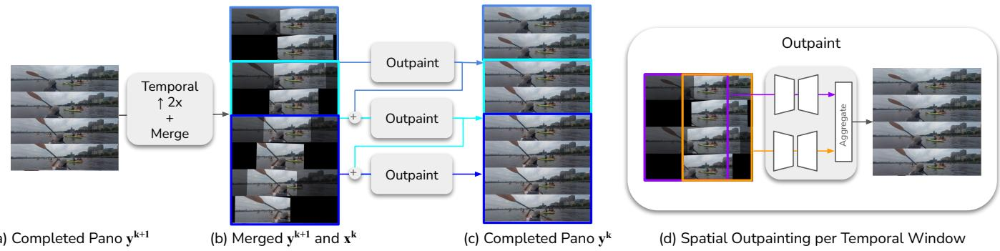  
Fig. 3. Upsampling and outpainting. The completed panorama from the previous level $\mathbf { y } ^ { k + 1 }$ (a) is temporally-upsampled and composited with the current level input video $\mathbf { x } ^ { k }$ to form a partially-completed input $\hat { \mathbf { y } } _ { m e r g e } ^ { k }$ (b, input pixels shown highlighted). The model uses the full $\hat { \mathbf { y } } _ { m e r g e } ^ { k }$ for context and resynthesizes content outside the input mask to complete the next level panorama $\mathbf { y } ^ { k } \left( \mathbf { c } \right) .$ In the time dimension, the model is applied in a sliding-window fashion with half-window overlap. In the spatial dimension, multiple overlapping predictions are computed in parallel, then aggregated and a sample is drawn from the average (d).

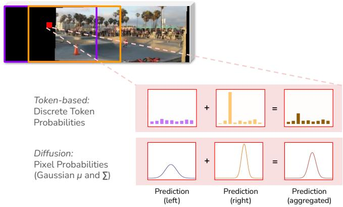  
Fig. 4. Spatial aggregation of predicted distributions. To generate a sample in the overlap (red), we linearly interpolate the two predicted probability distributions (purple, orange) and sample from the aggregated distribution (brown). With a token-based method the distribution is a discrete distribution over the vocabulary. With diffusion, the distribution is a Gaussian distribution over pixel values, represented by μ and Σ.

3.3.1 Diffusion. For a diffusion model, averaging overlapping windows is a form of MultiDiffusion [Bar-Tal et al. 2023]. We crop the projected panoramic canvas to each input window, then outpaint any regions outside the valid pixels m using the mask-conditioned version of Lumiere. The µ and Σ predictions are averaged, then a new sample is drawn using DDPM [Ho et al. 2020]. We found that the shape and motion of the panorama masks caused boundary artifacts with the original mask-conditioned model, so we finetuned the model on a dataset of natural videos masked by synthetic panorama masks designed to mimic real m.

3.3.2 Token-based. For a token-based model like Phenaki, spatial aggregation can be performed by averaging the predicted probability distributions over the tokens before sampling. Fig. 4 illustrates spatial aggregation with a simplified case of two overlapping spatial windows. The red patch represents one of the tokens to be generated and lies within both the left (purple) and the right (orange) windows. Each window of masked tokens can be input to the transformer network to predict a probability distribution for the red token. These distributions are then averaged and a predicted token is drawn from the averaged distribution.

Note that Phenaki employs causal masking during training, which means the model cannot complete earlier frames based on later frames at test time. To work around this issue, the base panorama $\mathbf { x } ^ { K }$ is completed in two passes, one forward and one backward (timereversed), and the valid pixels of the forward and backward passes are merged (please see supplemental material for details). Since later temporal upsampling steps always start from a complete panorama, this approach is only necessary for $\mathbf { \Psi } _ { \mathbf { X } } K$

## 3.4 Temporal Coarse-to-fine

To restore the original temporal dimension of the video, we progressively complete panoramic videos at upsampled temporal resolutions. For each level $k \in [ K - 1 , 0 ]$ , we take the input video $\mathbf { x } ^ { k }$ and the completed, coarser-level panoramic video $\mathbf { y } ^ { \hat { k } + 1 }$ and combine them to produce a complete panoramic video $\mathbf { y } ^ { k } \left( \mathrm { F i g } . 3 \right)$ . Intuitively, we want the video generation model to provide temporal details for $\mathbf { y } ^ { k }$ that are consistent with the input pixels in $\mathbf { x } ^ { k }$ and the coarse-level context in $\mathbf { y } ^ { k + 1 }$ . To achieve this, we apply three steps: (1) temporal upsampling, (2) merging with the input pixels, and (3) resynthesis.

We first temporally upsample $\mathbf { y } ^ { k + \bar { 1 } }$ to create a $\hat { \mathbf { y } } _ { u p } ^ { k }$ that is framerate matched, and composite $\mathbf { x } ^ { k }$ over $\hat { \mathbf { y } } _ { u p } ^ { k }$ to form a merged $\hat { \mathbf { y } } _ { m e r g e } ^ { k }$ Optionally, we may align $\mathbf { x } ^ { k }$ to $\hat { \mathbf { y } } _ { u p } ^ { k }$ prior to compositing using grid-warp-based optical flow [Szeliski 2010] and color histogram matching. We found spatial and color alignment useful when using Phenaki, but unnecessary when using Lumiere. The resulting $\hat { \mathbf { y } } _ { m e r g e } ^ { k }$ matches the input video inside $\mathbf { m } ^ { k }$ but lacks temporal details outside.

We adapt the resynthesis algorithm to the base model type, as follows:

3.4.1 Diffusion. Resynthesis using a diffusion model is controlled by the mask conditioning signal. A full-frame mask is applied to the odd-numbered frames of $\hat { \mathbf { y } } _ { m e r g e } ^ { k }$ , and the original mask $\mathbf { m } ^ { k }$ to the even-numbered frames. That is, we constrain the diffusion sampling to maintain the temporally-upsampled, generated pixels at the oddnumbered frames, and allow resynthesis of the generated pixels only at the even-numbered frames. For videos with fast motion $( \mathrm { e . g . }$ , the kayak paddle in Fig. 1), the temporally-upsampled pixels at odd-number frames may also need to be resynthesized. In this case we maintain the full-frame masks at odd frames for the first $1 / 8$ of the sampling schedule, then switch to the input mask $\mathbf { m } ^ { k }$ for the entire window to allow the model to synthesize new temporal details. Resynthesis is applied over the entire sequence using sliding temporal windows with an overlap of half the window length (40 frames for Lumiere).

3.4.2 Token-based. With a token-based model, the pixels outside $\mathbf { m } ^ { k }$ are resynthesized by masking and regenerating the corresponding tokens:

$$
\hat { \mathbf { z } } _ { m e r g e } ^ { k } = e n c ( \hat { \mathbf { y } } _ { m e r g e } ^ { k } )
$$

$$
\begin{array} { r } { \mathbf { z } ^ { k } = x f ( \hat { \mathbf { z } } _ { m e r g e } ^ { k } \odot \mathbf { m } _ { z } ^ { k } ) , } \end{array}
$$

where $\hat { \mathbf { z } } _ { m e r g e } ^ { k }$ is the set of tokens encoded from $\hat { \mathbf { y } } _ { m e r g e } ^ { k } , \mathbf { m } _ { z } ^ { k }$ is the token-level mask, $\mathbf { z } ^ { k }$ is the set of resynthesized tokens, enc is the token encoder, and $x f$ is the token transformer network. The full sequence $\mathbf { y } ^ { k } = d e c ( \mathbf { z } ^ { k } )$ is constructed using sliding temporal windows with an overlap of half the window length (5 frames for Phenaki, as in [Villegas et al. 2022]).

## 3.5 Inference-Time Finetuning

Some modules of the video generation model can be optionally finetuned at inference time to further improve results. The Phenaki model's encoder/decoder architecture in particular incurs some fidelity loss, so the base Phenaki model cannot exactly reproduce the original video pixels. To better align the result with the input video, we finetune the Phenaki decoder dec on patches of valid pixels x  m prior to synthesizing the final result. Finetuning helps to preserve details of the input in the outpainted regions. Lumiere is a pixel-diffusion model without an encoder and decoder step, and we found it produced results closer to the input video overall, though high-frequency details could likely be improved with finetuning (see Sec. 5).

## 4 Results

We evaluate our approach in two settings: real-world casual panning captures, and “synthetic” panning videos generated by applying a moving crop window to videos captured with a 360-degree camera. The synthetic setting allows us to compare the models' performance directly against a ground-truth panoramic video.

## 4.1 Baseline Methods

We include four baseline methods for comparison (Fig. 5): a simple linear interpolation baseline, two flow-based video inpainting algorithms, and a recent video generation model MAGVIT [Yu et al. 2023] that demonstrated video panorama outpainting.

Linear interpolation baseline. For the linear baseline, the output color at pixel p is a linear interpolation of the closest before and after frames, or the nearest neighbor frame if only before or after exists. The result matches the input video exactly and matches any stationary elements in the scene. Moving objects exhibit the expected ghosting artifacts, with extreme failures in the case of non-stationary camera.

Flow-based baselines. We include two methods for video inpainting using optical flow: ProPainter [Zhou et al. 2023] and E²FGVI[Li et al. 2022]. These methods are tasked with completing the region outside the valid pixels m. Both methods internally estimate flow, so the only inputs are $\mathbf { x } ^ { 0 }$ and $\mathbf { m } ^ { 0 }$

MAGVIT baseline. For the MAGVIT baseline, we apply repeated horizontal outpainting to extend the input video to outside the panorama canvas, then crop. Due to the temporal window of MAGVIT being limited to 16 frames, we subsample a portion of each video to obtain a single-direction pan of the full scene from left to right, and evaluate only on this subset of frames.

## 4.2 Quantitative Evaluation

Besides typical similarity metrics (PSNR, LPIPS [Zhang et al. 2018]) and single-video FID [Arora and Lee 2021], we also compute optical flow EPE (endpoint error) to measure the consistency of the generated motions. We compute flow between consecutive frames of the groundtruth and the output video and measure their L2 difference. When evaluating small motions at low image resolution, we empirically found grid-based flow [Szeliski 2010] to produce more reliable sub-pixel alignments than network-based flow (e.g. RAFT [Teed and Deng 2020]). For pixel-level metrics (PSNR, EPE), we separately evaluate static and dynamic regions (see supplemental for details).

## 4.3 Synthetic Panning Videos

To create synthetic panning videos we center crop an input video captured with a 360-degree video camera and add a moving crop window over 88 frames at 15fps (Figure 7). We then apply our system to complete a new video panorama. We curated 12 360-degree videos licensed under Creative Commons and plan to include these videos along with our results upon publication.

Synthetic videos allow us to evaluate the model's output directly against a ground-truth video panorama. Note that our goal is to generate a plausible completed panorama, not recreate an input panorama. However, our model should recreate stationary scene elements as closely as possible.

Fig. 7 shows results on two stationary camera videos (“scuba”, “Bangkok”) and two moving camera videos (“skate", “ski”). Our method recovers static regions faithfully, and renders moving objects in plausible positions (diver in “scuba”, skiers in “ski”) even under challenging moving-camera settings. Certain scenarios prove too difficult to resolve: for example, the person in “skate" is observed

Protatr notate EI OUr.) ( us) ) ) s i) GT

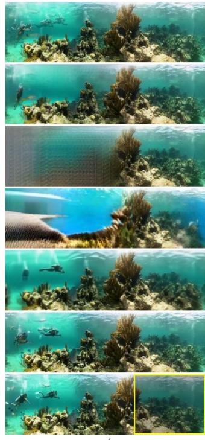  
scuba

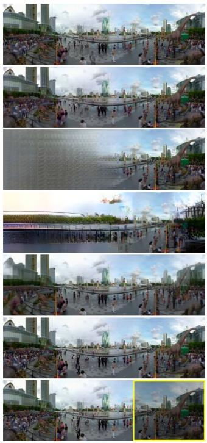  
Bangkok

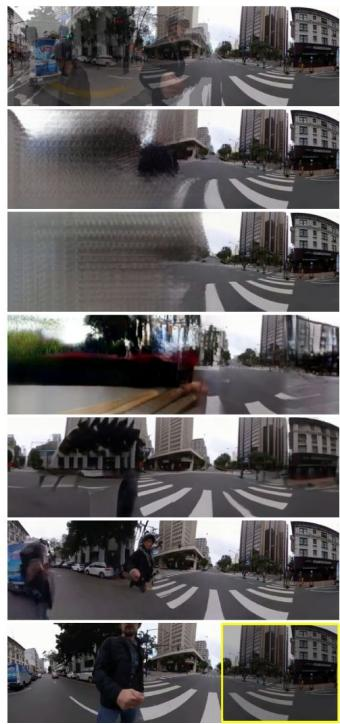  
skate

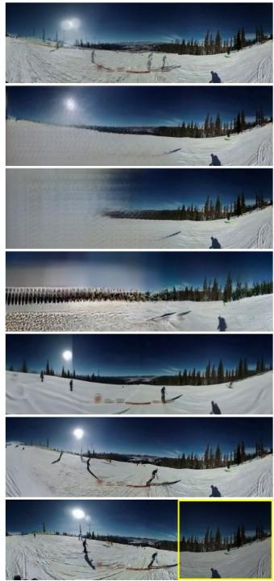  
ski  
Fig. 5. Comparison with baseline methods. From top to bottom: linear interpolation between pixels based on time produces sharp results for stationary regions, but does not interpolate motion. ProPainter [Zhou et al. 2023] and E²FGVI [Li et al. 2022] are flow-based methods that can produce realistic results in stationary regions (scuba, Bangkok), but fail for moving cameras (skate, ski) or moving objects away from the input window (divers on left in scuba). MAGVIT [Yu et al. 2023] is a video-generation method but does not generate on a common panorama canvas, so it loses information away from the input window. Our results use a coarse-to-fine approach to build a consistent panoramic video and better match the ground-truth. Bottom: ground truth video with input window marked in yellow. See supplemental material for video results.

very briefly but undergoes large motion. The model realistically renders the missing person in the first frame, but it struggles to complete the middle frame.

We show qualitative comparisons with baselines in Fig. 5. Linear interpolation produces obvious ghosting artifacts for moving objects (the diver in “scuba”, skier in “ski”), and fails completely for camera motion (“skate"). The MAGVIT prediction is reasonable near the observed region, but quickly degrades the greater the distance from the input window.

Quantitative results are shown in Table 1. For all results on “Ours”, we generate four samples and manually select the best. Our diffusionbased method performs the best across all metrics except the static split of PSNR and EPE. The baseline interpolation method performs best on the static splits, which is expected given that it perfectly reproduces stationary parts of the synthetic videos. However, the interpolation method performs poorly on EPE dynamic split (1.92 vs. 1.67 and 1.25 for our token-based and diffusion-based methods, respectively).

The flow-based methods ProPainter [Zhou et al. 2023] and E²FGVI [Li et al. 2022] both assume small mask regions and large frame-toframe overlap. Nevertheless, ProPainter [Zhou et al. 2023] handles videos with stationary camera (e.g. scuba, Bangkok) surprisingly well, even producing a higher PSNR than our Phenaki-based result.

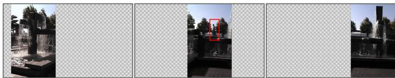  
Input Frames

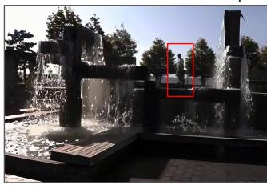  
Our Result

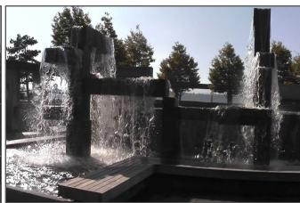  
Result of [Agarwala 2005]

Fig. 6. Comparison with Panoramic Video Textures [Agarwala et al. 2005]. PVT uses a graph-cut formulation to create a looping panoramic video. Our method can create similar videos, but can also include non-stationary features like the person walking behind the waterfall (boxed).

Subjective quality is lower, however, especially for scenes with a moving camera (Fig. 5, skate, ski).

The video models allow our method to produce more realistic motion than baselines in the inpainted regions, with a static/dynamic

Table 1. Quantitative results on synthetic panning videos, computed on the inpainted regions (further split into static and dynamic regions for pixellevel metrics). MAGVIT\* is evaluated on a subset of frames (Sec. 4.3).
<table><tr><td rowspan="2">Method</td><td colspan="2">PSNR ↑</td><td rowspan="2">LPIPS↓</td><td rowspan="2">VFID ↓</td><td colspan="2">EPE↓</td></tr><tr><td>sta</td><td>dyn</td><td>sta</td><td>dyn</td></tr><tr><td>Interpolate</td><td>29.4</td><td>19.1</td><td>0.10</td><td>0.09</td><td>0.04</td><td>1.92</td></tr><tr><td>ProPainter</td><td>24.7</td><td>19.6</td><td>0.19</td><td>0.21</td><td>0.12</td><td>1.70</td></tr><tr><td>E2FGVI</td><td>18.2</td><td>16.6</td><td>0.36</td><td>0.47</td><td>0.63</td><td>2.03</td></tr><tr><td>MAGVIT*</td><td>12.9</td><td>12.4</td><td>0.41</td><td>0.57</td><td>1.17</td><td>1.92</td></tr><tr><td>naive Phenaki</td><td>18.3</td><td>16.4</td><td>0.23</td><td>0.26</td><td>0.41</td><td>1.94</td></tr><tr><td>Ours (Phenaki)</td><td>23.2</td><td>18.4</td><td>0.20</td><td>0.19</td><td>0.07</td><td>1.67</td></tr><tr><td>naive Lumiere</td><td>18.5</td><td>18.3</td><td>0.24</td><td>0.18</td><td>0.41</td><td>1.94</td></tr><tr><td>Ours (Lumiere)</td><td>28.5</td><td>20.8</td><td>0.09</td><td>0.05</td><td>0.05</td><td>1.25</td></tr></table>

EPE of 0.05/1.25 (Lumiere) and 0.07/1.67 (Phenaki) compared to 0.12/1.70 for ProPainter.

## 4.4 Real Panning Videos

To further evaluate performance on real-world panning captures, we captured a set of 10 panning videos using a phone video camera. Three of these videos contain panning in both directions, while the rest pan in a single direction. Additionally, 6 of the 10 videos are filmed with a vertical aspect ratio. These videos have roughly stationary cameras that we stabilize onto the panoramic canvas using homographies [Hartley and Zisserman 2004]. Fig. 8 shows representative examples of real videos. We do not have groundtruth panoramic videos to compute quantitative results against, but we observe that overall quality is similar to the synthetic panning results. We additionally process and compare the waterfall video from the original panoramic video textures work [Agarwala et al. 2005] (Fig. 6).

## 4.5 Ablations

Besides the alternative baselines, we analyze two main ablations of our diffusion-based method: 1) “naive" Lumiere without mask finetuning, and 2) our method with temporal MultiDiffusion instead of temporal coarse-to-fine. Ablation results are shown in Fig. 9 and Fig. 10. Additional ablations for our token-based method can be found in supplemental.

Naive Lumiere. We use the baseline mask-conditioned Lumiere model from [Bar-Tal et al. 2024] along with spatio-temporal MultiDiffusion to complete the panorama videos. Since the mask-conditioned model was trained on static masks, it produces significant artifacts on the dynamic-mask panorama videos, including visible seams around the mask boundary, color issues, and large blobs (Fig. 9). Quantitative comparisons are shown in Table 1.

Removing temporal coarse-to-fine. We ablate the temporal coarseto-fine component and replace it with temporal MultiDiffusion with window sizes of 80 frames and stride of 40 frames. A comparison is shown in Fig. 10. As the camera pans from left to right, the temporal MultiDiffusion result suffers from drift and is unable to propagate the appearance of the person from the earlier frames to the later frames (orange box). Temporal coarse-to-fine generates a more plausible continuation of the person's appearance and motion due to an initial round of coarse completion where the model sees the full extent of the scene within a single temporal window.

## 4.6 Computational Cost

For the Lumiere model, base-resolution inference on a Google Cloud TPU v5p-4 configuration for a 84x128x512 size video (39 Lumiere forward passes, 256 ddpm steps per pass) takes 300 minutes. The super-resolution stage runs diffusion at 8x the base resolution and takes 48 minutes (7 Lumiere super-res forward passes, 32 ddim steps per pass). The one-time fine-tuning of the original Lumiere checkpoint on panoramic masks takes 30 hours on a batch size of 128 for 35K steps. For Phenaki, inference for a 172×320×96 video (31 Phenaki forward runs) on a TPU v3-8 is 20.4 min; finetuning the Phenaki decoder dec takes \~25 min.

Inference for both models can be greatly optimized by parallelizing the M spatial windows, reducing the runtime to its $\frac { 1 } { \mathbf { M } }$

## 5 Discussion and Limitations

The method presented in this paper can complete a panoramic video from a casually-captured panning video. This task would be impossible without a strong prior on realistic videos and motion, which has only recently become available in the form of generative models of video. While panoramic videos from stationary (rotationonly), panning cameras have been shown in limited settings, such as Panoramic Video Textures [Agarwala et al. 2005], constructing panoramic videos containing large object motions (Fig. 1) or the entirely shifting visual field of a moving camera (Fig. 8, "dynibar") are capabilities unlocked only with a generative video prior.

Given the nascent capabilities of generative video models, however, our method has some limitations that could lead to future work:

Limited context window. Current video generation models process a limited number of frames simultaneously (80 for Lumiere, 11 for Phenaki). This limited context window necessitates a temporal coarse-to-fine approach to allow the model to fill in the entire panoramic video consistently (Fig. 10). A limited amount of temporal coarsening is possible, however, without completely blurring out fast motion or dropping small objects. For our experiments we used up to 5 levels of temporal coarsening for Phenaki and 2 for Lumiere, for a maximum video length of 172 or 160 frames.

Synthesis quality. While the quality of the generated video is often convincing, neither model we tested consistently generates photorealistic results. Limitations on synthesis quality are especially noticeable for close-up human faces (e.g., Fig. 10, "palace") Our diffusion-based results could potentially preserve the high frequencies of the input videos better by finetuning the Lumiere super-resolution module with mask-conditioning. However, this modification would require adding a new conditioning input and computationally-intensive retraining, and was not done as part of this work. We expect this limitation to be removed in the future.

Latent video diffusion models. Several recent video generation models [Blattmann et al. 2023a; Guo et al. 2023] use a latent diffusion model (LDM) as a backbone to reduce runtime cost. Since the

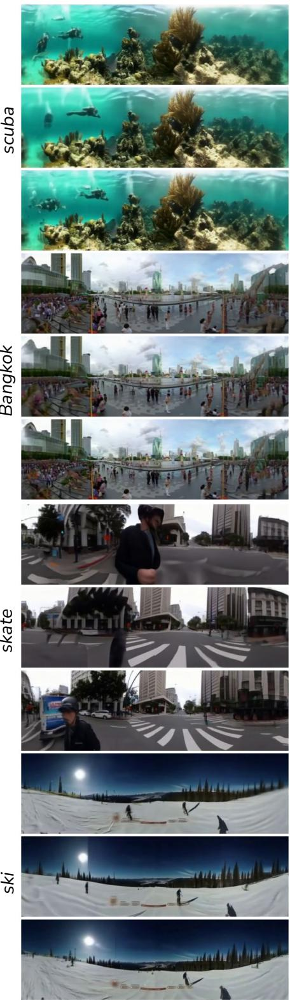

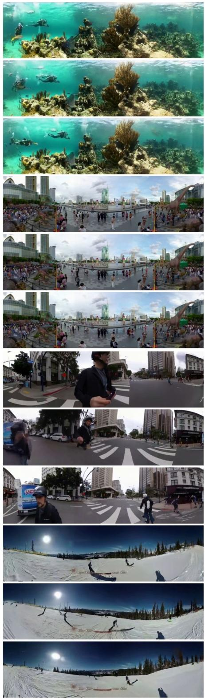

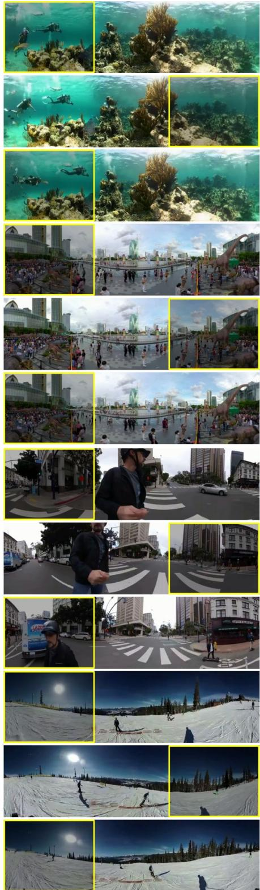  
(a) Phenaki  
(b) Lumiere  
(c) GT (input window boxed)  
Fig. 7. Results on synthetic panning videos. Left: Phenaki model results. Middle: Lumiere model results. Right: ground-truth panoramic video captured with wide-angle camera. Darkened boxed area is the input window shown to the model. Please see supplemental material for full video results.

seasde

saepark

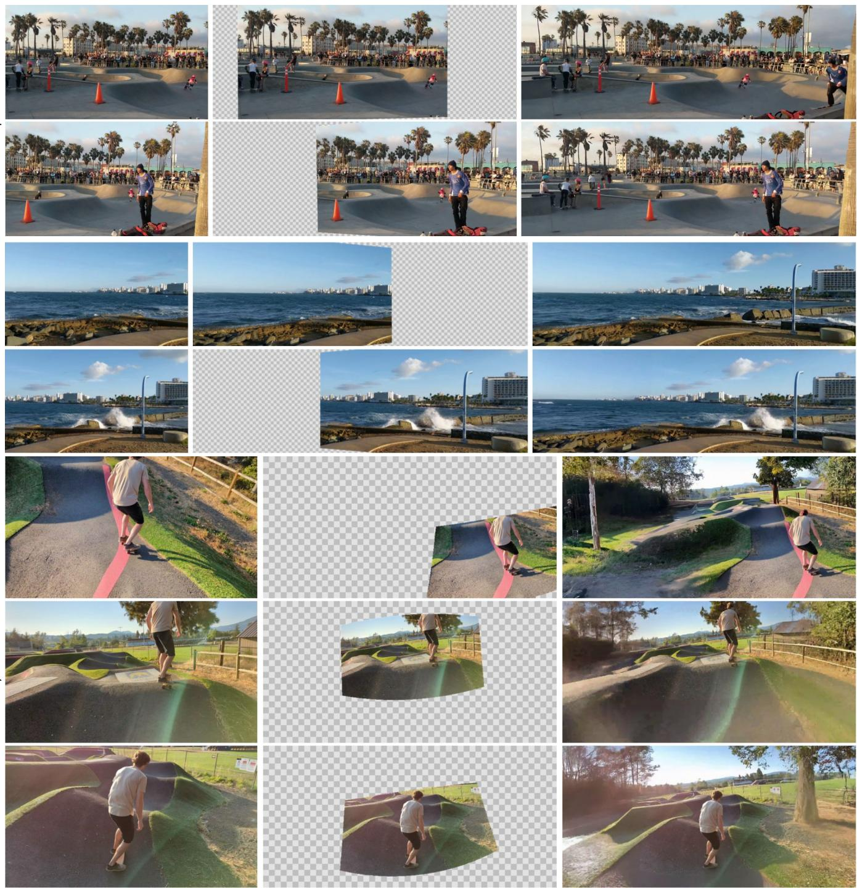  
dyibar  
Input Panning Video  
Reprojected Input Video  
Our Result  
Fig. 8. Results on real videos. Left: representative input frames. Middle: frames projected to panorama canvas. Right: our result. Our method synthesizes realistic motions for an unseen person entering the frame (top), ocean waves (middle), and for scenery around a moving camera (bottom). See supplemental material for videos.

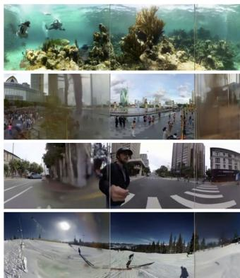  
Naive Lumiere

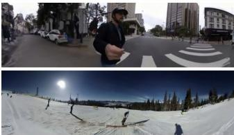  
Ours

Fig. 9. Naive Lumiere vs. Ours. Left: Lumiere without panorama mask finetuning or temporal coarse-to-fine. Right: our result. Compare with our full method and ground-truth in Fig. 5.  
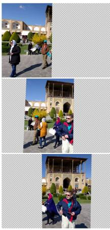  
Reprojected Input

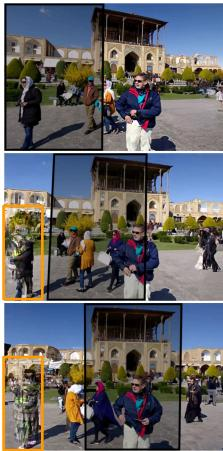  
Temporal MultiDiffusion

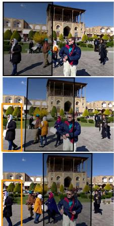  
Temporal Coarse-to-Fine

Fig. 10. Ablation of Temporal Coarse-to-Fine. Coarse-to-Fine synthesis (right) generates more consistent results over long videos than temporal MultiDiffusion (middle). With temporal MultiDiffusion, later generations can drift from the input pixels (orange box), while coarse-to-fine generates a plausible continuation of the pedestrian. Input pixels shown darkened.

latent space is lower resolution than the image space, applying our method to LDM-based models would likely require careful handling of masking in the encoder and the diffusion model, possibly through a combination of panoramic-mask finetuning and separate masking in the encoder and diffusion model. We leave this exploration for future work.

## References

Aseem Agarwala, Ke Colin Zheng, Chris Pal, Maneesh Agrawala, Michael Cohen, Brian Curless, David Salesin, and Richard Szeliski. 2005. Panoramic video textures. In ACM SIGGRAPH 2005 Papers. 821–827.

Rajat Arora and Yong Jae Lee. 2021. SinGAN-GIF: Learning a Generative Video Model from a Single GIF. In 2021 IEEE Winter Conference on Applications of Computer Vision (WACV). 1309-1318. https://doi.org/10.1109/WACV48630.2021.00135

Omer Bar-Tal, Hila Chefer, Omer Tov, Charles Herrmann, Roni Paiss, Shiran Zada, Ariel Ephrat, Junhwa Hur, Yuanzhen Li, Tomer Michaeli, et al. 2024. Lumiere: A space-time diffusion model for video generation. arXiv preprint arXiv:2401.12945 (2024).

Omer Bar-Tal, Lior Yariv, Yaron Lipman, and Tali Dekel. 2023. MultiDiffusion: Fusing Diffusion Paths for Controlled Image Generation. arXiv preprint arXiv:2302.08113 (2023).

Andreas Blattmann, Tim Dockhorn, Sumith Kulal, Daniel Mendelevitch, Maciej Kilian, Dominik Lorenz, Yam Levi, Zion English, Vikram Voleti, Adam Letts, et al. 2023a. Stable video diffusion: Scaling latent video diffusion models to large datasets. arXiv preprint arXiv:2311.15127 (2023).

Andreas Blattmann, Robin Rombach, Huan Ling, Tim Dockhorn, Seung Wook Kim, Sanja Fidler, and Karsten Kreis. 2023b. Align your latents: High-resolution video synthesis with latent diffusion models. In Proceedings of the IEEE/CVF Conference on Computer Vision and Pattern Recognition. 22563-22575.

M. Brown and D.G. Lowe. 2007. Automatic Panoramic Image Stitching using Invariant Features. IFCV (2007).

Peter J Burt and Edward H Adelson. 1987. The Laplacian pyramid as a compact image code. In Readings in computer vision. Elsevier, 671–679.

Vincent Couture, Michael S Langer, and Sébastien Roy. 2011. Panoramic stereo video textures. In 2011 International Conference on Computer Vision. IEEE, 1251-1258.

Chen Gao, Ayush Saraf, Jia-Bin Huang, and Johannes Kopf. 2020. Flow-edge guided video completion. In Computer Vision-ECCV 2020: 16th European Conference, Glasgow, UK, August 23–28, 2020, Proceedings, Part XII 16. Springer, 713–729.

Nuno Gracias, Mohammad Mahoor, Shahriar Negahdaripour, and Arthur Gleason. 2009. Fast image blending using watersheds and graph cuts. Image and Vision Computing 27, 5 (2009), 597–607.

Yuwei Guo, Ceyuan Yang, Anyi Rao, Yaohui Wang, Yu Qiao, Dahua Lin, and Bo Dai. 2023. Animatediff: Animate your personalized text-to-image diffusion models without specific tuning. arXiv preprint arXiv:2307.04725 (2023).

R. I. Hartley and A. Zisserman. 2004. Multiple View Geometry in Computer Vision (second ed.). Cambridge University Press, ISBN: 0521540518.

Jonathan Ho, William Chan, Chitwan Saharia, Jay Whang, Ruiqi Gao, Alexey Gritsenko, Diederik P Kingma, Ben Poole, Mohammad Norouzi, David J Fleet, et al. 2022. Imagen video: High definition video generation with diffusion models. arXiv preprint arXiv:2210.02303 (2022).

Jonathan Ho, Ajay Jain, and Pieter Abbeel. 2020. Denoising diffusion probabilistic models. Advances in neural information processing systems 33 (2020), 6840–6851.

Yuan-Ting Hu, Heng Wang, Nicolas Ballas, Kristen Grauman, and Alexander G Schwing. 2020. Proposal-based video completion. In Computer Vision-ECCV 2020: 16th European Conference, Glasgow, UK, August 23–28, 2020, Proceedings, Part XXVII 16. Springer, 38–54.

Jia-Bin Huang, Sing Bing Kang, Narendra Ahuja, and Johannes Kopf. 2016. Temporally coherent completion of dynamic video. ACM Transactions on Graphics (ToG) 35, 6 (2016), 1-11.

Shachar Ilan and Ariel Shamir. 2015. A Survey on Data-Driven Video Completion. In Computer Graphics Forum, Vol. 34. Wiley Online Library, 60–85.

Dan Kondratyuk, Lijun Yu, Xiuye Gu, José Lezama, Jonathan Huang, Grant Schindler, Rachel Hornung, Vighnesh Birodkar, Jimmy Yan, Ming-Chang Chiu, Krishna Somandepalli, Hassan Akbari, Yair Alon, Yong Cheng, Josh Dillon, Agrim Gupta, Meera Hahn, Anja Hauth, David Hendon, Alonso Martinez, David Minnen, Mikhail Sirotenko, Kihyuk Sohn, Xuan Yang, Hartwig Adam, Ming-Hsuan Yang, Irfan Essa, Huisheng Wang, David A. Ross, Bryan Seybold, and Lu Jiang. 2024. VideoPoet: A Large Language Model for Zero-Shot Video Generation. arXiv:2312.14125

Zhen Li, Cheng-Ze Lu, Jianhua Qin, Chun-Le Guo, and Ming-Ming Cheng. 2022. Towards An End-to-End Framework for Flow-Guided Video Inpainting. In IEEE Conference on Computer Vision and Pattern Recognition (CVPR).

Jing Liao, Mark Finch, and Hugues Hoppe. 2015. Fast computation of seamless video loops. ACM Transactions on Graphics (TOG) 34, 6 (2015), 1–10.

Zicheng Liao, Neel Joshi, and Hugues Hoppe. 2013. Automated video looping with progressive dynamism. ACM Transactions on Graphics (TOG) 32, 4 (2013), 1–10.

David G Lowe. 2004. Distinctive image features from scale-invariant keypoints. International journal of computer vision 60 (2004), 91–110.

Patrick Pérez, Michel Gangnet, and Andrew Blake. 2023. Poisson image editing. In Seminal Graphics Papers: Pushing the Boundaries, Volume 2. 577–582.

Alex Rav-Acha, Yael Pritch, Dani Lischinski, and Shmuel Peleg. 2007. Dynamosaicing: Mosaicing of dynamic scenes. IEEE Transactions on Pattern Analysis and Machine Intelligence 29, 10 (2007), 1789–1801.

Heung-Yeung Shum and Richard Szeliski. 1997. Panoramic image mosaics. Technical Report. Citeseer.

Drew Steedly, Chris Pal, and Richard Szeliski. 2005. Efficiently registering video into panoramic mosaics. In Tenth IEEE International Conference on Computer Vision (ICCV'05) Volume 1, Vol. 2. IEEE, 1300–1307.

Richard Szeliski. 2010. Computer Vision: Algorithms and Applications (1st ed.). Springer-Verlag, Berlin, Heidelberg.

Richard Szeliski et al. 2007. Image alignment and stitching: A tutorial. Foundations and Trends® in Computer Graphics and Vision 2, 1 (2007), 1–104.

Richard Szeliski and Heung-Yeung Shum. 2000. Creating Full View Panoramic Image Mosaics and Environment Maps. Computer Graphics (Proceedings of Siggraph '97) (04 2000). https://doi.org/10.1145/258734.258861

Zachary Teed and Jia Deng. 2020. Raft: Recurrent all-pairs field transforms for optical flow. In Computer Vision-ECCV 2020: 16th European Conference, Glasgow, UK, August 23–28, 2020, Proceedings, Part II 16. Springer, 402–419.

Ruben Villegas, Mohammad Babaeizadeh, Pieter-Jan Kindermans, Hernan Moraldo, Han Zhang, Mohammad Taghi Saffar, Santiago Castro, Julius Kunze, and Dumitru Erhan. 2022. Phenaki: Variable Length Video Generation from Open Domain Textual Descriptions. In International Conference on Learning Representations.

Yonatan Wexler, Eli Shechtman, and Michal Irani. 2007. Space-time completion of video. IEEE Transactions on pattern analysis and machine intelligence 29, 3 (2007), 463-476.

Yingen Xiong and Kari Pulli. 2010. Fast panorama stitching for high-quality panoramic images on mobile phones. IEEE Transactions on Consumer Electronics 56, 2 (2010), 298-306. https://doi.org/10.1109/TCE.2010.5505931

Lijun Yu, Yong Cheng, Kihyuk Sohn, José Lezama, Han Zhang, Huiwen Chang, Alexander G Hauptmann, Ming-Hsuan Yang, Yuan Hao, Irfan Essa, et al. 2023. Magvit: Masked generative video transformer. In Proceedings of the IEEE/CVF Conference on

Computer Vision and Pattern Recognition. 10459–10469.

Richard Zhang, Phillip Isola, Alexei A Efros, Eli Shechtman, and Oliver Wang. 2018. The Unreasonable Effectiveness of Deep Features as a Perceptual Metric. In CVPR.

Zhoutong Zhang, Forrester Cole, Zhengqi Li, Michael Rubinstein, Noah Snavely, and William T Freeman. 2022. Structure and motion from casual videos. In European Conference on Computer Vision. Springer, 20–37.

Zhixing Zhang, Bichen Wu, Xiaoyan Wang, Yaqiao Luo, Luxin Zhang, Yinan Zhao, Peter Vajda, Dimitris Metaxas, and Licheng Yu. 2023. AVID: Any-Length Video Inpainting with Diffusion Model. arXiv preprint arXiv:2312.03816 (2023).

Daquan Zhou, Weimin Wang, Hanshu Yan, Weiwei Lv, Yizhe Zhu, and Jiashi Feng. 2022. Magicvideo: Efficient video generation with latent diffusion models. arXiv preprint arXiv:2211.11018 (2022).

Shangchen Zhou, Chongyi Li, Kelvin C.K Chan, and Chen Change Loy. 2023. ProPainter: Improving Propagation and Transformer for Video Inpainting. In Proceedings of IEEE International Conference on Computer Vision (ICCV).