# OmnimatteZero: Fast Training-free Omnimatte with Pre-trained Video Diffusion Models

DVIR SAMUEL, Bar-Ilan University, Israel and OriginAI, Israel

MATAN LEVY, Hebrew University of Jerusalem, Israel

NIR DARSHAN, OriginAI, Israel

GAL CHECHIK, NVIDIA Research, Israel and Bar-Ilan University, Israel

RAMI BEN-ARI, OriginAI, Israel

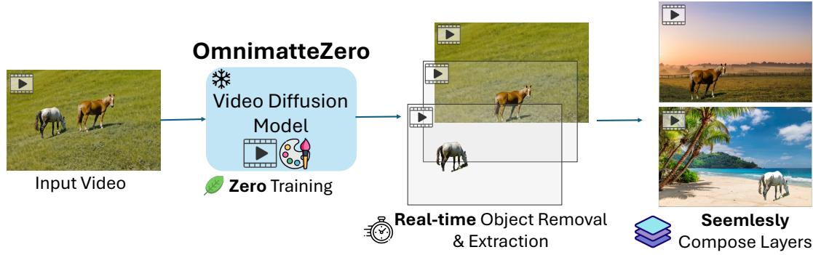  
Fig. 1. OmnimatteZero is the first training-free generative approach for Omnimatte, leveraging pre-trained video diffusion models to achieve object removal, extraction, and seamless layer compositions in just 0.04 sec/frame (on an A100 GPU). See video examples in the supplemental material.

In Omnimatte, one aims to decompose a given video into semantically meaningful layers, including the background and individual objects along with their associated effects, such as shadows and reflections. Existing methods often require extensive training or costly self-supervised optimization. In this paper, we present OmnimatteZero, a training-free approach that leverages off-the-shelf pre-trained video diffusion models for omnimatte. It can remove objects from videos, extract individual object layers along with their effects, and composite those objects onto new videos. These are accomplished by adapting zero-shot image inpainting techniques for video object removal, a task they fail to handle effectively out-of-the-box. To overcome this, we introduce temporal and spatial attention guidance modules that steer the diffusion process for accurate object removal and temporally consistent background reconstruction. We further show that self-attention maps capture information about the object and its footprints and use them to inpaint the object's effects, leaving a clean background. Additionally, through simple latent arithmetic, object layers can be isolated and recombined seamlessly with new video layers to produce new videos. Evaluations show that OmnimatteZero not only achieves superior performance in terms of background reconstruction but also sets a new record for the fastest Omnimatte approach, achieving real-time performance with minimal frame runtime. Project Page.

CCS Concepts: • Computing methodologies → Machine learning algorithms;

Additional Key Words and Phrases: Omnimatte, Video Diffusion Model, Training-free, Real-time

## ACM Reference Format:

Dvir Samuel, Matan Levy, Nir Darshan, Gal Chechik, and Rami Ben-Ari. 2025. OmnimatteZero: Fast Training-free Omnimatte with Pre-trained Video Diffusion Models. In SIGGRAPH Asia 2025 Conference Papers (SA Conference Papers '25), December 15–18, 2025, Hong Kong, Hong Kong. ACM, New York, NY, USA, 11 pages. https://doi.org/10.1145/3757377.3763917

## 1 Introduction

Extracting or isolating objects in videos is a central problem in video understanding and editing, with important applications such as removing, modifying, or enhancing elements within a video scene. One important flavor of this task is video matting [Chuang et al. 2002], which involves decomposing a video into a background layer and one or more foreground layers, each representing an individual object. A particularly challenging form of video matting is Omnimatte [Lu et al. 2021; Wang and Adelson 1994], where each foreground object is not only isolated but also includes associated effects such as shadows, reflections, and scene perturbations. The layers extracted by video matting facilitate various video editing applications, including object removal, background replacement, retiming [Lu et al. 2020], and object duplication [Lee et al. 2024], many of which require estimating occluded background regions using techniques like video inpainting or omnimatting.

Authors' Contact Information: Dvir Samuel, Bar-Ilan University, Ramat-Gan, Israel and OriginAI, Ramat-Gan, Israel, dvirsamuel@gmail.com; Matan Levy, Hebrew University of Jerusalem, Jerusalem, Israel, levymsn@gmail.com; Nir Darshan, OriginAI, Tel-Aviv, Israel, nir@originai.co; Gal Chechik, NVIDIA Research, Tel-Aviv, Israel and Bar-Ilan University, Tel-Aviv, Israel, gal.chechik@gmail.com; Rami Ben-Ari, OriginAI, Tel-Aviv, Israel, ramib@originai.co.

However, despite their promise, existing methods for video inpainting and Omnimatte face significant limitations. Recent inpainting approaches [Li et al. 2025; Zhou et al. 2023], while trained on annotated datasets for object removal, fail to account for the nuanced effects that objects impart on the scene. Similarly, current Omnimatte methods demand computationally intensive self-supervised optimization for each video [Lee et al. 2024; Lin et al. 2023; Lu et al. 2021; Suhail et al. 2023]. Some approaches further rely on large hand-crafted training datasets [Lee et al. 2024; Winter et al. 2024] or require 3D scene modeling using meshes or NeRFs [Lin et al. 2023; Suhail et al. 2023], resulting in hours of training and slow per-frame rendering.

Given the success of fast, training-free approaches in image editing [Corneanu et al. 2024; Lugmayr et al. 2022], a natural question arises: can these methods be effectively adapted to video editing?

In this paper, we present a new approach called OmnimatteZero, the first training-free generative method to Omnimatte. OmnimatteZero (named for its zero training and optimization requirements) leverages off-the-shelf pre-trained video diffusion models to remove all objects from a video, extract individual object layers along with their associated effects, and finally composite them onto new backgrounds. This entire process is performed efficiently during diffusion inference, making it significantly faster than current methods. See Figure 1 for illustration.

We begin by adapting training-free image inpainting methods [Lug mayr et al. 2022; Meng et al. 2022] to handle object inpainting in videos using diffusion models. However, we find that simply applying these frame-by-frame techniques to videos leads to poor results: missing regions are not filled convincingly, and temporal consistency breaks down. To address this, we propose two attention guidance modules that can be easily integrated into pre-trained video diffusion models. These modules guide the diffusion process to achieve both accurate object removal and consistent background reconstruction. The first module, Temporal Attention Guidance (TAG), uses background patches from nearby frames. By modifying self-attention layers, it encourages the model to use these patches to reconstruct masked regions, improving temporal coherence. The second module, Spatial Attention Guidance (SAG), operates within each frame to refine local details and enhance visual plausibility.

We also observe that self-attention maps contain cues not just about the object but also its indirect effects, such as shadows and reflections. By leveraging this information, our method can inpaint these subtle traces, yielding cleaner backgrounds. For foreground layer extraction, we find that the object (and its traces) can be isolated by subtracting the latent representation of the clean background from the original video latent. This extracted object layer can then be seamlessly inserted into new backgrounds by simply adding the latents, enabling fast and flexible video composition.

To validate our approach, we apply it to two video diffusion models, LTXVideo [HaCohen et al. 2024] and Wan2.1 [video 2025], and evaluate it on standard Omnimatte benchmarks both quantitatively and qualitatively. Our method outperforms all supervised and selfsupervised existing inpainting and Omnimatte techniques across all benchmarks in terms of background reconstruction and object layer extraction. Notably, OmnimatteZero requires no training or additional optimization, functioning entirely within the denoising process of diffusion models. This positions OmnimatteZero as the fastest Omnimatte technique to date.

## 2 Related Work

## 2.1 Omnimatte

The first Omnimatte approaches [Kasten et al. 2021; Lu et al. 2021] use motion cues to decompose a video into RGBA matte layers, assuming a static background with planar homographies. Optimization isolates dynamic foreground layers, taking 3 to 8.5 hours per video and \~2.5 seconds per frame to render. Later methods enhanced Omnimatte with deep image priors [Gu et al. 2023; Lu et al. 2022] and 3D representations [Lin et al. 2023; Suhail et al. 2023; Wu et al. 2024], but still rely on strict motion assumptions and require extensive training (\~6 hours) with rendering times of 2.5-3.5 seconds per frame. A recent generative approach [Lee et al. 2024] uses video diffusion priors to remove objects and effects, with test-time optimization for frame reconstruction, taking \~9 seconds per frame. In this paper, we propose a novel, training and optimization-free method using off-the-shelf video diffusion models, achieving realtime performance in 0.04 seconds per frame.

## 2.2 Video Inpainting

Earlier video inpainting methods [Chang et al. 2019; Hu et al. 2020; Wang et al. 2019] used 3D CNNs for spatiotemporal modeling but struggled with long-range propagation due to limited receptive fields. Pixel-flow approaches [Gao et al. 2020; Zhang et al. 2022a,b] improved texture and detail restoration by utilizing adjacent frame information. Recently, Zhou et al. [2023] introduced ProPainter, which enhances reconstruction accuracy and efficiency by leveraging optical flow-based propagation and attention maps. VideoPainter [Bian et al. 2025] proposed a dual-stream video inpainting method that injects video context into a pre-trained video diffusion model using a lightweight encoder. [Li et al. 2025] proposed DiffuEraser, which combines a pre-trained text-to-image diffusion model with BrushNet, a feature extraction module, to generate temporally consistent videos. In this paper, we propose a single-step object inpainting approach, directly applied during video diffusion model inference, implicitly leveraging spatial and temporal information from adjacent frames for inpainting.

## 2.3 Diffusion Transformers for Video Generation

Recent advancements in diffusion models have significantly improved text-to-video generation. These models, trained on large datasets of video-text pairs, can generate visually compelling videos from text descriptions. Recent work introduced LTX-Video [HaCohen et al. 2024], a real-time transformer-based latent diffusion model capable of generating videos at over 24 frames per second. It builds on 3D Video-VAE with a spatiotemporal latent space, a concept also used in Wan2.1 [video 2025] and the larger HunyuanVideo [Kong 2024]. Unlike traditional methods that treat the video VAE and denoising transformer separately, LTX-Video integrates them within a highly compressed latent space (1:192 compression ratio), optimizing their interaction. This spatiotemporal downscaling results in 32 × 32 × 8 pixels per token while maintaining high-quality video generation. Similarly, HunyuanVideo employs a large-scale video generation framework, integrating an optimized VAE and diffusion-based transformer to achieve excellent visual quality and motion consistency. These models demonstrate the trend of combining high-compression VAEs with transformer-based diffusion models for efficient and scalable video generation.

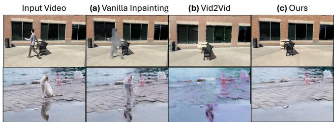  
Fig. 2. Comparison of object removal results using (a) vanilla image inpainting extended to video, (b) Vid2Vid zero-shot inpainting, and (c) our guidance-based approach. Vanilla methods fail to maintain temporal consistency or clean background reconstruction, while our method achieves coherent, artifact-free inpainting across frames.

## 3 Motivation: The failure of image inpainting approaches for videos

We begin by extending training-free image-diffusion inpainting techniques to video diffusion models. Our reference point is vanilla image inpainting [Lugmayr et al. 2022], a straightforward method that starts with a random noise at the masked area and, at each diffusion step t, injects Gaussian noise $\epsilon _ { t }$ into the original background area so the denoiser can reconstruct the masked region while preserving the background during denoising. For video, we apply it across the full video latent to maintain both spatial and temporal coherence, since frame-by-frame inpainting leads to temporal artifacts like flickering. In practice, this vanilla approach does preserve the original background alignment, however causes the masked areas to degrade into incoherent, temporally unstable blobs (Fig. 2a). We attribute this breakdown to a core difference between image and video models: image inpainting ensures spatial consistency within a single frame, while video inpainting must also maintain temporal consistency across frames. Unlike image inpainting, which relies heavily on hallucination, video inpainting must infer missing content from both spatial and temporal context, making it significantly more challenging. We further examine a second zero-shot inpainting method: Vid2Vid [HaCohen et al. 2024] (an adaptation from Img2Img [Meng et al. 2022]). This method applies heavy noise inside the mask and lighter noise elsewhere in the latent video, then denoises the entire latent. Vid2Vid effectively removes the target object and synthesizes plausible fills, however, it also introduces artifacts into the background and motion (Fig.2b).

While recent diffusion-based solutions [Bian et al. 2025; Lee et al. 2024] overcome these issues by training dedicated video diffusion models for object removal, we pose the following question: Can we develop a training free method that simultaneously (i) convincingly fills the masked region, (ii) preserves the background so that it is indistinguishable from the original video, and (iii) eliminates all residual evidence of the object's presence, including secondary effects like shadows and reflections?.

## 4 Preliminaries: Spatio-Temporal Attention in Video Diffusion Transformers

Video diffusion transformers interleave spatio-temporal self-attention modules in each diffusion block to model both fine-grained structure within frames and consistent dynamics across time. Given a video, it's latent tensor is $Z \in \mathbb { R } ^ { f \times w \times h \times c }$ , where f is the number of temporally compressed frames, and $w , h ,$ and c are the width, height, and channel dimensions in latent space. We reshape Z into $\bar { Z } \in \mathbb { R } ^ { ( f \times n ) \times c }$ , where $n = h \times \nu$ v is the number of tokens per frame. Self-attention is then applied over all $f \times n$ tokens:

$$
A \ = \ { \mathrm { A t t e n t i o n } } { \big ( } Q ( Z ) , K ( Z ) { \big ) } \ \in \ { \mathbb { R } } ^ { ( f \times n ) \times ( f \times n ) } .
$$

where $Q , K \in \mathbb { R } ^ { w \times h \times c }$ are the queries and keys, respectively. This matrix A encodes both spatial and temporal interactions in one operation. We denote tokens by $( i , p )$ with $i = 1 , \ldots , f$ the frame index and $p { = } 1 , \ldots , n$ the spatial position. Spatial attention within frame i (i.e. interactions among tokens $( i , p )$ and $( i , q ) )$ is given by the in-frame weights $A _ { \mathrm { \scriptsize ~ s p a t i a l } } ^ { ( i ) } ( p , q ) = A _ { ( i , p ) , ( i , q ) }$ . Temporal attention between frame i to frame $j \neq i$ (i.e. interactions between tokens $( i , p )$ and $( j , q ) )$ is given by $A _ { \mathrm { t e m p o r a l } } ^ { ( i , j ) } ( p , q ) \ = \ A _ { ( i , p ) , ( j , q ) } .$

## 5 Method: OmnimatteZero

In this section, we first describe how given a video $\mathcal { V } \in \mathbb { R } ^ { F \times W \times H \times 3 }$ and an object mask for each frame $\mathsf { \bar { M } } _ { o b j } \in \{ 0 , 1 \} ^ { F \times H \times W }$ , one can use off-the-shelf video diffusion models to remove the target object (Section 5.1) and its associated visual effects (Section 5.2). Next, we detail our strategy for isolating foreground objects together with their residual effects (Section 5.3). Finally, we demonstrate how to recombine these object-effect layers onto arbitrary background videos (Section 5.4), enabling flexible and realistic video editing.

In summary, our pipeline expands masks to capture object effects, inpaints them for clean backgrounds, isolates foregrounds via latent arithmetic, and seamlessly recomposes them onto new scenes.

## 5.1 Object Removal

Zero-shot video inpainting with diffusion models [Lugmayr et al. 2022; Meng et al. 2022] frequently struggles because the model must hallucinate content that is coherent both spatially and temporally ( Section 3). Recent studies show that the self-attention mechanism within diffusion models is crucial for maintaining coherence during model generation [Luo et al. 2025]. However, it remains unclear how self-attention can effectively guide the inpainting process.

Our core observation is that in real-world videos, the necessary background information is often readily available in neighboring frames. This principle has been leveraged in traditional video editing techniques [Criminisi et al. 2004; Wexler et al. 2004]. However, they often produce non-realistic results or do not scale for long videos. Motivated by this, we introduce a method that explicitly guides a video diffusion model to reconstruct missing pixels by leveraging spatial and temporal context, rather than relying on the model to infer this implicitly. To further enhance spatial inpainting within individual frames, particularly when background details are absent from adjacent frames $( \mathrm { e . g . }$ , due to static scenes or lack of camera/object motion), we exploit contextual cues from regions surrounding the masked area within the same frame. These temporal and spatial guidance are facilitated through careful manipulations of spatial and temporal self-attention.

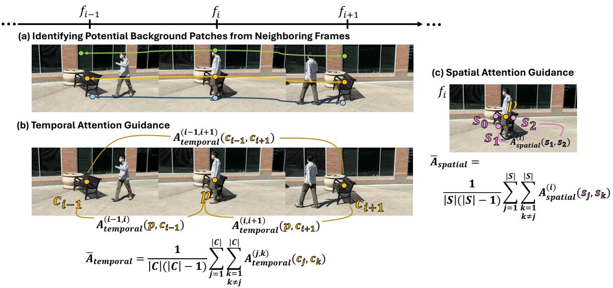  
Fig. 3. Overview of our Object Removal strategy in OmnimatteZero. (a) We first identify potential background correspondences across frames. (b) Temporal Attention Guidance (TAG): Temporal attention scores between a foreground point and its background correspondences are replaced with the average attention between all background pairs, promoting consistent inpainting across time. (c) Spatial Attention Guidance (SAG): Within a frame, the attention from a foreground point to nearby background points is adjusted to reflect the mean attention among background points themselves, improving inpainting quality when temporal context is unavailable.

We thus introduce two novel modules: Temporal Attention guidance (TAG) and Spatial Attention Guidance (SAG). These modules seamlessly integrate into existing pre-trained video diffusion models, effectively steering the diffusion process toward object removal and coherent background reconstruction.

5.1.1 Identifying Potential Background Patches from Neighboring Frames. To accurately inpaint masked areas in a specific frame, it is essential to identify corresponding background patches from neighboring frames, while preserving awareness of the video's underlying 3D structure. This task can be effectively addressed using Track-Any-Point (TAP-Net) [Doersch et al. 2023], a real-time tracking framework. TAP-Net captures spatial and temporal coherence by tracking points from one frame to their corresponding locations across subsequent frames, as illustrated in Figure 3a, where points from frame $f _ { i }$ are matched across other frames. Formally, given a point p on the object in frame i, TAP-Net identifies its corresponding point set among frames $C = \{ C _ { j } | j \neq i \}$ . To ensure that only background regions are considered, we discard points in C that intersect the object mask M in their respective frames.

5.1.2 Temporal Attention Guidance (TAG). To effectively guide the denoising process toward inpainting using neighboring frames, we explicitly set the temporal attention score between a foreground point $\mathcal { P }$ (in frame i) and each of its background correspondences $c \in C$ to be the mean temporal attention observed between all distinct pairs of corresponding background points (see Figure 3b). Formally, we first compute the mean temporal attention

$$
\bar { A } _ { t e m p o r a l } = \frac { 1 } { | C | ( | C | - 1 ) } { \sum _ { j = 1 } ^ { | C | } \sum _ { k = 1 } ^ { | C | } } A _ { t e m p o r a l } ^ { ( j , k ) } ( c _ { j } , c _ { k } ) .\tag{1}
$$

Since the attention is bidirectional, the denominator $| C | ( | C | - 1 )$ correctly enumerates all ordered pairs $( c _ { j } , c _ { k } )$ where $j \neq k ,$ ensuring that each directional interaction is counted exactly once.

We then replace the temporal-attention score from p to every background point c as follows:

$$
A _ { t e m p o r a l } ^ { ( i , j ) } ( { p } , { c } _ { j } ) = \bar { A } _ { t e m p o r a l } , \quad \forall c _ { j } \in C .
$$

This assignment transfers a consensus cue from the entire background set to the foreground point, encouraging consistent inpainting across frames.

5.1.3 Spatial Attention Guidance (SAG). To further improve spatial inpainting within each frame and to address cases where a point lacks correspondences in other frames, we reinforce spatial attention within the same frame. Specifically, for any foreground point $\boldsymbol { p }$ in frame i, we set its spatial attention scores with surrounding background points S to be the mean spatial attention computed among all pairs of background points within the same frame (see Figure 3c). Formally:

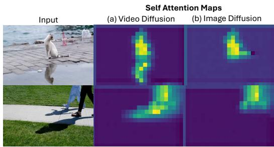  
Fig. 4. Self-attention maps from (a) LTX Video diffusion model and (b) Stable Diffusion (image based). The spatio-temporal video latent "attends to object associated effects" (e.g., shadow, reflection) where, image models struggles to capture these associations.

$$
\bar { A } _ { s p a t i a l } = \frac { 1 } { | S | ( | S | - 1 ) } { \sum _ { j = 1 } ^ { | S | } } \sum _ { \stackrel { k = 1 } { k \neq j } } ^ { | S | } A _ { s p a t i a l } ^ { ( I ) } ( s _ { j } , s _ { k } ) .\tag{2}
$$

Finally, we replace the spatial-attention score from p to every background point s as follows:

$$
A _ { \mathrm { s p a t i a l } } ^ { i } ( \boldsymbol { p } , \boldsymbol { s } ) = \bar { A } _ { s p a t i a l } , \quad \forall \boldsymbol { s } \in \boldsymbol { S } .
$$

This strategy ensures coherent spatial inpainting even in the absence of temporal information.

## 5.2 Removing Associated Object Effects

We are interested in masking the object with its associated effects. Recently, [Lee et al. 2024] showed that pretrained video diffusion models can associate objects with their effects by analyzing selfattention maps between query and key tokens related to the object of interest. They leveraged this insight to train diffusion models for object removal along with its associated footprint. In contrast to [Lee et al. 2024], we propose to directly derive the masks from the attention maps, allowing a training-free object removal approach. Specifically, we apply a single noising and denoising step on the video latent and compute the attention weights between query and key tokens associated with the object. More precisely, for each latent frame i at diffusion layer l, we calculate the attention map as follows:

$$
A _ { i } ^ { l } = \mathrm { s o f t m a x } \left( \frac { Q _ { i } ^ { l } ( M _ { o b j } \odot K _ { i } ^ { l } ) ^ { T } } { \sqrt { c } } \right) \in \mathbb { R } ^ { N \times N }\tag{3}
$$

where $Q _ { i } ^ { l } , K _ { i } ^ { l } \in \mathbb { R } ^ { w \times h \times c }$ are the queries and keys respectively at layer l and frame $i , N = w \times h$ and c is the number of channels of the latent.

We then compute a soft-mask per-frame, $M _ { i } ~ \in ~ [ 0 , 1 ] ^ { w \times h \times c }$ which is aggregated across all diffusion layers:

$$
M _ { i } = \frac { 1 } { L } \sum _ { l = 1 } ^ { L } A _ { i } ^ { l }\tag{4}
$$

where L is the number of layers in the video diffusion model. Then we extend $\mathcal { M } _ { i }$ to the whole video by concatenating all frame masks channel-wise ${ \mathcal { M } } _ { o b j } = \mathrm { c o n c a t } \{ { \mathcal { M } } _ { 1 } , . . . { \mathcal { M } } _ { f } \} \in { \mathbb { R } } ^ { { \bar { \boldsymbol { w } } } \times { h } \times { f } }$ deriving a soft-mask latent. To obtain a binary mask we perform Otsu thresholding [Otsu 1979] for each latent frame, $\hat { M } _ { o b j } = \mathbb { I } ( M _ { o b j } )$ . This new mask replaces the mask $M _ { o b j }$ provided as input by the user. Figure 4(a) shows self-attention maps from LTX-Video [HaCohen et al. 2024] of two video frames. The attention maps reveal the model's ability to localize not only primary objects—like the cat and the walking person—but also their associated physical effects, such as reflections and shadows. This demonstrates the model's robustness in consistently tracking these cues even when similar visual patterns are present elsewhere in the scene.

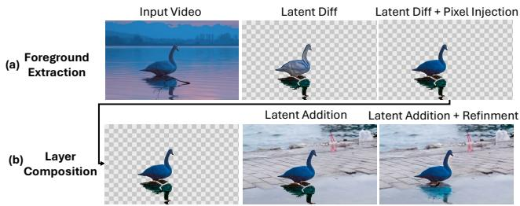  
Fig. 5. (a) Foreground Extraction: The target object is extracted by latent code arithmetic, subtracting the background video encoding from the object+background latent (Latent Diff). This initially results in distortions, which are later corrected by replacing pixel values using the original video and a user-provided mask (Latent Diff + Pixel injection). (b) Layer Composition: The extracted object layer is added to a new background latent (Latent Addition). To improve blending, a few steps of noising-denoising are applied, yielding a more natural integration of the object into the new scene (Latent Addition + Refinement). See video examples in the supp material.

Interestingly, to the best of our knowledge, this approach has not been explored for masking object effects (e.g shadows) in images. Unlike video diffusion models, image models do not capture object effects from still images [Winter et al. 2024]. Figure 4(b) illustrates this by showing self-attention maps extracted using StableDiffusion [Rombach et al. 2022], a text-to-image diffusion model, which demonstrates that the object does not attend to its associated effects. We believe that this aligns with the principle of common fate in Gestalt psychology [Köhler 1992], which suggests that elements moving together are perceived as part of the same object. Video diffusion models seem to implicitly leverage this principle by grouping objects with their effects through motion.

## 5.3 Foreground Extraction

We can now use our object removal approach to extract object layers along with their associated effects. To isolate a specific object, we apply our method twice: first, removing all objects from the video, leaving only the background, denoted as $\bar { V _ { b q } } ^ { - } \in \mathbb { R } ^ { F \times W \times H \times 3 }$ with its corresponding latent $Z _ { b q } ;$ second, removing all objects except the target object, resulting in a video of the object with the background, denoted as $\bar { V _ { o b j + b q } } \in \mathbb { R } ^ { F \times W \times H \times 3 }$ with its corresponding latent $Z _ { o b j + b g }$ . We can now derive the video of the object isolated from the background by simply subtracting the two latents $Z _ { o b j } = Z _ { o b j + b g } - Z _ { b g }$ Applying thresholding on $Z _ { o b j }$ results in a latent that is decoded to a video $V _ { o b j }$ containing only the object and its associated effects (see Figure 5a Latent Diff). While the extracted effects appear convincing, the object itself often suffers from distortions due to latent values falling outside the diffusion model's learned distribution. To address this issue, we make use of the information available in the pixel-space. We refine the object's appearance by replacing its values in the pixel-space with those from the original video, based on the user provided mask:

Table 1. Quantitative comparison: Background Reconstruction. OmnimatteZero outperforms all omnimatte and video inpainting methods, achieving the best PSNR and LPIPS without training or per-video optimization. It also runs significantly faster, with OmnimatteZero [LTXVideo] at 0.04s per frame. "-" denotes missing values due to unreported data or unavailable public code.
<table><tr><td rowspan="2">Scene Metric</td><td colspan="3">Movie</td><td colspan="3">Kubric</td><td rowspan="2">Average</td><td colspan="4"></td><td rowspan="2"> $T _ { r u n }$ </td></tr><tr><td>PSNR↑</td><td>LPIPS↓</td><td>SSIM↑</td><td>PSNR↑</td><td>LPIPS↓</td><td>SSIM↑</td><td>PSNR↑</td><td>LPIPS↓</td><td>SSIM↑</td><td> $T _ { t r a i n }$  (hours) (s/frame)</td></tr><tr><td>ObjectDrop [Winter et al. 2024]</td><td>28.05</td><td>0.124</td><td></td><td>34.22</td><td>0.083</td><td></td><td></td><td>31.14</td><td>0.104</td><td></td><td></td><td></td></tr><tr><td>Video Repaint [LTXVideo]* [Lugmayr et al. 2022]</td><td>20.13</td><td>0.252</td><td></td><td>21.15</td><td>0.289</td><td></td><td></td><td>20.64</td><td>0.271</td><td></td><td>0</td><td>0.4</td></tr><tr><td>Video Repaint [Wan2.1]* [Lugmayr et al. 2022]</td><td>21.44</td><td>0.244</td><td></td><td>24.16</td><td>0.261</td><td></td><td></td><td>22.8</td><td>0.253</td><td></td><td>0</td><td>32</td></tr><tr><td>Temporal Enhance [LTXVideo]* [Luo et al. 2025]</td><td>21.33</td><td>0.248</td><td></td><td>23.01</td><td>0.281</td><td></td><td></td><td>22.8</td><td>0.265</td><td></td><td>0</td><td>0.04</td></tr><tr><td>Temporal Enhance [Wan2.1]* [Luo et al. 2025]</td><td>21.93</td><td>0.222</td><td></td><td>24.26</td><td>0.253</td><td></td><td></td><td>23.01</td><td>0.237</td><td></td><td>0</td><td>3.2</td></tr><tr><td>Lumiere inpainting [Bar-Tal et al. 2024]</td><td>26.62</td><td>0.148</td><td></td><td>31.46</td><td>0.157</td><td></td><td></td><td>29.04</td><td>0.153</td><td></td><td></td><td>9</td></tr><tr><td>Propainter [Zhou et al. 2023]</td><td>27.44</td><td>0.114</td><td></td><td>34.67</td><td>0.056</td><td></td><td></td><td>31.06</td><td>0.085</td><td></td><td></td><td>0.083</td></tr><tr><td>DiffuEraser [Zhou et al. 2023]</td><td>29.51</td><td>0.105</td><td></td><td>35.19</td><td>0.048</td><td></td><td></td><td>32.35</td><td>0.077</td><td></td><td></td><td>0.8</td></tr><tr><td>Ominmatte [Lu et al. 2021]</td><td>21.76</td><td>0.239</td><td>0.736</td><td>26.81</td><td>0.207</td><td>0.831</td><td></td><td>24.29</td><td>0.223</td><td>0.783</td><td>3</td><td>2.5</td></tr><tr><td>D2NeRF [Wu et al. 2024]</td><td></td><td></td><td></td><td>34.99</td><td>0.113</td><td>0.887</td><td></td><td></td><td></td><td></td><td>3</td><td>2.2</td></tr><tr><td>LNA [Kasten et al. 2021]</td><td>23.10</td><td>0.129</td><td>0.847</td><td></td><td></td><td></td><td></td><td></td><td></td><td></td><td>8.5</td><td>0.4</td></tr><tr><td>OmnimatteRF [Lin et al. 2023]</td><td>33.86</td><td>0.017</td><td>0.981</td><td>40.91</td><td>0.028</td><td>0.970</td><td></td><td>37.38</td><td>0.023</td><td>0.975</td><td>6</td><td>3.5</td></tr><tr><td>Generative Omnimatte [Lee et al. 2024]</td><td>32.69</td><td>0.030</td><td>0.989</td><td>44.07</td><td>0.010</td><td>0.981</td><td></td><td>38.38</td><td>0.020</td><td>0.985</td><td></td><td>9</td></tr><tr><td>OmnimatteZero [LTXVideo] (Ours)</td><td>35.11</td><td>0.014</td><td>0.992</td><td>44.97</td><td>0.010</td><td></td><td>0.988</td><td>40.04</td><td>0.012</td><td>0.990</td><td>0</td><td>0.04</td></tr><tr><td>OmnimatteZero [Wan2.1] (Ours)</td><td>34.12</td><td>0.017</td><td>0.993</td><td>45.55</td><td>0.006</td><td></td><td>0.987</td><td>39.84</td><td>0.011</td><td>0.990</td><td>0</td><td>3.2</td></tr></table>

$$
V _ { o b j } = M _ { o b j } ^ { p } \odot V _ { o b j + b g } + \left( 1 - M _ { o b j } ^ { p } \right) \odot V _ { o b j } .\tag{5}
$$

This correction preserves the object's fidelity while maintaining its associated effects, resulting in high-quality object layers (see Figure 5a Latent Diff + Pixel Injection). A comparison of OmnimatteZero with other baselines for foreground extraction is provided in the Supplemental.

Alpha-Channel Extraction: The alpha-channel is obtained from the soft mask Mi (Eq. 4) by decoding it with the video VAE using only the spatial and temporal upsampling layers, skipping feature re-encoding. This ensures (1) softness, the output remains a soft mask that captures graded transitions around boundaries and effects, and (2) alignment, the decoded alpha-channel is upsampled to the original resolution, maintaining pixel-wise correspondence with the RGB frames. The result is a temporally and spatially consistent matte that preserves soft boundaries, shadows, and reflections, enabling realistic compositing and evaluation.

## 5.4 Layer Composition

With the object layers extracted, we can now seamlessly compose them onto new videos by adding the object layer latent to a new background latent $Z _ { b g } ^ { N }$ Specifically,

$$
Z _ { o b j + b g } ^ { N } = Z _ { b g } ^ { N } + Z _ { o b j } .\tag{6}
$$

Figure 5b (Latent Addition) illustrates the initial result with some residual inconsistencies, which we finally fix, by applying a 3 noisingdenoising steps. This process helps smooth transitions between the

video background and foreground layers, resulting in a more natural and cohesive video (Figure 5b Latent Addition + Refinment).

## 6 Experiments

Following [Lee et al. 2024], we evaluate OmnimatteZero on three applications: (1) Background Reconstruction, where the foreground is removed to recover a clean background; (2) Foreground Extraction, where objects are extracted, together with their associated effects (e.g. shadows and reflections); and (3) Layer Composition, where extracted elements are reinserted into new backgrounds while preserving visual consistency. For qualitative results, each figure shows one representative frame per video; full videos are in the supplementary material.

## 6.1 Background Layer Reconstruction

Compared methods: We conducted a comparative evaluation of our approach with several SoTA methods. These methods fall into four categories: (A) Omnimatte methods that are trained to decompose a given video into layers: Omnimatte [Lu et al. 2021], D2NeRF [Wu et al. 2024], LNA [Kasten et al. 2021], OmnimatteRF [Lin et al. 2023] and Generative Omnimatte [Lee et al. 2024]. (B) Video inpainting methods that are trained to remove objects from a video: RePaint [Lugmayr et al. 2022] adapted for video, Temporal Enhance [Luo et al. 2025] applied to vanilla inpainting (Sec 2) which enhances general temporal attention during denoising, Lumiere inpainting [Bar-Tal et al. 2024], Propainter [Zhou et al. 2023], DiffuEraser [Li et al. 2025], and VideoPainter [Bian et al. 2025]. Finally, (C) An image inpainting method that is applied for each video frame independently: ObjectDrop [Winter et al. 2024].

Datasets and Metrics: We evaluate our method on two standard Omnimatte datasets: Movies [Lin et al. 2023] and Kubric [Wu et al. 2024]. These datasets provide object masks for each frame and ground truth background layers for evaluation. All methods are assessed using PSNR, SSIM, and LPIPS metrics to measure the accuracy of background reconstruction, along with comparisons of training and runtime efficiency on a single A100 GPU.

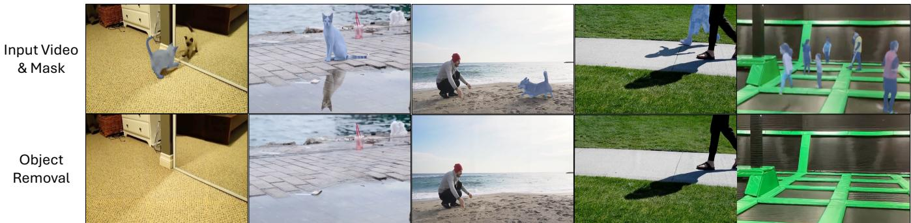  
Fig. 6. Qualitative Results: Object removal and background reconstruction. The first row shows input video frames with object masks, while the second row presents the reconstructed backgrounds. Our approach effectively removes objects while preserving fine details, reflections, and textures, demonstrating robustness across diverse scenes. Notice the removal of the cat's reflection in the mirror and water, the shadow of the dog and bicycle (with the rider), and the bending of the trampoline when removing the jumpers. See video examples in the supplemental material

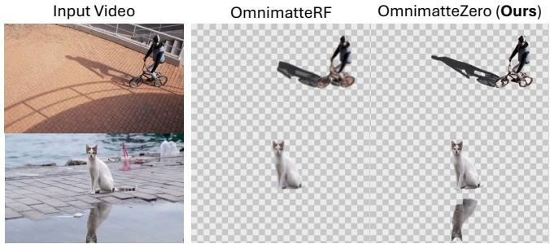  
Fig. 7. Qualitative Comparison: Foreground Extraction. Foreground extraction comparison between OmnimatteZero and OmnimatteRF [Lin et al. 2023]. Our method accurately captures both the object and its associated effects, such as shadows and reflections, in contrast to OmnimatteRF, missing or distorting shadows (row 1) and reflections (row 2).

Quantitative results: Table 1 presents a comparison of OmnimatteZero with the SoTA Omnimatte and inpainting methods on the Movies and Kubric benchmarks. It shows that OmnimatteZero outperforms existing supervised and self-supervised methods designed for object inpainting or omnimatte. It achieves the highest PSNR and lowest LPIPS on both the Movie and Kubric datasets, demonstrating superior background reconstruction. Specifically, OmnimatteZero [LTXVideo] achieves a PSNR of 35.11 (Movie) and 44.97 (Kubric), surpassing Generative Omnimatte [Lee et al. 2024], all while requiring no training or per-video optimization. Notably, this improvement is not due to a stronger video generation model, as both OmnimatteZero and Video RePaint [Lugmayr et al. 2022] use the same generator, yet Video RePaint records the lowest PSNR and highest LPIPS across all benchmarks.

Our method is also significantly faster. OmnimatteZero [LTXVideo] runs at just 0.04s per frame (or 24 frames per second). These results establish OmnimatteZero as the first training-free, real-time video matting method, offering both superior performance and efficiency.

Qualitative results: Figure 6 presents qualitative results of our object removal method across various scenes. The first row shows input video frames with masked objects, while the second row displays the reconstructed backgrounds. The videos include (1) a cat running toward a mirror, (2) a static cat looking left and right, (3) a dog running toward a man, (4) two people walking, and (5) multiple people jumping on a trampoline. Our method effectively removes objects like people and animals even when similar objects and effects appear in the video, while preserving fine details and textures. Notably, in the first two columns, OmnimatteZero eliminates the cat without leaving mirror or water reflections. The last column further demonstrates its ability to remove objects while maintaining scene integrity, even correcting the trampoline's bending effect after removing the jumper. Figure 9 10 presents a qualitative comparison of OmnimatteZero with SoTA omnimatte and video inpainting methods. Our method consistently produces cleaner and more temporally coherent background reconstructions with fewer artifacts and distortions, especially in challenging scenes involving motion, shadows, and texture continuity. The figures includes diverse videos such as dogs running on grass, a person walking past a building, a woman walking on the beach, swans in a lake and more. In the first three rows of Figure 10, OmnimatteZero reconstructs textured and complex backgrounds (e.g., grass, water, sand) without the distortions and ghosting present in OmnimatteRF and DiffuEraser (see red boxes). In all rows of Figure 9, competing methods leave visible shadow remnants, semantic drift, or object traces, while OmnimatteZero removes foregrounds cleanly and fills in semantically appropriate content.

## 6.2 Foreground Extraction

We aim to extract the foreground object along with its associated effects, such as shadows and reflections. Figure 7 compares OmnimatteZero for foreground extraction with OmnimatteRF [Lin et al. 2023]. Our training-free method accurately isolates objects while preserving fine details of their interactions with the scene, such as reflections and shadows. In contrast, OmnimatteRF struggles to fully capture the associated effects. Notably, in the second and third rows, our method correctly extracts both the shadow of the cyclist and the reflection of the cat, while OmnimatteRF either distorts or omits these elements. These results demonstrate that OmnimatteZero provides superior, training-free foreground extraction, effectively handling complex visual effects where existing methods fall short.

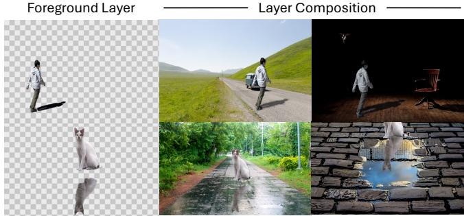  
Fig. 8. Qualitative Comparison: Layer Composition. The extracted foreground objects, along with their shadows and reflections, are seamlessly integrated into diverse backgrounds, demonstrating the effectiveness of our approach in preserving visual coherence and realism across different scenes. See video examples in the supplemental material

## 6.3 Layer Composition

The objective here is to take the extracted foreground layers and seamlessly composite them onto new background layers. Figures 8 and 11 presents the results of OmnimatteZero, highlighting its ability to maintain object integrity, shadows, and reflections while enabling smooth re-composition across different scenes. Notably, it demonstrates how the model adaptively integrates the inserted object into the environment, such as enhancing the cat's reflection in the clear water stain or adjusting the man's appearance to match the night lighting.

## 7 Conclusion and Limitations

In this work, we introduced OmnimatteZero, the first training-free approach for video omnimatte. By leveraging pre-trained video diffusion models together with spatial and temporal attention guidance, OmnimatteZero enables real-time object removal, foreground extraction, and seamless layer recomposition without any additional training or test-time optimization. Extensive experiments demonstrate that our method outperforms supervised and self-supervised baselines in both background reconstruction and multi-object handling, while achieving state-of-the-art runtime efficiency.

Nevertheless, several limitations remain. First, since our pipeline relies on VAE compression and decompression, the reconstructed video may exhibit slight deviations from the original input. Second, the quality of temporal correspondence depends on the accuracy of TAP, which can degrade under heavy occlusions or in low-resolution videos. Third, the fidelity of inpainting is ultimately bounded by the capabilities of the underlying video diffusion model, which may struggle in highly complex or unfamiliar scenes. We believe these limitations will be progressively mitigated as future video generative models continue to improve in visual fidelity, temporal consistency, and robustness. OmnimatteZero provides a fast, flexible, and practical framework that can readily incorporate such advances, paving the way for scalable, real-time video editing applications.

## Acknowledgments

We thank Yoni Kasten for his insightful input and valuable contributions to this work.

## References

Omer Bar-Tal, Hila Chefer, Omer Tov, Charles Herrmann, Roni Paiss, Shiran Zada, Ariel Ephrat, Junhwa Hur, Guanghui Liu, Amit Raj, Yuanzhen Li, Michael Rubinstein, Tomer Michaeli, Oliver Wang, Deqing Sun, Tali Dekel, and Inbar Mosseri. 2024. Lumiere: A Space-Time Diffusion Model for Video Generation.

Yuxuan Bian, Zhaoyang Zhang, Xuan Ju, Mingdeng Cao, Liangbin Xie, Ying Shan, and Qiang Xu. 2025. VideoPainter: Any-length Video Inpainting and Editing with Plug-and-Play Context Control. SIGGRAPH (2025).

Ya-Liang Chang, Zhe Yu Liu, Kuan-Ying Lee, and Winston H. Hsu. 2019. Free-Form Video Inpainting With 3D Gated Convolution and Temporal PatchGAN. In ICCV. 9065-9074.

Yung-Yu Chuang, Aseem Agarwala, Brian Curless, David H Salesin, and Richard Szeliski. 2002. Video matting of complex scenes. In Proceedings of the 29th annual conference on Computer graphics and interactive techniques. 243-248.

Ciprian Corneanu, Raghudeep Gadde, and Aleix M Martinez. 2024. Latentpaint: Image inpainting in latent space with diffusion models. In WACV.

A. Criminisi, P. Perez, and K. Toyama. 2004. Region filling and object removal by exemplar-based image inpainting. IEEE Transactions on Image Processing (2004).

Carl Doersch, Yi Yang, Mel Vecerik, Dilara Gokay, Ankush Gupta, Yusuf Aytar, Joao Carreira, and Andrew Zisserman. 2023. TAPIR: Tracking any point with per-frame initialization and temporal refinement. In ICCV.

Chen Gao, Ayush Saraf, Jia-Bin Huang, and Johannes Kopf. 2020. Flow-edge Guided Video Completion. In ECCV. 713-729.

Zeqi Gu, Wenqi Xian, Noah Snavely, and Abe Davis. 2023. FactorMatte: Redefining Video Matting for Re-Composition Tasks. ACM Transactions on Graphics (TOG) (2023).

Yoav HaCohen, Nisan Chiprut, Benny Brazowski, Daniel Shalem, David-Pur Moshe, Eitan Richardson, E. I. Levin, Guy Shiran, Nir Zabari, Ori Gordon, Poriya Panet, Sapir Weissbuch, Victor Kulikov, Yaki Bitterman, Zeev Melumian, and Ofir Bibi. 2024. LTX-Video: Realtime Video Latent Diffusion. ArXiv (2024).

Yuan-Ting Hu, Heng Wang, Nicolas Ballas, Kristen Grauman, and Alexander G. Schwing. 2020. Proposal-Based Video Completion. In ECCV, Vol. 12372. 38–54.

Yoni Kasten, Dolev Ofri, Oliver Wang, and Tali Dekel. 2021. Layered neural atlases for consistent video editing. ACM Transactions on Graphics (TOG) 40, 6 (2021), 1–12.

Wolfgang Köhler. 1992. Gestalt psychology: The definitive statement of the Gestalt theory. H. Liveright.

Weijie Kong. 2024. HunyuanVideo: A Systematic Framework For Large Video Generative Models.

Yao-Chih Lee, Erika Lu, Sarah Rumbley, Michal Geyer, Jia-Bin Huang, Tali Dekel, and Forrester Cole. 2024. Generative Omnimatte: Learning to Decompose Video into Layers. CVPR (2024).

Xiaowen Li, Haolan Xue, Peiran Ren, and Liefeng Bo. 2025. DiffuEraser: A Diffusion Model for Video Inpainting.

Geng Lin, Chen Gao, Jia-Bin Huang, Changil Kim, Yipeng Wang, Matthias Zwicker, and Ayush Saraf. 2023. OmnimatteRF: Robust Omnimatte with 3D Background Modeling. In ICCV.

Erika Lu, Forrester Cole, Tali Dekel, Weidi Xie, Andrew Zisserman, William T Freeman, and Michael Rubinstein. 2022. Associating Objects and Their Effects in Video Through Coordination Games. In NeurIPS.

Erika Lu, Forrester Cole, Tali Dekel, Weidi Xie, Andrew Zisserman, David Salesin, William T Freeman, and Michael Rubinstein. 2020. Layered neural rendering for retiming people in video. arXiv:2009.07833 (2020).

Erika Lu, Forrester Cole, Tali Dekel, Andrew Zisserman, William T Freeman, and Michael Rubinstein. 2021. Omnimatte: Associating Objects and Their Effects in Video. In CVPR

Andreas Lugmayr, Martin Danelljan, Andres Romero, Fisher Yu, Radu Timofte, and Luc Van Gool. 2022. Repaint: Inpainting using denoising diffusion probabilistic models. In CVPR.

Yang Luo, Xuanlei Zhao, Mengzhao Chen, Kaipeng Zhang, Wenqi Shao, Kai Wang, Zhangyang Wang, and Yang You. 2025. Enhance-A-Video: Better Generated Video for Free. ArXiv (2025).

Chenlin Meng, Yutong He, Yang Song, Jiaming Song, Jiajun Wu, Jun-Yan Zhu, and Stefano Ermon. 2022. SDEdit: Guided Image Synthesis and Editing with Stochastic Differential Equations. In ICLR.

Nobuyuki Otsu. 1979. A Threshold Selection Method from Gray-Level Histograms. IEEE Trans. Syst. Man Cybern. (1979).

Robin Rombach, Andreas Blattmann, Dominik Lorenz, Patrick Esser, and Björn Ommer. 2022. High-resolution image synthesis with latent diffusion models. In CVPR.

Mohammed Suhail, Erika Lu, Zhengqi Li, Noah Snavely, Leonid Sigal, and Forrester Cole. 2023. Omnimatte3D: Associating objects and their effects in unconstrained

monocular video. In CVPR

Wan video. 2025. Wan: Open and Advanced Large-Scale Video Generative Models. https://github.com/Wan-Video/Wan2.1.

Chuan Wang, Haibin Huang, Xiaoguang Han, and Jue Wang. 2019. Video Inpainting by Jointly Learning Temporal Structure and Spatial Details. In AAAI. 5232–5239.

J.Y.A. Wang and E.H. Adelson. 1994. Representing moving images with layers. IEEE Transactions on Image Processing (1994).

Y. Wexler, E. Shechtman, and M. Irani. 2004. Space-time video completion. In CVPR.

Daniel Winter, Matan Cohen, Shlomi Fruchter, Yael Pritch, Alex Rav-Acha, and Yedid Hoshen. 2024. ObjectDrop: Bootstrapping Counterfactuals for Photorealistic Object Removal and Insertion.

Tianhao Wu, Fangcheng Zhong, Andrea Tagliasacchi, Forrester Cole, and Cengiz Oztireli. 2024. D²2NeRF: Self-Supervised Decoupling of Dynamic and Static Objects from a Monocular Video.

Kaidong Zhang, Jingjing Fu, and Dong Liu. 2022a. Flow-Guided Transformer for Video Inpainting. In ECCV, Vol. 13678. 74–90.

Kaidong Zhang, Jingjing Fu, and Dong Liu. 2022b. Inertia-Guided Flow Completion and Style Fusion for Video Inpainting. In CVPR. 5972–5981.

Shangchen Zhou, Chongyi Li, Kelvin C.K Chan, and Chen Change Loy. 2023. ProPainter: Improving Propagation and Transformer for Video Inpainting. In ICCV.

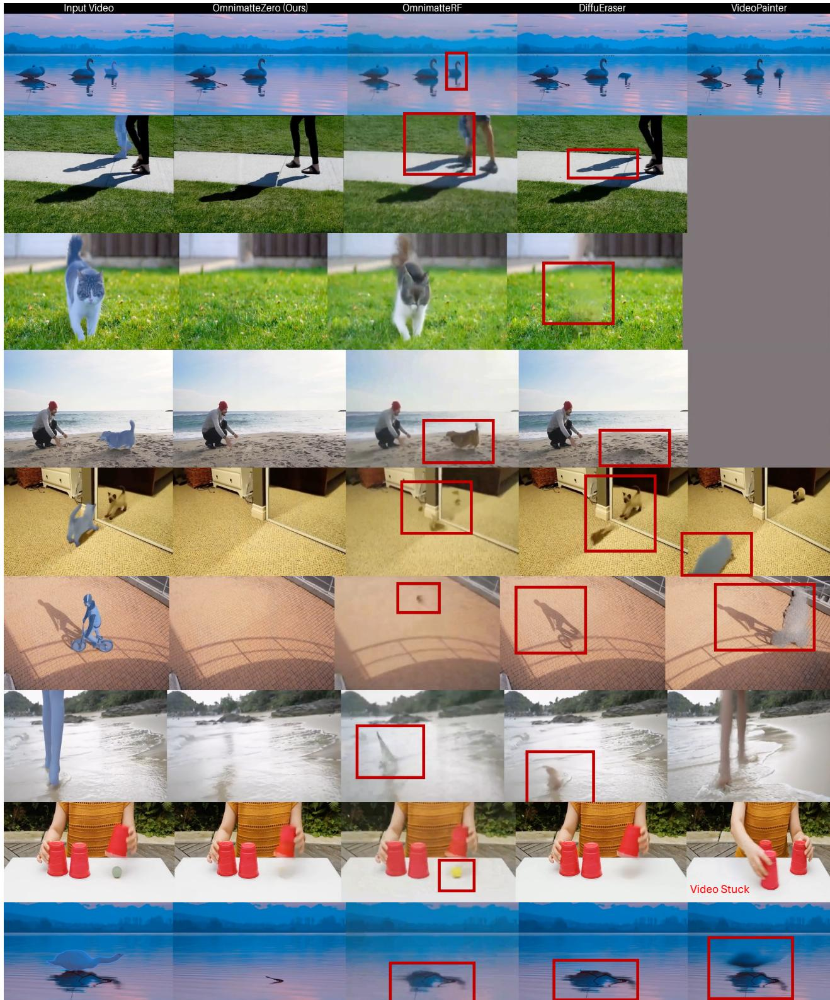  
Fig. 9. Qualitative comparison with state-of-the-art video inpainting methods. OmnimatteZero produces clean, temporally consistent background reconstructions across a diverse range of scenes, including dynamic motion, shadows, reflections, and fine textures. Compared to other methods, it avoids common artifacts such as ghosting, blur, and shadow remnants (highlighted in red boxes), successfully filling in complex backgrounds across varying temporal and spatial contexts. Gray frames indicate failure cases where the inpainting method returned an error. See the supplementary material for full videos.

SA Conference Papers '25, December 15–18, 2025, Hong Kong, Hong Kong.

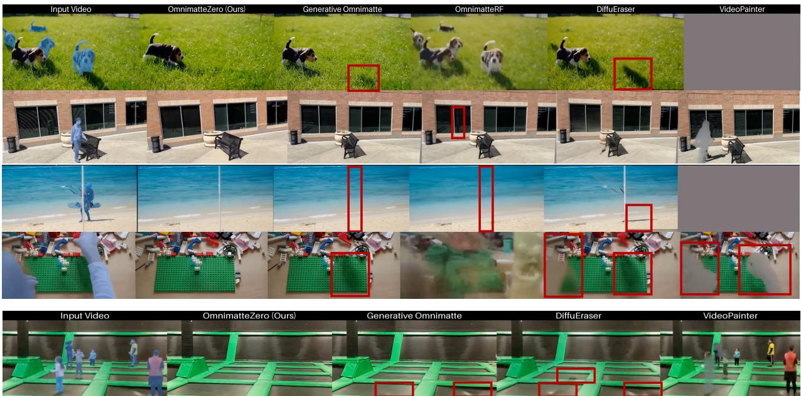

Fig. 10. Qualitative comparison with state-of-the-art video inpainting methods. OmnimatteZero achieves clean, temporally consistent background reconstructions across diverse scenes, preserving fine textures, shadows, and reflections. Compared to prior methods, it avoids common artifacts such as ghosting, blur, and residual shadows (highlighted in red). Gray frames indicate failure cases where the method returned an error. See supplementary material for full video results  
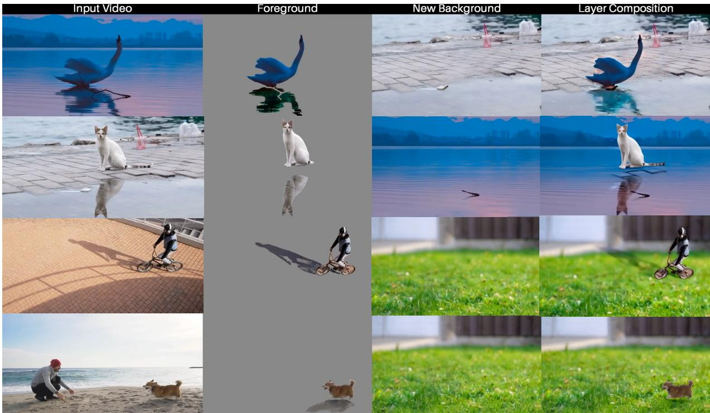  
Fig. 11. Qualitative Comparison: Layered Composition. From left to right: the original video frame, the extracted foreground (including shadows and reflections), the target background, and our final composite. Across four diverse examples (a swan, a cat, a bicyclist, and a dog), our method preserves accurate shadows, reflections, and object-scene coherence, yielding visually seamless results. See the supplementary material for full videos.