# EasyOmnimatte: Taming Pretrained Inpainting Diffusion Models for End-to-End Video Layered Decomposition

Yihan Hu¹ Xuelin Chen² Xiaodong Cun¹,†

1 GVC Lab, Great Bay University 2Adobe Research

https://github.com/GVCLab/EasyOmnimatte

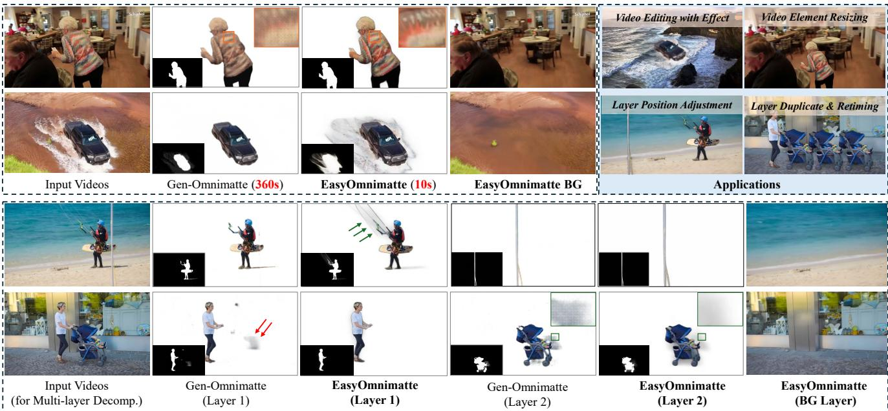  
Figure 1. EasyOmnimatte is the first, end-to-end video omnimatte method, eliminating the need for slow, multi-stage optimization-based pipelines (e.g., Gen-Omnimatte [15]). EasyOmnimatte produces high-fidelity alpha mattes that accurately capture the associated effects, all within just seconds, representing a significant gain over existing state-of-the-art methods in both quality and efficiency.

## Abstract

Existing video omnimatte methods typically rely on slow, multi-stage, or inference-time optimization pipelines that fail to fully exploit powerful generative priors, producing suboptimal decompositions. Our key insight is that, if a video inpainting model can be finetuned to remove the foreground-associated effects [15], then it must be inherently capable of perceiving these effects, and hence can also be netuned for the complementary task: foreground layer decomposition with associated effects. However, although naïvely finetuning the inpainting model with LoRA applied to all blocks can produce high-quality alpha mattes, it fails to capture associated effects. Our systematic analysis reveals this arises because effect-related cues are primarily encoded in specific DiT blocks and

become suppressed when LoRA is applied across all blocks. To address this, we introduce EasyOmnimatte, the first unified, end-to-end video omnimatte method. Concretely, we inetune a pretrained video inpainting diffusion model to learn dual complementary experts while keeping its original weights intact: an Effect Expert, where LoRA is applied only to effect-sensitive DiT blocks to capture the coarse structure of the foreground and associated effects, and a fully LoRAfnetuned Quality Expert learns to refine the alpha matte. During sampling, Effect Expert is used for denoising at early, high-noise steps, while Quality Expert takes over at later, low-noise steps. This design eliminates the need for two full diffusion passes, significantly reducing computational cost without compromising output quality. Ablation studies validate the effectiveness of this Dual-Expert strategy. Experiments demonstrate that EasyOmnimatte sets a new state-of-the-art for video omnimatte and enables various downstream tasks, significantly outperforming baselines in both quality and efficiency.

## 1. Introduction

Decomposing videos into layered representations is a fundamental problem in computer vision, with significant applications in video editing and visual effects. Effective decomposition enables a variety of video editing tasks, including object removal, background replacement, and other creative workflows. However, extracting accurate alpha mattes for target foregrounds is labor-intensive, especially for complex effects arising from object-environment interactions such as shadows, reflections, generated smoke, or splashes. Apparently, this task is highly difficult to achieve using conventional methods. To address this, the pioneering work [27] has formulated the Omnimatte task, which seeks to separate a foreground object and all its associated visual effects into a single coherent layer, and trains a UNet model on the input video in a self-supervised manner. Subsequently, there has been a surge of follow-up omnimatte methods improving it from various perspectives. However, these follow-ups typically rely on slow, multi-stage, or inference-time optimization pipelines that fail to fully exploit powerful generative priors, producing suboptimal decompositions.

In this work, we present the irst unifed, end-to-end framework for video omnimatte generation, addressing the aforementioned limitations, as illustrated in Fig.2. Our key insight is that since video inpainting models can be finetuned to remove foreground-associated effects [15, 45, 52, 53], they must inherently perceive them. Consequently, instead of removing these effects, we can finetune the same model to extract them for the foreground layer prediction. To this end. we explore employing lightweight Low-Rank Adaptation (LoRA) [10] modules to finetune the inpainting model on a synthetic matting dataset, enabling it to directly predict the foreground layer in a single, efficient stage. Nonetheless, our initial experiments (in Fig.8) with this straightforward setup revealed a critical and unexpected challenge: while the finetuned model effectively mattes the foreground objects, it failed to consistently perceive and capture associated effects such as shadows and reflections — even when trained with ground-truth targets that include them.

Intrigued by this phenomenon, we conduct a systematic analysis of the model's internal mechanisms. Inspired by ObjectDrop [45] and the analysis in Gen-Omnimatte [15], we examine how different blocks of the inpainting model respond to subtle “effect" cues. Our structural analysis of the inpainting model reveals that the perception of these effects is concentrated within a specific subset of blocks in the DiT architecture. Applying LoRA to all DiT blocks tends to overemphasize the main alpha prediction task and inadvertently suppresses the weaker, effect-related signals, manifested as missing effects in the omnimatting results. With these findings, our key idea is to finetune a pretrained video inpainting diffusion model to learn two complementary experts while keeping its original weights frozen: an Effect Expert, where LoRA is applied only to effect-sensitive intermediate stages to capture the coarse structure of the foreground and its associated effects, and a Quality Expert, where LoRA is applied to all DiT blocks, learns to add fine details to the alpha matte. Notably, during diffusion sampling, the Effect Expert model is only employed at early, high-noise stages to generate coarse, effect-aware omnimatte predictions, while the Quality Expert model refines the alpha matte only at later, low-noise stages. Rather than running the two finetuned models sequentially for full diffusion sampling, this alternating strategy achieves high-quality results with roughly half the computational cost.

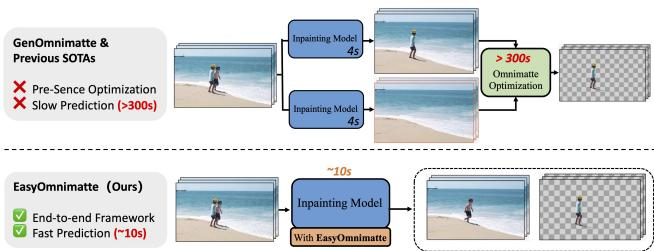  
Figure 2. (a) Previous two-stage approaches (e.g., Generative Omnimatte [15]) suffer from costly test-time optimization and error propagation. (b) In contrast, our unified framework simultaneously predicts the background and separates the foreground with its effects in a single end-to-end model.

Experiments confirm that this classic coarse-to-fine strategy, which leverages both the specialized and full LoRA adaptations, is crucial for producing alpha mattes that are accurate and faithfully preserve associated effects. Our evaluation demonstrates that EasyOmnimatte sets a new state-ofthe-art (SOTA) video omnimatte. Importantly, the proposed method maintains an end-to-end, feed-forward decomposition of the foreground layers, ensuring both effectiveness and efficiency.

In summary, our main contributions are as follows:

• We introduce the first end-to-end video omnimatte method, which directly adapts a pre-trained video inpainting model to capture associated visual effects, eliminating the need for slow, multi-stage optimization-based pipelines.

• We perform a structural analysis revealing that the standard inpainting pretraining objective inherently conflicts with the preservation of foreground effects, strongly motivating our key designs.

• We finetune a pretrained video inpainting diffusion model to learn two specialized experts. These complementary experts operate in tandem across the high- and low-noise denoising stages, producing high-fidelity alpha mattes that accurately capture the associated effects, all without additional computational overhead.

## 2. Related Work

Foreground Isolation and Matting. The most straightforward way to extract the foreground layer from a video is via matting [31, 40]. Converting the foreground into a transparent (RGBA) format enables a wide range of video editing tasks, making video matting a fundamental technique for such applications. In recent years, deep learning-based matting methods for both images [11, 44, 46, 49, 51] and videos [12, 21, 37, 47] have achieved significant improvements, enhancing the accuracy of alpha matte prediction while reducing the need for extensive guidance information. These methods, often trained on fine-grained labeled datasets, can automatically learn image features to predict high-quality alpha mattes. However, limitations in the diversity of training data [20, 32, 37, 46] and specific training strategies [12, 13, 21] often limit their performance to certain foreground categories, most notably humans. Furthermore, they tend to fail to capture foreground-associated effects, such as shadows or reflections. While some methods [20, 35] leverage a known background to partially address these limitations, they impose strict requirements, such as a static scene or a pre-captured clean background plate.

Video Matting with Associated Effects. A series of methods, exemplified by Omnimatte [26, 27], enables the decomposition of a video into foreground and background layers, with the foreground layer encompassing associated visual effects. These approaches aim to completely separate the foreground layer from the video, leveraging motion cues through flow-based techniques [1, 3, 41] to achieve this effect. Subsequent works have further enhanced the capabilities of Omnimatte by incorporating deep image priors [7, 28] extending planar homography constraints through non-rigid warping [26, 50] or 3D scene representations [19, 36]. However, a significant drawback is the reliance on restrictive motion assumptions, which can result in severely degraded performance when such assumptions no longer hold.

Video Inpainting for Object Removal. Both background matting and Omnimatte-like optimization methods rely on precise background guidance. On the other end, the rapid progress of visual generative models [2, 5, 6, 8, 9, 14, 24, 38, 48] has greatly advanced video inpainting techniques, enabling accurate background layer prediction. Early video inpainting methods focused on natural content completion by exploiting spatio-temporal cues from adjacent frames [4, 23, 39, 56] or propagating optical flow [17, 54] to reduce hallucinations and artifacts within masked regions. The latest approaches [16, 57] directly adapt and fine-tune large video generative models for efficient object removal. Nonetheless, these methods cannot eliminate the associated effects of an object, often leaving residual artifacts inside the inpainted background. In image object removal, several recent methods [45, 52, 53] have specifically addressed the challenge of removing both objects and their associated effects. The key idea behind these approaches is to condition the generative model on the original, unmasked image, enabling it to learn the correlations between objects and their corresponding effects. Building on this success, Generative Omnimatte [15] (referred to as Gen-Omnimatte) extends this idea to video generation models, successfully training a video removal model capable of cleanly removing objects and their associated visual effects. Its success has also inspired training-free research approaches like [34].

## 3. Method

We tackle the vedio omnimatte task, which seeks to decompose an input video $V ~ \in ~ \mathbb { R } ^ { N \times H \times W \times 3 }$ into a foreground layer $\pmb { \dot { F } } \in \mathbb { R } ^ { N \times H \times W \times 3 }$ , its corresponding alpha matte $\pmb { \alpha } \in [ 0 , 1 ] ^ { N \times H \times W }$ , and a restored background layer $\pmb { { B } } \in \mathbb { R } ^ { N \times \dot { H } \times \dot { W } \times 3 }$ . These layers must adhere to the standard alpha compositing equation: $V = \pmb { \alpha } \odot \pmb { F } + ( 1 - \pmb { \alpha } ) \odot \pmb { B }$ where denotes element-wise multiplication. In contrast to multi-stage pipelines [15, 27] that predict B and $\{ \alpha , F \}$ sequentially, we formulate this as a direct, end-to-end prediction problem with a single model G. This model, with trainable parameters $\Theta ,$ is trained to map the input video directly and simultaneously to the complete set of decomposition layers. This unified transformation is expressed as:

$$
( F , \alpha , B ) = \mathcal { G } ( V , M , c ; \Theta ) ,\tag{1}
$$

where M indicates the per-frame coarse foreground masks $( i . e .$ , without the effects), and c the inpainting condition.

As shown in Fig. 3, to mitigate the data scarcity issue, our core idea is to repurpose the powerful generative prior of a pre-trained video inpainting model in Sec. 3.1. However, we observe that a naive fine-tuning of such a model struggles to capture subtle but crucial foreground effects $( e . g .$ , shadows, reflections). To understand this limitation, we first conduct a rigorous structural analysis (Sec. 3.2) of the inpainting model, revealing an innate functional conflict in its later blocks that actively suppresses effect-related signals. Guided by this key observation, we propose a novel Dual Experts Sampling (Sec. 3.3) that resolves this conflict.

## 3.1. Repurpose Inpainting Diffusion for Omnimatte

Video inpainting models inherently encode a strong separation prior, allowing them to remove foregrounds and their associated effects [15]. We leverage this prior differently: by adapting the model to directly predict the foreground's alpha matte, we achieve a unified, end-to-end Omnimatte pipeline. As Figure 3 shows, to achieve omnimatte prediction in a feed-forward way without compromising the model's powerful priors, we introduce Branch DiT Blocks, constructed by adding trainable LoRA modules [10] to the original DiT blocks, to recover the alpha mate with additional tokens.

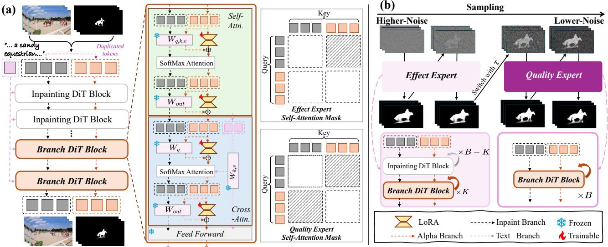  
Figure 3. EasyOmnimatte. a) We branch out LoRA-finetuned blocks from the original inpainting DiT blocks to jointly predict the alpha matte, alongside the pretrained model. In each Branch DiT Block, LoRA are applied only to the duplicated set of input tokens, leaving the original inpainting branch unaffected. b) During sampling, the Effect Expert model is only employed at early, high-noise stages to generate coarse, effect-aware omnimatte predictions, while the Quality Expert model refines the alpha matte only at later, low-noise stages. This alternating strategy achieves high-quality results with greatly reduced compute cost, compared to individually sampling.

The baseline inpainting model is conditioned on the complete video frames F, per-frame foreground masks M provided by modern segmentors [33], and a brief environmental text description c for background guidance. F and M are incorporated into the noise latents of the inpainting DiT through channel concatenation and projection to obtain the input visual token. Our method directly inherits this complete input scheme with additional tokens. Specifically, we first duplicate the input visual tokens as well as the rotary positional embeddings (RoPE) following [42], then token-wisely concatenate them, creating two parallel sets: the original tokens destined for the inpainting task and a copied set for alpha matte prediction. These lightweight LoRA are applied exclusively to the copied set of tokens. Consequently, the original, frozen backbone of the inpainting model operates on the untainted original tokens, proceeding with its background prediction task, while the LoRA-equipped branch processes the copied tokens, effectively redirecting their output from background prediction toward alpha matte estimation.

We choose to predict the alpha matte  instead of the foreground layer F [55] since the alpha matte is well-defined across the entire frame (i.e., it has a value of 0 in pure background regions), providing a more stable and well-posed prediction target. In contrast, the foreground pixels are only defined where the alpha is greater than zero.

Since we froze the original video inpainting model, the original input of the video inpainting model predicts the background β, whereas the alpha matte  is generated by the additional tokens, as shown in Fig. 3. We then analytically recover the foreground layer $\hat { F }$ by rearranging the standard compositing equation. For each frame f, the foreground $F _ { f }$ is computed as:

$$
\hat { F } _ { f } = \frac { \mathrm { c l i p } ( I _ { f } - ( 1 - \hat { \alpha } _ { f } ) \cdot \hat { B } _ { f } ) } { \hat { \alpha } _ { f } + \epsilon } ,\tag{2}
$$

where $I _ { f }$ is the original frame, $\hat { B } _ { f }$ is the inpainted background, and € is a small constant to prevent division by zero. The clip function ensures that the resulting pixel values remain within the valid [0, 1] range.

## 3.2. Block-Wise Analysis of Effects Association

Following the above structure, we observe that even when employing all Branch DiT blocks, video inpainting models still fail to effectively capture and preserve the associated effects. Given the efficacy of inpainting models in erasing an object as well as its attendant effects that are not specified we infer an underlying sequential process of first perceiving and then eliminating these phenomena. To validate this hypothesis, we perform a block-wise analysis to probe the mechanisms for effect-perception and processing at different depths of the network.

We calculate the Effects Association Score [15, 45] s(p) for each foreground pixel $p ,$ based on a block's self-attention map W. This score represents the fraction of a pixel's attention that is directed towards the effects region $M ^ { e }$

$$
s ( p ) = \frac { \sum _ { y \in M ^ { e } } \mathbf { W } _ { p , y } } { \sum _ { x \in I } \mathbf { W } _ { p , x } } ,\tag{3}
$$

so for frame $f ,$ we can obtain the effect-related attentive map of the b-th DiT blocks, denoted as $S _ { f , t }$

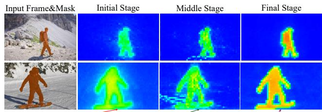

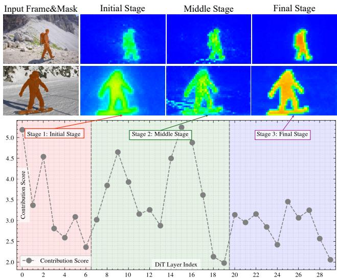  
Figure 4. Our block-wise Analysis. Bottom: Contribution scores per layer reveal the three inpainting stages. Top: Averaged attention maps $( S _ { b } )$ for each stage show that the middle stage is most sensitive to effects (e.g., shadows), which are then suppressed in the final stage, corroborating our perception-then-elimination hypothesis.

To quantify how different attention blocks in a DiT perceive associated effects, we compute a normalized, blockwise contribution score. Specifically, for each frame $f ,$ we extract the ground-truth effect mask $\mathbf { M } _ { f } ^ { e }$ by taking the intersection of a binarized alpha matte and the complement of a dilated foreground mask, isolating the effect region from the object itself. Sec.C presents the full derivation.

The block-wise contribution score $C _ { b }$ for a video is the sum of activations within the effect mask over all N frames:

$$
C _ { b } = \frac { \sum _ { f = 1 } ^ { N } \sum _ { p } ( S _ { f , b } \odot M _ { f } ^ { e } ) } { \sum _ { b = 1 } ^ { B } \sum _ { f = 1 } ^ { N } \sum _ { p } ( S _ { f , b } \odot M _ { f } ^ { e } ) } .\tag{4}
$$

By averaging these scores over the full dataset, we obtain an architectural sensitivity profile that highlights which blocks are most responsive to associated effects (Fig. 4, bottom).

Based on the block-wise contribution scores, which we plot in Fig. 4, we partition the inpainting model into three distinct stages using the curve's troughs as clear delineators. The averaged $S _ { b }$ maps for each stage, also visualized in Fig.4 on real-world videos, elucidate their functional roles. The initial stage, characterized by broad receptive fields, primarily encodes contextual scene information. Blocks in the middle stage most strongly capture the spatial structures of foreground-associated effects. Conversely, in the final stage, effect-related features are actively suppressed. This observation validates our hypothesis on the inpainting mechanism.

## 3.3. Dual Experts Sampling

Based on the above findings, we involve a novel dual expert sampling strategy by Effect Expert and Quality Expert sequentially to obtain the final omnimatte as shown in Fig. 3 (b). Below, we provide the details for each part. Effect Expert is a model specialized in fine-tuning the original video inpainting model to capture the effects. Instead of applying LoRA to all DiT blocks, Effect Expert has only LoRA fine-tuning blocks exclusively on the final stages of the inpainting DiT as shown in Fig. 3. The motivation lies in the finding from Fig. 4, which is to prevent the LoRA modules trained for alpha prediction from interfering with the inpainting model's inherent ability to perceive and remove associated effects. Formally, denote the DiT blocks in the inpainint model as $\boldsymbol \Theta = \{ L _ { 1 } , L _ { 2 } , \dots , L _ { B } \}$ , our Effect Expert model $\mathcal { G } ^ { E }$ now has trainable weights:

$$
\begin{array} { r } { \Theta _ { E } : = \{ \mathcal { B } ( L _ { b } ) \mid b \in ( B - K , B ] \} , } \end{array}\tag{5}
$$

where B is the branch-out operation adding LoRA to the last K DiT block. To train the Effect Expert, we modify the self-attention mask so that the inpainting query tokens do not attend to the effect-matting tokens. This ensures that the inpainting branch remains unaffected, while its intermediate representations provide stable guidance for the effectcapturing branch (see Fig. 3, top-middle).

Quality Expert. As shown in Fig. 8 (d), while the Effect Expert model significantly improves the preservation of effects, it comes at the cost of reduced precision in the overall matte shape compared to the single, full Quality Expert with trainable weights $\Theta _ { O } \colon$

$$
\begin{array} { r } { \Theta _ { O } : = \{ \mathcal { B } ( L _ { b } ) \ | \ b \in [ 1 , B ] \} , } \end{array}\tag{6}
$$

To train Quality Expert, we mask out the attention between the inpainting tokens and the matting tokens (see Fig. 3, bottom-middle). This design not only accelerates attention computation but also yields improved matting quality.

Sampling. We further introduce a Dual Expert Sampling Strategy to achieve both high-fidelity effect prediction and accurate matte generation, and high computational efficiency. Our approach is inspired by the progressive nature of diffusion and flow-matching models, which generate content by gradually reducing noise over a series of timesteps, from high noise to low noise, to capture the target effects at early diffusion stages when the major content forms and refine details at later stages. As illustrated in Fig. 3 (b), we control the applied model of the diffusion timestep by the threshold τ. Let $\mathcal { G } ^ { E }$ and $\mathcal { G } ^ { Q }$ denote the trained Effect Expert model and Quality Expert model, respectively, the sampling progress at a timestep t is determined as follows:

$$
\mathcal { G } = \left\{ \begin{array} { l l } { \mathcal { G } _ { E } } & { \mathrm { i f ~ } t > \tau , } \\ { \mathcal { G } _ { Q } } & { \mathrm { i f ~ } t \le \tau , } \end{array} \right.\tag{7}
$$

where $\tau$ is set to 0.5 in our experiments suggested by Fig. 9. These complementary experts operate in tandem across the high- and low-noise denoising stages, producing high-fidelity alpha mattes that accurately capture the associated effects, all without additional computational overhead.

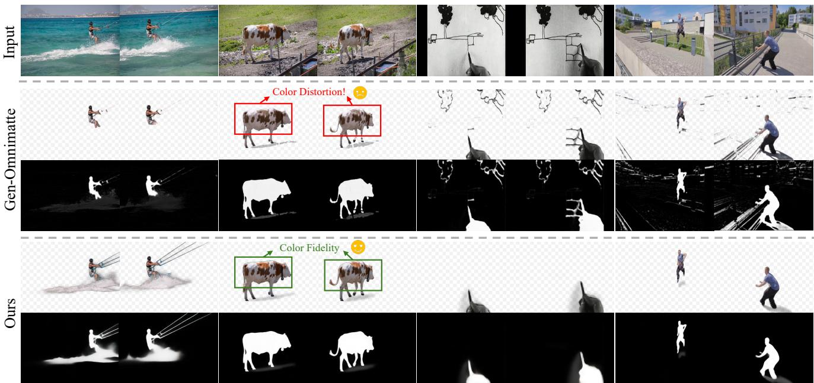  
Figure 5. Qualitative comparison with optimization-based omnimatte method [15]. Please zoom in for a better view.

## 4. Experiments

Our training data is synthetically generated by compositing foreground videos with high-quality alpha matte annotation [20] over background videos. The background videos are sourced from large-scale, high-resolution video datasets [18], each accompanied by a descriptive caption. During composition, we apply a set of dynamic augmentations, including random resizing, rotation, and translation of the foreground, to enhance the diversity of the training samples. The foreground mask M required by the inpainting model is derived directly from the ground-truth alpha matte $\alpha _ { g t }$ . To simulate foreground effects, we generate pseudoshadows by applying a series of transformations (e.g., shearing, blurring, and color adjustments) to the foreground matte.

For our experiments, we initialize our approach with a video inpainting model provided by Lee et al. [15], which is built upon the open-source video generation framework from Wan et al. [38]. We then fine-tune this model to adapt it for the Omnimatte task. Our fine-tuning strategy incorporates a dual-expert architecture using LoRA, where the ranks for the Effect Expert and the Quality Expert are set to 128 and 64, respectively. For the dual-expert sampling strategy, we employ a default threshold of $\tau = 0 . 5$ . The entire model is trained end-to-end for 8,000 iterations using the AdamW optimizer [25] with a learning rate of $1 \times 1 0 ^ { - 3 }$ . The training is conducted on two H100 GPUs. We select the DAVIS [30] dataset and real-world videos collected from the internet for our comparative evaluation below.

## 4.1. Comparison with State-of-the-Art Methods

Optimization-based Omnimatte Prediction. After generating the background with the same removal model we use we employ the Omnimatte Optimization method from Gen-Omnimatte [15] to decompose the foreground. Following the official recommendations, we set the number of optimization steps to 4000 and enabled detail transfer [26]. Note that this is a test-time optimization method similar to the previous approaches [19, 27], requiring several minutes of optimization for each foreground layer, which is over an order of magnitude slower than our approach.

Learning-based Matting Prediction. We establish two categories of learning-based matting baselines. First, for background-matting methods, we use the output of our removal model to guide BGMv2 [20]. Second, for maskguided methods, we generate an initial mask for the foreground and its effects by integrating the segmentation model [33] with SSIS-v2 [43]. This mask is then used to prompt the video matting model [47] for prediction. While contemporary learning-based methods are considerably more efficient than Gen-Omnimatte, they typically fail to preserve the object's associated effects, and even with auxiliary postprocessing, the results are often suboptimal.

Qualitative Comparison. Fig. 5 presents our comparison against the optimization-based method. Gen-Omnimatte [15] suffers from color distortion, leading to poor foreground decomposition. Furthermore, it fails in scenarios with rapid background changes, resulting in significant background bleeding into the foreground layer. In contrast, our method overcomes these shortcomings while drastically reducing the inference time from several minutes to under 10 seconds. Fig. 6 shows the comparison against dedicated matting methods. When capturing associated foreground effects, both matting baselines tend to predict excessively high alpha values in the effect regions. This results in the extracted foreground being contaminated with colors from the original background. Moreover, baselines exhibit poor generalization to non-human categories due to the absence of the generative priors, leading to significant artifacts and low-quality mattes. Quantitative Comparison and Human Evaluation. To objectively evaluate the performance of EasyOmnimatte in the absence of labeled test data, we design two quantitative experiments and incorporate a human evaluation study. The quantitative experiments include calculating a series of perceptual losses of the recomposed video against the original, as well as batch compositing onto numerous backgrounds and calculating the effect on the background video distribution. These experiments are based on the viewpoint that high-quality layered results can prevent the loss of original video information and allow for more harmonious synthesis into new backgrounds. More details can be found in Sec.D in the supplementary material. We also conduct the human evaluation to assess the layering effect based on three criteria: foreground integrity, effect harmony, and temporal consistency. In our experiments, 28 users participated with 20 videos to study, resulting in 1,680 opinions.

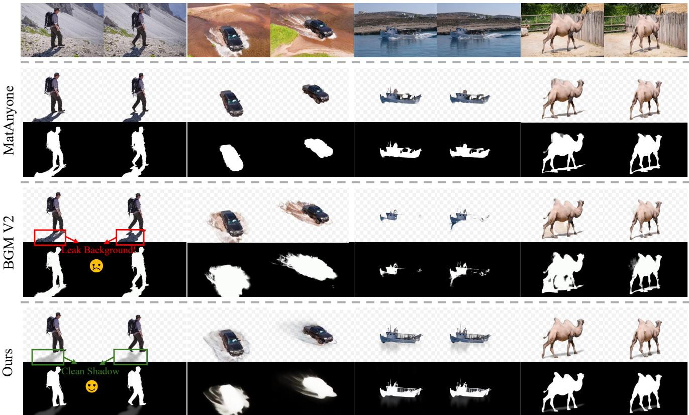  
Figure 6. Qualitative comparisons with learning-based matting method [20, 47]. Please zoom in for a better view.

## 4.2. Ablation Study

Effectiveness of different attention masking strategies. Figure 7 shows the results under different self-attention mask configurations. As shown in (a), allowing unrestricted communication between the branch tokens during inference leads

Table 1. Quantitative comparion with baselines. Notice that the BGM V2 and MatAnyone are not specifically for associated effects. † indicates cooperation with the shadow detection method [43].

<table><tr><td>Method</td><td>PSNR (↑)</td><td>SSIM (↑)</td><td>WE(↓)</td><td>FVD (↓)</td></tr><tr><td>BGM V2 [20]</td><td>26.61</td><td>78.78</td><td>101.04</td><td>168.31</td></tr><tr><td>MatAnyone† [47]</td><td>26.12</td><td>78.68</td><td>100.46</td><td>146.44</td></tr><tr><td>Gen-Omnimatte [15]</td><td>24.35</td><td>69.36</td><td>101.33</td><td>116.32</td></tr><tr><td>EasyOmnimatte(Ours)</td><td>26.23</td><td>78.83</td><td>100.94</td><td>105.48</td></tr></table>

Table 2. User Studies. Human evaluation of different video generation methods across multiple aspects. Scores range from 0 to 5, with higher scores indicating better performance. Bold values represent the best performance within each metric. † indicates cooperation with the shadow detection method [43].
<table><tr><td>Method</td><td>Overall Score ↑</td><td>Foreground Integrity ↑</td><td>Effect Harmony ↑</td><td>Temporal Consistency ↑</td></tr><tr><td>BGM-V2</td><td>2.26</td><td>1.78</td><td>2.96</td><td>2.04</td></tr><tr><td>MatAnyone†</td><td>2.82</td><td>2.83</td><td>2.60</td><td>3.02</td></tr><tr><td>Gen-Omnimatte</td><td>2.85</td><td>2.45</td><td>3.36</td><td>2.74</td></tr><tr><td>EasyOmnimatte(Ours)</td><td>4.08</td><td>4.07</td><td>3.97</td><td>4.21</td></tr></table>

to a corrupted background prediction, which in turn degrades the final foreground decomposition. Conversely, as seen in (b), preserving only the alpha-to-background attention path enhances the effect expert to perceive object-associated effects. However, this masking setup fails to resolve the poor quality of the alpha matte predicted by the Effect Expert. We attribute this issue to the masking strategy itself, rather than to the partial application of LoRA on only a subset of

(b) Inital Stage Only

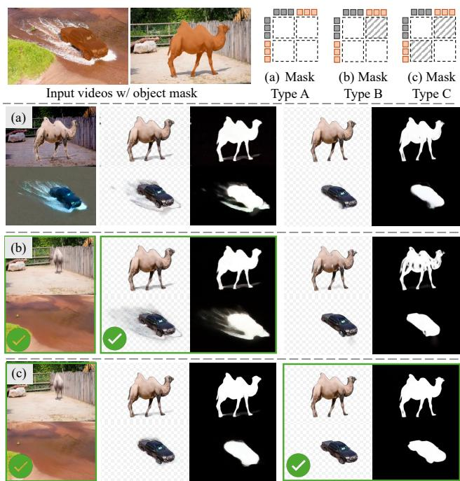  
Background  
Effect Expert  
Quality Expert  
Figure 7. Ablation of Attention Masking. Training without the correct self-attention mask configuration renders both the Effect Expert and the Matting Expert ineffective. We use Mask type B and Mask type C for Effect Expert Quality Expert, respectively.

the Effect Expert's blocks. This is evidenced by the Quality Expert, which, despite being fine-tuned with LoRA across all blocks, also yields unsatisfactory results under the identical mask configuration. Therefore, our final strategy is to train the branches in complete isolation and then use the mask in (c) during inference. With this masking constraint, training the Quality Expert is equivalent to fine-tuning the inpainting model. Without being influenced by the frozen inpainting branch, the Quality Expert can quickly fit the matting data and form high-quality alpha mattes. However, the trade-off is that the Quality Expert remains incapable of perceiving effects, further highlighting the expert sample strategy.

Ablation of Branch DiT Placement. We experiment with modifying the Branch DiT Block to different inpainting stages in Fig.8 (a-c). Our finding is consistent with the conclusion from our analysis: applying LoRA to the later layers, which are responsible for suppressing effects, yields the most significant improvement in effect preservation.

Validation of the Dual Expert Strategy. We compare our full method against two primary variants in Fig.8: (d) using only the Effect Expert for the entire generation process, and (e) using only the Quality Expert. The results show that the Quality Expert achieves high precision on the main foreground but fails on effects, while the Effect Expert is strong on effects but sacrifices boundary precision. Our full model, which combines them via the hybrid diffusion sampling strategy, combines both of the advantages.

Effect of different timestep threshold τ. To further investigate the impact of the τ in our Dual Experts Sampling strategy, we perform a quantitative analysis on a synthetic validation set. This set is generated by augmenting the test set of VideoMatte240K [20] with the pseudo-shadow augmentation method. We use the Mean Squared Error (MSE) metric to separately assess the quality of the predicted foreground subject and the captured effects. The results of this analysis are visualized in Figure 9.

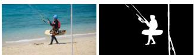  
(a) Input Frame & Mask

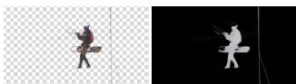

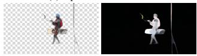

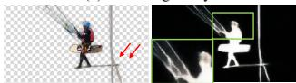

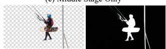  
(d) Final Stage Only (Effect Expert)  
(e) Quality Expert Only

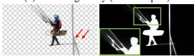  
(f) Our Full Method

Figure 8. Dual Expert Sampling Strategy. We only add LoRA to the final stage to keep the prediction of the effects, and our full dual expert strategy further improves the matting quality.  
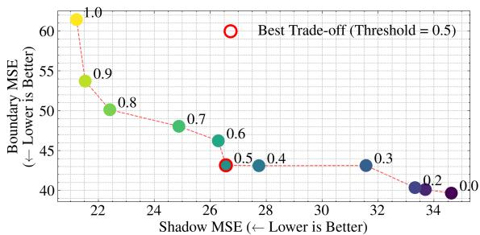  
Figure 9. Effect of varying threshold τ.By default, we set τ = 0.5 for a balanced outcome, but users can decrease it for higher matting precision or increase it for more prominent associated effects.

## 5. Conclusion

We introduce EasyOmnimatte, a novel, end-to-end framework for video omnimatte, that is capable of capturing complex foreground-associated effects with ease. Our key idea is to repurpose a powerful video inpainting model that has been proofed to be capable of perceiving the associated effects. Nonetheless, a trivial setup that directly apply LoRA to all DiT blocks fails to capture the effects. We analyze the source of this failure and, consequently, propose the Dual Expert matting strategy. This strategy successfully captures the associated effects while simultaneously producing high-quality alpha matting. Our work establishes a new and highly effective paradigm for adapting large-scale generative models to complex, detailed video decomposition tasks.

Limitations and Future Work. While our method demonstrates superior omnimatte performance, it is intrinsically linked to the capabilities of the base inpainting model. For future work, we will implement our block-wise analysis and adaptation framework to diverse generative models.

## Acknowledgements

This work was financially supported in part by National Natural Science Foundation of China (Project No. 62506064) and Guangdong Provincial Regional Joint Fund (Project No. 2024A1515110052). The computational resources are supported by SongShan Lake HPC Center (SSL-HPC) in Great Bay University.

## References

[1] Edward H Adelson. Layered representations for vision and video. In Proceedings IEEE Workshop on Representation of Visual Scenes (In Conjunction with ICCV'95), pages 3–9. IEEE, 1995. 3

[2] Andreas Blattmann, Tim Dockhorn, Sumith Kulal, Daniel Mendelevitch, Maciej Kilian, Dominik Lorenz, Yam Levi, Zion English, Vikram Voleti, Adam Letts, et al. Stable video diffusion: Scaling latent video diffusion models to large datasets. arXiv preprint arXiv:2311.15127, 2023. 3

[3] Gabriel J Brostow and Irfan A Essa. Motion based decompositing of video. In Proceedings of the Seventh IEEE International Conference on Computer Vision, volume 1, pages 8–13. IEEE, 1999. 3

[4] Ya-Liang Chang, Zhe Yu Liu, Kuan-Ying Lee, and Winston Hsu. Free-form video inpainting with 3d gated convolution and temporal patchgan. In Proceedings of the IEEE/CVF international conference on computer vision, pages 9066– 9075,2019.3

[5] Haoxin Chen, Yong Zhang, Xiaodong Cun, Menghan Xia, Xintao Wang, Chao Weng, and Ying Shan. Videocrafter2: Overcoming data limitations for high-quality video diffusion models. In Proceedings of the IEEE/CVF Conference on Computer Vision and Pattern Recognition, pages 7310–7320, 2024.3

[6] Rohit Girdhar, Mannat Singh, Andrew Brown, Quentin Duval, Samaneh Azadi, Sai Saketh Rambhatla, Akbar Shah, Xi Yin, Devi Parikh, and Ishan Misra. Emu video: Factorizing textto-video generation by explicit image conditioning. arXiv preprint arXiv:2311.10709, 2023.3

[7] Zeqi Gu, Wenqi Xian, Noah Snavely, and Abe Davis. Factormatte: Redefining video matting for re-composition tasks. ACM Transactions on Graphics (TOG), 42(4):1–14, 2023. 3

[8] Yoav HaCohen, Nisan Chiprut, Benny Brazowski, Daniel Shalem, Dudu Moshe, Eitan Richardson, Eran Levin, Guy Shiran, Nir Zabari, Ori Gordon, et al. Ltx-video: Realtime video latent diffusion. arXiv preprint arXiv:2501.00103, 2024. 3

[9] Jonathan Ho, William Chan, Chitwan Saharia, Jay Whang, Ruiqi Gao, Alexey Gritsenko, Diederik P Kingma, Ben Poole, Mohammad Norouzi, David J Fleet, et al. Imagen video: High definition video generation with diffusion models. arXiv preprint arXiv:2210.02303, 2022. 3

[10] Edward J Hu, Yelong Shen, Phillip Wallis, Zeyuan Allen-Zhu, Yuanzhi Li, Shean Wang, Lu Wang, Weizhu Chen, et al. Lora: Low-rank adaptation of large language models. ICLR, 1(2):3, 2022. 2, 3, 12

[11] Yihan Hu, Yiheng Lin, Wei Wang, Yao Zhao, Yunchao Wei, and Humphrey Shi. Diffusion for natural image matting. In

European Conference on Computer Vision, pages 181–199. Springer, 2024. 3

[12] Chuong Huynh, Seoung Wug Oh, Abhinav Shrivastava, and Joon-Young Lee. Maggie: Masked guided gradual human instance matting. In Proceedings of the IEEE/CVF Conference on Computer Vision and Pattern Recognition, pages 3870–3879, 2024.3

[13] Zhanghan Ke, Jiayu Sun, Kaican Li, Qiong Yan, and Rynson WH Lau. Modnet: Real-time trimap-free portrait matting via objective decomposition. In Proceedings of the AAAI Conference on Artificial Intelligence, volume 36, pages 1140– 1147,2022.3

[14] Weijie Kong, Qi Tian, Zijian Zhang, Rox Min, Zuozhuo Dai, Jin Zhou, Jiangfeng Xiong, Xin Li, Bo Wu, Jianwei Zhang, et al. Hunyuanvideo: A systematic framework for large video generative models. arXiv preprint arXiv:2412.03603, 2024. 3

[15] Yao-Chih Lee, Erika Lu, Sarah Rumbley, Michal Geyer, Jia-Bin Huang, Tali Dekel, and Forrester Cole. Generative omnimatte: Learning to decompose video into layers. In Proceedings of the Computer Vision and Pattern Recognition Conference, pages 12522–12532, 2025. 1, 2, 3, 4, 6, 7, 12

[16] Xiaowen Li, Haolan Xue, Peiran Ren, and Liefeng Bo. Diffueraser: A diffusion model for video inpainting. arXiv preprint arXiv:2501.10018, 2025. 3

[17] Zhen Li, Cheng-Ze Lu, Jianhua Qin, Chun-Le Guo, and Ming-Ming Cheng. Towards an end-to-end framework for flowguided video inpainting. In Proceedings of the IEEE/CVF conference on computer vision and pattern recognition, pages 17562–17571, 2022. 3

[18] Bin Lin, Yunyang Ge, Xinhua Cheng, Zongjian Li, Bin Zhu, Shaodong Wang, Xianyi He, Yang Ye, Shenghai Yuan, Liuhan Chen, et al. Open-sora plan: Open-source large video generation model. arXiv preprint arXiv:2412.00131, 2024. 6

[19] Geng Lin, Chen Gao, Jia-Bin Huang, Changil Kim, Yipeng Wang, Matthias Zwicker, and Ayush Saraf. Omnimatterf: Robust omnimatte with 3d background modeling. In Proceedings of the IEEE/CVF International Conference on Computer Vision, pages 23471–23480, 2023. 3, 6

[20] Shanchuan Lin, Andrey Ryabtsev, Soumyadip Sengupta, Brian L Curless, Steven M Seitz, and Ira Kemelmacher-Shlizerman. Real-time high-resolution background matting. In Proceedings of the IEEE/CVF Conference on Computer Vision and Pattern Recognition, pages 8762–8771, 2021. 3, 6, 7,8, 12

[21] Shanchuan Lin, Linjie Yang, Imran Saleemi, and Soumyadip Sengupta. Robust high-resolution video matting with temporal guidance. In Proceedings of the IEEE/CVF Winter Conference on Applications of Computer Vision, pages 238– 247, 2022.3, 12

[22] Yaron Lipman, Ricky TQ Chen, Heli Ben-Hamu, Maximilian Nickel, and Matt Le. Flow matching for generative modeling arXiv preprint arXiv:2210.02747, 2022. 12

[23] Rui Liu, Hanming Deng, Yangyi Huang, Xiaoyu Shi, Lewei Lu, Wenxiu Sun, Xiaogang Wang, Jifeng Dai, and Hongsheng Li. Fuseformer: Fusing fine-grained information in transformers for video inpainting. In Proceedings of the IEEE/CVF international conference on computer vision, pages 14040– 14049,2021.3

[24] Yixin Liu, Kai Zhang, Yuan Li, Zhiling Yan, Chujie Gao,

Ruoxi Chen, Zhengqing Yuan, Yue Huang, Hanchi Sun, Jianfeng Gao, et al. Sora: A review on background, technology, limitations, and opportunities of large vision models. arXiv preprint arXiv:2402.17177, 2024. 3

[25] Ilya Loshchilov and Frank Hutter. Decoupled weight decay regularization. arXiv preprint arXiv:1711.05101, 2017. 6

[26] Erika Lu, Forrester Cole, Tali Dekel, Weidi Xie, Andrew Zisserman, David Salesin, William T Freeman, and Michael Rubinstein. Layered neural rendering for retiming people in video. arXiv preprint arXiv:2009.07833, 2020. 3, 6

[27] Erika Lu, Forrester Cole, Tali Dekel, Andrew Zisserman, William T Freeman, and Michael Rubinstein. Omnimatte: Associating objects and their effects in video. In Proceedings of the IEEE/CVF Conference on Computer Vision and Pattern Recognition, pages 4507–4515, 2021. 2, 3, 6

[28] Erika Lu, Forrester Cole, Weidi Xie, Tali Dekel, Bill Freeman, Andrew Zisserman, and Michael Rubinstein. Associating objects and their effects in video through coordination games. Advances in Neural Information Processing Systems, 35:27049–27060, 2022. 3

[29] William Peebles and Saining Xie. Scalable diffusion models with transformers. In Proceedings of the IEEE/CVF international conference on computer vision, pages 4195–4205, 2023.12

[30] Jordi Pont-Tuset, Federico Perazzi, Sergi Caelles, Pablo Arbeláez, Alex Sorkine-Hornung, and Luc Van Gool. The 2017 davis challenge on video object segmentation. arXiv preprint arXiv:1704.00675,2017.6

[31] Thomas Porter and Tom Duff. Compositing digital images. In Proceedings of the 11th annual conference on Computer graphics and interactive techniques, pages 253–259, 1984. 3

[32] Yu Qiao, Yuhao Liu, Xin Yang, Dongsheng Zhou, Mingliang Xu, Qiang Zhang, and Xiaopeng Wei. Attention-guided hierarchical structure aggregation for image matting. In Proceedings of the IEEE/CVF Conference on Computer Vision and Pattern Recognition, pages 13676–13685, 2020. 3

[33] Nikhila Ravi, Valentin Gabeur, Yuan-Ting Hu, Ronghang Hu, Chaitanya Ryali, Tengyu Ma, Haitham Khedr, Roman Rädle, Chloe Rolland, Laura Gustafson, Eric Mintun, Junting Pan, Kalyan Vasudev Alwala, Nicolas Carion, Chao-Yuan Wu, Ross Girshick, Piotr Dollár, and Christoph Feichtenhofer. Sam 2: Segment anything in images and videos. arXiv preprint arXiv:2408.00714, 2024. 4, 6

[34] Dvir Samuel, Matan Levy, Nir Darshan, Gal Chechik, and Rami Ben-Ari. Omnimattezero: Fast training-free omnimatte with pre-trained video diffusion models. In Proceedings of the SIGGRAPH Asia 2025 Conference Papers, pages 1–11, 2025.3

[35] Soumyadip Sengupta, Vivek Jayaram, Brian Curless, Steven M Seitz, and Ira Kemelmacher-Shlizerman. Background matting: The world is your green screen. In Proceedings of the IEEE/CVF Conference on Computer Vision and Pattern Recognition, pages 2291–2300, 2020. 3

[36] Mohammed Suhail, Erika Lu, Zhengqi Li, Noah Snavely, Leonid Sigal, and Forrester Cole. Omnimatte3d: Associating objects and their effects in unconstrained monocular video. In Proceedings of the IEEE/CVF Conference on Computer Vision and Pattern Recognition, pages 630–639, 2023. 3

[37] Yanan Sun, Guanzhi Wang, Qiao Gu, Chi-Keung Tang, and

Yu-Wing Tai. Deep video matting via spatio-temporal alignment and aggregation. In Proceedings of the IEEE/CVF Conference on Computer Vision and Pattern Recognition, pages 6975–6984, 2021. 3

[38] Team Wan, Ang Wang, Baole Ai, Bin Wen, Chaojie Mao, Chen-Wei Xie, Di Chen, Feiwu Yu, Haiming Zhao, Jianxiao Yang, et al. Wan: Open and advanced large-scale video generative models. arXiv preprint arXiv:2503.20314, 2025. 3, 6, 12

[39] Chuan Wang, Haibin Huang, Xiaoguang Han, and Jue Wang. Video inpainting by jointly learning temporal structure and spatial details. In Proceedings of the AAAI conference on artificial intelligence, volume 33, pages 5232–5239, 2019. 3

[40] Jue Wang, Michael F Cohen, et al. Image and video matting: a survey. Foundations and Trends® in Computer Graphics and Vision, 3(2):97–175, 2008. 3

[41] John YA Wang and Edward H Adelson. Representing moving images with layers. IEEE transactions on image processing, 3(5):625–638, 1994. 3

[42] Luozhou Wang, Yijun Li, Zhifei Chen, Jui-Hsien Wang, Zhifei Zhang, He Zhang, Zhe Lin, and Ying-Cong Chen. Transpixeler: Advancing text-to-video generation with transparency. In Proceedings of the Computer Vision and Pattern Recognition Conference, pages 18229–18239, 2025. 4

[43] Tianyu Wang, Xiaowei Hu, Pheng-Ann Heng, and Chi-Wing Fu. Instance shadow detection with a single-stage detector. IEEE Transactions on Pattern Analysis and Machine Intelligence, pages 1–14, 2022. 6, 7

[44] Zhixiang Wang, Baiang Li, Jian Wang, Yu-Lun Liu, Jinwei Gu, Yung-Yu Chuang, and Shin'Ichi Satoh. Matting by generation. In ACM SIGGRAPH 2024 Conference Papers, pages 1–11,2024.3

[45] Daniel Winter, Matan Cohen, Shlomi Fruchter, Yael Pritch, Alex Rav-Acha, and Yedid Hoshen. Objectdrop: Bootstrapping counterfactuals for photorealistic object removal and insertion. In European Conference on Computer Vision, pages 112–129. Springer, 2024. 2, 3, 4

[46] Ning Xu, Brian Price, Scott Cohen, and Thomas Huang. Deep image matting. In Proceedings of the IEEE conference on computer vision and pattern recognition, pages 2970–2979, 2017.3

[47] Peiqing Yang, Shangchen Zhou, Jixin Zhao, Qingyi Tao, and Chen Change Loy. Matanyone: Stable video matting with consistent memory propagation. In Proceedings of the Computer Vision and Pattern Recognition Conference, pages 7299–7308, 2025.3,6,7

[48] Zhuoyi Yang, Jiayan Teng, Wendi Zheng, Ming Ding, Shiyu Huang, Jiazheng Xu, Yuanming Yang, Wenyi Hong, Xiaohan Zhang, Guanyu Feng, et al. Cogvideox: Text-to-video diffusion models with an expert transformer. arXiv preprint arXiv:2408.06072, 2024. 3

[49] Jingfeng Yao, Xinggang Wang, Shusheng Yang, and Baoyuan Wang. Vitmatte: Boosting image matting with pre-trained plain vision transformers. Information Fusion, 103:102091, 2024.3

[50] Vickie Ye, Zhengqi Li, Richard Tucker, Angjoo Kanazawa, and Noah Snavely. Deformable sprites for unsupervised video decomposition. In Proceedings of the IEEE/CVF Conference on Computer Vision and Pattern Recognition, pages 2657–

2666, 2022.3

[51] Qihang Yu, Jianming Zhang, He Zhang, Yilin Wang, Zhe Lin, Ning Xu, Yutong Bai, and Alan Yuille. Mask guided matting via progressive refinement network. In Proceedings of the IEEE/CVF conference on computer vision and pattern recognition, pages 1154–1163, 2021. 3

[52] Xin Yu, Tianyu Wang, Soo Ye Kim, Paul Guerrero, Xi Chen, Qing Liu, Zhe Lin, and Xiaojuan Qi. Objectmover: Generative object movement with video prior. In Proceedings of the Computer Vision and Pattern Recognition Conference, pages 17682–17691, 2025. 2, 3

[53] Yongsheng Yu, Ziyun Zeng, Haitian Zheng, and Jiebo Luo. Omnipaint: Mastering object-oriented editing via disentangled insertion-removal inpainting. arXiv preprint arXiv:2503.08677, 2025. 2, 3

[54] Kaidong Zhang, Jingjing Fu, and Dong Liu. Flow-guided transformer for video inpainting. In European conference on computer vision, pages 74–90. Springer, 2022. 3

[55] Lvmin Zhang and Maneesh Agrawala. Transparent image layer diffusion using latent transparency. arXiv preprint arXiv:2402.17113, 2024. 4

[56] Shangchen Zhou, Chongyi Li, Kelvin CK Chan, and Chen Change Loy. Propainter: Improving propagation and transformer for video inpainting. In Proceedings of the IEEE/CVF international conference on computer vision, pages 10477–10486, 2023. 3

[57] Bojia Zi, Weixuan Peng, Xianbiao Qi, Jianan Wang, Shihao Zhao, Rong Xiao, and Kam-Fai Wong. Minimax-remover: Taming bad noise helps video object removal. arXiv preprint arXiv:2505.24873, 2025.3