# MatAnyone 2: Scaling Video Matting via a Learned Quality Evaluator

Peiqing Yang1 Shangchen Zhou¹† Kai Hao1 Qingyi Tao²2 1S-Lab, Nanyang Technological University 2SenseTime Research, Singapore https://pq-yang.github.io/projects/MatAnyone2/

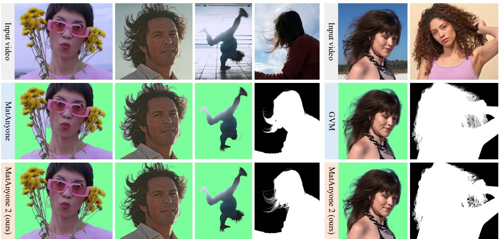  
Figure 1. (a) Our MatAnyone 2 significantly outperforms MatAnyone [39] in preserving fine details and avoiding segmentation-like boundaries, while also showing enhanced robustness under challenging lighting conditions, e.g., backlit scenes. (b) As a diffusion-based video matting method, GVM [5] often produces blurry alpha mattes with unnatural transitions along object boundaries, e.g., hair strands In contrast, MatAnyone 2 generates clear, high-quality alpha mattes with natural boundary details. (Zoom-in for best view)

## Abstract

Video matting remains limited by the scale and realism of existing datasets. While leveraging segmentation data can enhance semantic stability, the lack of effective boundary supervision often leads to segmentation-like mattes lacking fine details. To this end, we introduce a learned Matting Quality Evaluator (MQE) that assesses semantic and boundary quality of alpha mattes without ground truth. It produces a pixel-wise evaluation map that identifies reliable and erroneous regions, enabling ine-grained quality assessment. The MQE scales up video matting in two ways: (1) as an online matting-quality feedback during training to suppress erroneous regions, providing comprehensive supervision, and (2) as an offline selection module for data curation, improving annotation quality by combining the strengths of leading video and image matting models. This

process allows us to build a large-scale real-world video matting dataset, VMReal, containing 28K clips and 2.4M frames. To handle large appearance variations in long videos, we introduce a reference-frame training strategy that incorporates long-range frames beyond the local window for effective training. Our MatAnyone 2 achieves stateof-the-art performance on both synthetic and real-world benchmarks, surpassing prior methods across all metrics

## 1. Introduction

Video matting (VM) has gained increasing attention for its broad applications in visual effects and video editing. Despite recent advances [5, 7, 8, 17, 19, 39], existing methods still suffer from blurry boundaries, missing regions, and unstable tracking. A key underlying reason is the limited scale, quality, and realism of existing VM datasets. The recent VM800 dataset [39] provides the largest collection of video foregrounds, but it contains only 826 sequences (\~ 1/60 the size of the video object segmentation (VOS) dataset used in SAM 2 [27]). To enrich training samples, existing pipelines typically composite foregrounds onto random backgrounds via RGBA blending. However, such synthetic data often exhibit inconsistent lighting and unnatural boundaries, leading to a domain gap from real videos that limits model generalization in challenging cases.

To alleviate data limitations, recent video matting methods have explored leveraging segmentation priors from pretrained models and large-scale VOS data. (1) Pretraining. Some works employ segmentation models [8] or data [5, 17, 44] for pretraining, followed by finetuning on matting datasets. However, the limited availability of highquality matting data often causes the pretrained segmentation capability to degrade during finetuning. (2) Jointtraining. Some studies [7, 19, 39] instead combine segmentation and matting supervision within a unified framework, enabling the model to learn both tasks simultaneously. However, segmentation data can only provide reliable supervision for non-boundary regions (where alpha values are 0 or 1). For boundary regions, MatAnyone [39] applies an unsupervised loss [22] that relies on a strong assumption, leading to weak boundary supervision. While this enhances semantic and tracking accuracy, it often causes the predicted mattes degrade into segmentation-like masks, especially around boundaries (see Fig. 1). These methods seek an optimal trade-off between matting and segmentation through balanced data and loss, yet simultaneously improving semantic accuracy and boundary details remains highly challenging.

To this end, we introduce a novel Matting Quality Evaluator (MQE) that mitigates the long-standing shortage of real VM data and effectively harnesses segmentation information. This evaluator operates in two modes: (i) an online matting-quality guidance during training, and (ii) an offline pixel-wise selection module for data curation, which together scale up video matting training. Given an input frame, its segmentation mask, and the predicted alpha matte, the evaluator produces a binary evaluation map that identifies “reliable" vs. “erroneous" regions. It implicitly inherits the binary labels of non-boundary regions from the input segmentation masks, while assessing fine-detail matting quality in boundary regions leveraging a DINOv3- based encoder [30]. This enables the learned MQE to accurately identify inaccurate or low-quality alpha predictions in a pixel-wise manner, thereby providing a comprehensive assessment of both semantic accuracy and detail fidelity (see Fig. 4), without requiring ground-truth mattes.

Online Guidance - MQE serves as an online guidance signal that provides dynamic supervision through its on-the-fly quality assessment. Specifically, its binary evaluation map acts as a penalty map that encourages the network to correct errors in the erroneous regions. Operating without groundtruth mattes (requiring only segmentation masks), MQE offers effective boundary supervision for rich segmentation data, thereby enabling large-scale training for matting.

Offline Selection - MQE also serves as an offline selection module for scalable curation of a real-world video matting dataset. Manual annotation of video alpha mattes is extremely challenging, if not impossible at scale, leaving such a dataset long absent and hindering progress in this field. To overcome this, we design an automated dualbranch annotation pipeline, where MQE acts as a quality arbiter to assess and fuse predictions from two complementary methods: state-of-the-art video and image matting models, which excel in semantic stability and boundary detail, respectively. By selecting reliable regions from each, the MQE combines their strengths, yielding annotation with both stable semantics and high-quality details. This pipeline constructs VMReal, a large-scale and real-world video matting dataset with about 28K clips (\~ 35× larger than previous dataset [39]) and 2.4M annotated frames covering diverse scenes, lighting conditions, and motion patterns.

Moreover, in long videos where subject appearance varies largely over time, propagation-based methods like MatAnyone [39] may fail to matte out new human or clothing parts unseen in earlier frames. Training on short sequences cannot model such variations, while long sequences lead to excessive memory overhead. To address this, we introduce a reference-frame strategy that incorporates long-range frames beyond the local training window, enabling the model to handle large appearance changes across long videos without large memory costs.

In summary, our main contributions are as follows:

• We present a learned MQE that performs semantic and detail assessment of predicted mattes without ground truth. It functions as both an online guidance signal for training and an offline selection module for data curation, effectively scaling up video matting.

• Leveraging the MQE, we construct VMReal, a largescale, scene-diverse, and real-world video matting dataset, with about 28K clips and 2.4M annotated frames.

• We introduce a reference-frame training strategy that expands the temporal context, allowing our method to handle large appearance variations in long videos efficiently.

Together, these contributions lead to MatAnyone 2, which achieves superior results on both synthetic and real-world benchmarks, surpassing existing methods across all metrics.

## 2. Related Work

Video Matting. In the absence of auxiliary inputs [9, 13, 19, 24, 25, 45, 49], VM often becomes object-specific, with human video matting [5, 9, 13, 29, 49] being the most widely studied due to its strong real-world applicability. Nevertheless, these approaches tend to fail in challenging backgrounds when other visually similar objects appear in the scene. Recent progress in promptable segmentation [10, 27, 47, 50] has enabled human masks to be obtained with minimal effort, inspiring a series of mask-guided image [2, 15, 41–43] and video matting methods [7, 8, 14, 17, 39, 44] that incorporate segmentation priors for improved robustness across scenes. With the emergence of video diffusion models [1, 40], several recent studies have replaced traditional CNN backbones with diffusion networks [5, 38], reframing video matting as a generation problem. For example, GVM [5] leverages rich priors from a pretrained video diffusion model [1] by conditioning on the input video. Although the diffusion prior provides robustness, GVM still yields blurry alpha mattes, revealing its limitation imposed by suboptimal training data.

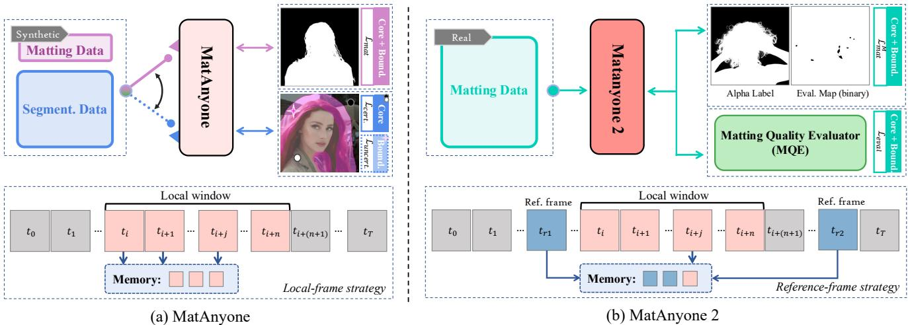  
Figure 2. Comparison of MatAnyone and MatAnyone 2. (a) MatAnyone [39] compensates for limited VM data by leveraging segmentation supervision, which provides reliable core-region guidance $( \mathcal { L } _ { c e r t . } )$ but weak boundary supervision $( \mathcal { L } _ { u n c e r t . } )$ , leading to segmentation-like mattes. Its memory is restricted to the local training window, limiting its ability to model large appearance changes. (b) MatAnyone 2 is trained with our real-world VMReal dataset, where each alpha label is paired with a binary evaluation map. This enables masked matting loss $\mathcal { L } _ { m a t } ^ { M }$ on reliable pixels, while the learned MQE supplies $\mathcal { L } _ { e v a l }$ to supervise both core and boundary regions. For large variations, a reference-frame strategy adds long-range temporal cues, improving robustness to large appearance changes without extra memory cost.

Video Matting and Segmentation Datasets. Existing video matting datasets [5, 8, 18, 32, 38, 39, 46] suffer from limited scale, quality, and realism, which significantly constrain model performance and generalization. Although recent efforts such as VM800 [39] have expanded data scale and quality compared to VideoMatte240K [18], and GVM [5] constructs high-fidelity 4K rendered clips, these datasets remain synthetic and are still much smaller than large-scale video object segmentation (VOS) datasets [27, 35]. For instance, the SA-V dataset used by SAM 2 [27] is roughly 60 times larger than VM800 and contains diverse real-world videos with dense annotations. While real-world image matting datasets such as P3M-10k [11], D646 [24], and AIM [12] are available, they are limited in scale and, when used for training alone, can harm the temporal consistency of video matting models. In this work, we construct VMReal, a large-scale real-world video matting dataset, to address the data deficiency in the video matting field.

Quality Assessment for Data Curation. Due to the high cost of manual annotation, large-scale datasets often rely on model-assisted or fully automated labeling pipelines. Recent works in image generation [21, 23, 31, 33] and restoration [3, 34] employ image quality assessment (IQA) models to construct better-worse data pairs within the Direct Preference Optimization (DPO) framework, guiding models toward perceptually better results. Also, automatic quality evaluation has been explored in low-level vision tasks [3, 16, 34, 37]. For instance, Depth Anything V2 [37] integrates multi-model voting with selective human verification to ensure annotation reliability, and RORem [16] leverages human feedback to train a discriminator for automatic high-quality sample selection. These methods assess quality at the image level, whereas video matting demands pixel-level and temporally consistent evaluation, motivating our design of a learned MQE for constructing a large-scale video matting dataset.

## 3. Methodology

In this study, our goal is to scale up video matting with both high semantic accuracy and fne boundary fdelity. Previous work, MatAnyone [39], improves video matting by jointly training with segmentation data (Fig. 2(a)) through an improved supervision structure and loss design. However, segmentation data can only provide reliable supervision for non-boundary regions, while boundary regions are weakly constrained by an unsupervised loss. Although this improves semantic accuracy, it inevitably degrades boundary fidelity, resulting in segmentation-like mattes (see Fig. 1). To this end, we propose MatAnyone 2 (Fig. 2(b)), featuring a novel MQE. The MQE provides effective supervision for both non-boundary and boundary regions, without requiring matting ground truth. Moreover, MQE facilitates the construction of a large-scale real-world video matting dataset, allowing VM models to be effectively trained on high-quality matting data. Thanks to the improved supervision and training data brought by $\mathrm { M Q E } ,$ MatAnyone 2 achieves higher semantic accuracy while preserving fine boundary details.

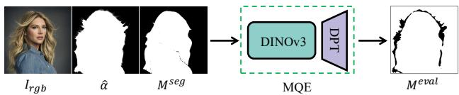  
Figure 3. Given an input tuple of video frame $I _ { r g b } ,$ predicted alpha , and segmentation mask $M ^ { s e g }$ , MQE produces a binary evaluation map ${ \dot { M } } ^ { e v a l }$ at the pixel-wise level (1: reliable, 0: erroneous).

In the following sections, we first introduce the training of the MQE model (Sec. 3.1), followed by its two roles for scaling up video matting: (i) an online matting-quality guidance during training (Sec. 3.2), and (ii) an offline pixelwise selection module for data curation (Sec. 3.3). Finally, we present a reference-frame training strategy that incorporates long-range frames to efficiently handle large appearance variations in long videos (Sec. 3.4).

## 3.1. Quality Evaluation Model

We aim to develop a reliable and pixel-wise MQE model that has the potential to provide effective matting-quality feedback during training while also assisting in data curation. As shown in Fig. 3, our MQE network receives a tuple input ${ \cal I } _ { i n } ^ { e v a l } : = < { \cal I } _ { r g b } , \hat { \alpha } , { \cal M } ^ { s e g } >$ , consisting of the video frame, predicted alpha matte, and segmentation mask, and produces a binary evaluation map $M ^ { e v a l } \ \in \ \{ 0 , 1 \} ^ { H \times W }$ where 1 and 0 indicate reliable and erroneous regions, respectively.

Providing the segmentation mask as an auxiliary input is crucial for achieving reliable matting quality evaluation. As shown in Fig. 4(b), for non-boundary regions, the learned MQE tends to inherit semantic cues from the segmentation mask, allowing it to easily identify foreground and background areas. For boundary regions, the MQE leverages the segmentation map to guide its attention toward fine-grained matting quality, such as hair mattes in Fig. 4(a). Moreover, as our MQE employs DINOv3 [30] as the encoder, it benefits from the rich and high-quality features, enabling it to effectively perceive and identify inaccurate or low-quality alpha predictions.

Training and Data for MQE. We formulate MQE learning as a binary segmentation task. To train such a model, we require a binary ground-truth map $M _ { g t } ^ { e v a l } \in \{ 0 , 1 \} ^ { H \times W }$ for evaluating an alpha prediction $\hat { \alpha } ,$ which does not naturally exist. Therefore, we construct training pairs using the existing image matting dataset P3M-10k [11], which provides human-annotated alpha mattes $\alpha _ { g t }$ corresponding to images $I _ { r g b }$ To evaluate $\hat { \alpha }$ against $\alpha _ { g t }$ and generate $M _ { g t } ^ { e v a l }$ , we design a discrepancy measure $\mathcal { D } ( \cdot )$ that computes a weighted combination of standard video matting metrics (MAD and Grad) within local patches. This measure effectively captures both semantic- and detail-level deviations. Specifically, the ground-truth evaluation map is defined as $M _ { g t } ^ { e v a l } = \mathbb { I } \big ( { \cal D } ( \alpha _ { g t } , \hat { \alpha } ) < \delta \big )$ , where $\mathbb { I } ( \cdot )$ denotes the indicator function and δ is a threshold. Since erroneous regions primarily occur around boundaries, class 1 (reliable regions) dominate class 0 (erroneous regions) in the training data, resulting in class imbalance. To mitigate this, we adopt the focal loss [20] to emphasize hard erroneous regions during training.

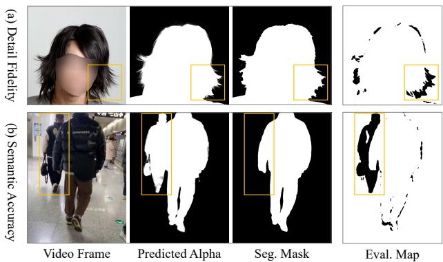  
Figure 4. Our learned Matting Quality Evaluation (MQE) model accurately identifies: (a) low-quality matting details along the boundary, and (b) semantically wrong regions at core areas, in a pixel-wise manner without requiring ground-truth mattes.

## 3.2. Online Matting-quality Guidance

Thanks to the pixel-wise quality evaluation provided by the learned MQE model, we leverage it as a matting-quality feedback signal during training, where its on-the-fly assessment offers dynamic online supervision, as shown in Fig. 2(b). For each input frame, the MQE first produces a probability map $P _ { e v a l } ^ { ( 0 ) }$ that indicates the likelihood of error for its alpha prediction in a pixel-wise manner, without requiring ground-truth alpha mattes. This map can serve as a penalty mask to guide the network in suppressing erroneous regions. The online guidance loss is defined as:

$$
\mathcal { L } _ { e v a l } = \| P _ { e v a l } ^ { ( 0 ) } \| _ { 1 } ,\tag{1}
$$

which encourages lower error probabilities and thus more accurate alpha predictions. Compared to the weak unsupervised loss used in MatAnyone [39], our MQE-based guidance loss $\mathcal { L } _ { e v a l }$ provides a more effective and stable learning signal for boundary regions (see Table 3(b)), enabling large-scale video matting training with unlabeled videos.

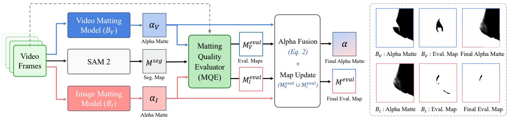  
Figure 5. Our automated dual-branch annotation pipeline. This pipeline enables large-scale construction of real-world VM datasets, resulting in our VMReal dataset. We combine two complementary annotation branches: the temporally stable $B _ { V }$ branch provides the base annotation, while the detail-preserving $B _ { I }$ branch offers fine boundary details. Pixels where $B _ { V }$ fails but $B _ { I }$ succeeds are selectively integrated to produce the fused alpha and its evaluation map. The example on the right shows that the fused annotation preserves semantic stability as well as rich boundary details, making it suitable for VM training.

## 3.3. Offline Pixel-wise Selection

Beyond using MQE as matting-quality guidance during training, we further employ it to directly construct a largescale, high-quality, real-world video matting dataset with detailed alpha annotations. Manual annotation of video alpha mattes at scale is prohibitively expensive, if not impossible, making such a dataset long unattainable and hindering progress in this field. To this end, we design an automated dual-branch annotation pipeline, as shown in Fig. 5, where MQE acts as a quality arbiter to evaluate and fuse predictions from two complementary branches, employing stateof-the-art video and image matting models.

Dual-branch Annotation. The first branch $( B _ { V } )$ employs a video matting model, $e . g .$ , MatAnyone [39], which ensures stable temporal consistency and robust overall structure but sometimes lacks fine details around object boundaries. In contrast, the second branch $( B _ { I } )$ adopts an image matting model, $e . g .$ , MattePro [43], guided by per-frame segmentation masks from SAM 2 [27]. Although it struggles to maintain temporal stability and semantic consistency, it produces sharper boundary details that effectively complement the video-matting branch. For each video sequence, these two branches generate complementary annotations: $B _ { V }$ excels in semantic stability, while $B _ { I }$ provides high-quality boundary details.

MQE as Quality Arbiter. The learned MQE acts as a quality arbiter that identifies reliable regions from each branch and fuses their strengths in a pixel-wise manner. $\mathbf { A } \mathbf { s }$ shown in Fig. 5, given video-based data, the two branches $B _ { V }$ and $B _ { I }$ respectively produce alpha mattes $\alpha _ { V }$ and $\alpha _ { I } .$ The MQE then performs quality evaluation on both branches, generating corresponding evaluation maps $M _ { V } ^ { e v a l }$ and $M _ { I } ^ { e v a l }$ . We take the stable and temporally consistent predictions from $B _ { V }$ as the base, while MQE selectively integrates boundary details from $B _ { I }$ in regions where $B _ { V }$ is unreliable $( M _ { V } ^ { e v a l } = 0 )$ but $B _ { I }$ is reliable $( M _ { I } ^ { e v a l } = 1 )$ We denote such regions with a fusion mask, $i . e . , M ^ { f u s e } =$

$M _ { I } ^ { e v a l } \odot ( 1 - M _ { V } ^ { e v a l } )$ , which is used to blend the two branches. To avoid boundary artifacts, we smooth the mask $M ^ { f u s e }$ with a Gaussian blur, resulting in seamless and soft blending between the two branches. The final fused alpha matte is obtained by:

$$
\alpha = \alpha _ { V } \odot ( 1 - M ^ { f u s e } ) + \alpha _ { I } \odot M ^ { f u s e } ,\tag{2}
$$

which preserves both semantic stability of $B _ { V }$ and fine boundary details from $B _ { I }$ . Meanwhile, the fused evaluation map is updated as $M ^ { e v a l } = M _ { V } ^ { e v a l } \cup M _ { I } ^ { e v a l }$

VMReal Dataset. Leveraging the proposed MQE-based dual-branch annotation pipeline, we construct VMReal, a large-scale, scene-diverse, and real-world video matting dataset with high-quality alpha annotations, comprising about 28K clips (\~ 35× larger than the previous dataset [39]) and 2.4M frames. Among them, a high-quality subset of 4.5K clips is collected from video footage websites and YouTube, featuring 1080p resolution with abundant fine-grained hair details. The remaining videos are derived from the SA-V dataset [27] (we filter out a humancentric subset), typically at 720p resolution, offering rich diversity in scenes, motions, and lighting conditions.

Train with VMReal Dataset. With the scalable automatic annotation pipeline, we can convert large amounts of unlabeled videos into matting data for training. Thus, we no longer perform joint training with both matting and segmentation data, effectively avoiding the segmentationlike results and loss of fine boundary details often caused by segmentation supervision. Instead, all samples are unified through our annotation pipeline into triplets of $\langle I _ { r g b } , \alpha , M ^ { e v a l } \rangle$ , where $M ^ { e v a l }$ denotes the pixel-wise reliability map. During training, the matting loss $\mathcal { L } _ { m a t } ^ { M }$ is computed only over reliable regions where $M ^ { e v a l } = 1$ , ensuring that supervision focuses on high-confidence areas while ignoring uncertain or low-quality regions. In this way, our unified training scheme as shown in Fig. 2(b) fully leverages diverse heterogeneous data sources and effectively scales up video matting training.

Table 1. Quantitative comparisons on different video matting benchmarks from diverse sources. The best and second-best performances are marked inredandorange, respectively. \* indicates that GVM [5] is a diffusion-based video matting method that leverages rich Stable Video Diffusion [1] priors, while our method is purely CNN-based. † indicates that MaGGIe [8] requires the instance mask as guidance for each frame, while our method only requires it in the first frame.
<table><tr><td rowspan="2">Metrics</td><td colspan="4">Auxiliary-free (AF) Methods</td><td colspan="5">Mask-guided Methods</td></tr><tr><td>MODNet [9]</td><td>RVM [19]</td><td>RVM-Large [19]</td><td>GVM* [5]</td><td>AdaM [17]</td><td>FTP-VM [6]</td><td>MaGGIe† [8]</td><td>MatAnyone [39]</td><td>Ours</td></tr><tr><td>VideoMatte (512 × 288)</td><td></td><td></td><td></td><td></td><td></td><td></td><td></td><td></td><td></td></tr><tr><td>MAD↓</td><td>9.41</td><td>6.08</td><td>5.32</td><td>6.39</td><td>5.30</td><td>6.13</td><td>5.49</td><td>5.15</td><td>4.73</td></tr><tr><td>MSE↓</td><td>4.30</td><td>1.47</td><td>0.62</td><td>1.82</td><td>0.78</td><td>1.31</td><td>0.60</td><td>0.93</td><td>0.55</td></tr><tr><td>Grad.↓</td><td>1.89</td><td>0.88</td><td>0.59</td><td>0.72</td><td>0.72</td><td>1.14</td><td>0.57</td><td>0.67</td><td>0.51</td></tr><tr><td>dtSSD↓</td><td>2.23</td><td>1.36</td><td>1.24</td><td>1.27</td><td>1.33</td><td>1.60</td><td>1.39</td><td>1.18</td><td>1.12</td></tr><tr><td>Conn↓</td><td>0.81</td><td>0.41</td><td>0.30</td><td>0.43</td><td>0.30</td><td>0.41</td><td>0.31</td><td>0.26</td><td>0.20</td></tr><tr><td colspan="2">VideoMatte (1920 × 1080)</td><td></td><td></td><td></td><td></td><td></td><td></td><td></td><td></td></tr><tr><td>MAD↓</td><td>11.13</td><td>6.57</td><td>5.81</td><td>6.33</td><td>4.42</td><td>8.00</td><td>4.42</td><td>4.24</td><td>4.10</td></tr><tr><td>MSE↓</td><td>5.54</td><td>1.93</td><td>0.97</td><td>2.08</td><td>0.39</td><td>3.24</td><td>0.40</td><td>0.33</td><td>0.28</td></tr><tr><td>Grad.↓</td><td>15.30</td><td>10.55</td><td>9.65</td><td>8.04</td><td>5.12</td><td>23.75</td><td>4.03</td><td>4.00</td><td>3.45</td></tr><tr><td>dtSSD↓</td><td>3.08</td><td>1.90</td><td>1.78</td><td>1.59</td><td>1.39</td><td>2.37</td><td>1.31</td><td>1.19</td><td>1.15</td></tr><tr><td colspan="2">YoutubeMatte (512 × 288)</td><td></td><td></td><td></td><td></td><td></td><td></td><td></td><td></td></tr><tr><td>MAD↓</td><td>19.37</td><td>4.08</td><td>3.36</td><td>3.30</td><td></td><td>3.08</td><td>3.54</td><td>2.72</td><td>2.30</td></tr><tr><td>MSE↓</td><td>16.21</td><td>1.97</td><td>1.04</td><td>1.52</td><td></td><td>1.29</td><td>1.23</td><td>1.01</td><td>0.78</td></tr><tr><td>Grad↓</td><td>2.05</td><td>1.34</td><td>1.03</td><td>0.79</td><td></td><td>1.16</td><td>1.10</td><td>0.97</td><td>0.78</td></tr><tr><td>dtSSD↓</td><td>2.79</td><td>1.81</td><td>1.62</td><td>1.52</td><td></td><td>1.83</td><td>1.88</td><td>1.60</td><td>1.45</td></tr><tr><td>Conn↓</td><td>2.68</td><td>0.60</td><td>0.50</td><td>0.44</td><td></td><td>0.41</td><td>0.49</td><td>0.39</td><td>0.32</td></tr><tr><td colspan="2">YoutubeMatte (1920 × 1080)</td><td></td><td></td><td></td><td></td><td></td><td></td><td></td><td></td></tr><tr><td>MAD↓</td><td>15.29</td><td>4.37</td><td>3.58</td><td>2.68</td><td></td><td>6.49</td><td>2.37</td><td>1.99</td><td>1.61</td></tr><tr><td>MSE↓</td><td>12.68</td><td>2.25</td><td>1.23</td><td>1.34</td><td></td><td>4.58</td><td>0.98</td><td>0.71</td><td>0.50</td></tr><tr><td>Grad↓</td><td>8.42</td><td>15.10</td><td>12.97</td><td>8.38</td><td></td><td>29.78</td><td>7.69</td><td>8.91</td><td>7.14</td></tr><tr><td>dtSSD↓</td><td>2.74</td><td>2.28</td><td>2.04</td><td>1.72</td><td></td><td>2.41</td><td>1.77</td><td>1.65</td><td>1.53</td></tr></table>

## 3.4. Reference-Frame Strategy for Long Videos

In long videos, the subject appearance can vary largely over time. Previous MatAnyone [39], which relies on a memorypropagation mechanism, often fails to matte out newly appearing human or clothing parts that were unseen in earlier frames. This limitation arises because, during training, it is exposed only to short sequences (e.g., 8 frames), where only frames within local window are stored in memory (Fig. 2(a)), preventing the model from modeling large appearance variations. Simply extending the training window (e.g., 40 frames [19]) would drastically increase memory consumption. To overcome this issue, we propose a reference-frame strategy that introduces long-range reference frames into memory beyond the local training window (Fig. 2(b)), following the training scheme of [48], thereby extending the temporal context without additional memory overhead. To strengthen the reference-frame strategy, we further apply a random dropout augmentation that randomly masks patches in both RGB and alpha maps, which mitigates over-reliance on historical memory and enhances the model's ability to handle unseen regions. This strategy effectively simulates the challenging large appearance variations commonly encountered in long videos, leading to improved stability under challenging scenarios (see Fig. 7).

## 4. Experiments

Implementation Details. Our MatAnyone 2 is trained on 8 A800-80G GPUs with a batch size of 16. Training clips are cropped to 480 × 480 and 8 frames. The matting backbone follows MatAnyone [39]. With VMReal as the training set, no separate networks or losses for different data types are needed. The Matting Quality Evaluator (MQE) is also trained on 8 A800-80G GPUs with a batch size of 16. Inspired by Depth Anything [36], the MQE uses pretrained DINOv3 [30] for feature extraction and a DPT [26] decoder for evaluation map prediction.

## 4.1. Comparisons

We compare MatAnyone 2 with several state-of-the-art methods, including auxiliary-free (AF) methods: MOD-Net [9], RVM [19], RVM-Large [19], and diffusion-based GVM [5]; as well as mask-guided methods: AdaM [17], FTP-VM [7], MaGGIe [8], and MatAnyone [39].

## 4.1.1. Quantitative Evaluations

Synthetic Benchmarks. We evaluate on synthetic benchmarks using MAD and MSE for semantic accuracy, Grad [28] for detail fidelity, Conn [28] for perceptual quality, and dtSSD [4] for temporal coherence. As shown in

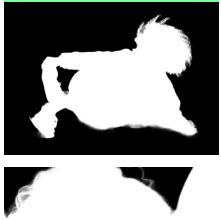

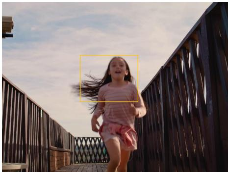

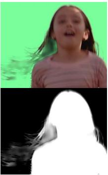

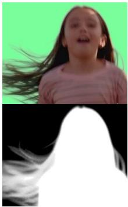

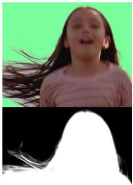

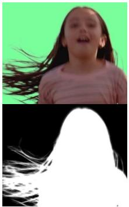

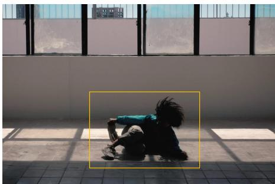

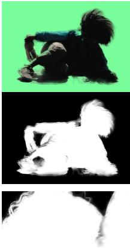

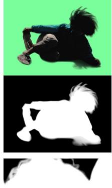

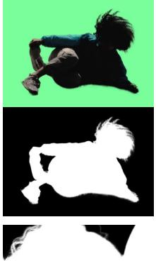

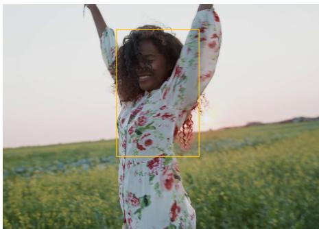  
Video Frame  
RVM

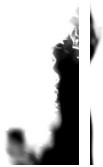  
GVM

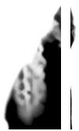

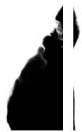  
MatAnyone  
MatAnyone 2 (Ours)

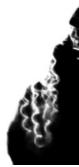  
Figure 6. Qualitative comparisons on real-world videos. Our MatAnyone 2 significantly outperforms leading auxiliary-free (RVM [19]). diffusion-based (GVM [5]), and mask-guided (MatAnyone [39]) approaches in both detail extraction and semantic accuracy under challenging conditions, e.g., wind-blown hair (first row) and complex lighting scenes (last two rows)

Table 1, our method achieves the best scores across all four benchmarks, demonstrating strong semantic accuracy, detail quality, and temporal stability. Compared with the leading mask-guided MatAnyone [39], our model reduces Grad and Conn by 27.1% and 22.4%, validating the effectiveness of MQE-based video matting scaling. Moreover, despite GVM's diffusion prior and MaGGIe's per-frame instance masks, our CNN model with only first-frame masks still outperforms all methods, demonstrating the effectiveness of online matting-quality guidance and the VMReal dataset for video matting training.

Real Benchmark. To assess model generalization on realworld videos, we further evaluate our method on the realworld CRGNN dataset [32], as shown in Table 2. This dataset contains 19 real-world videos with ground-truth alpha mattes manually annotated every 10 frames. The substantial metric improvements over MatAnyone [39] indicate enhanced semantic accuracy, finer details, and better temporal consistency. Although GVM [5] achieves competitive results due to its strong diffusion prior, our MatAnyone 2 still delivers the best performance across all metrics, highlighting the superior generalizability and robustness of our scaling design under real-world conditions.

Table 2. Quantitative comparisons on the CRGNN real-world dataset [32], where ground-truth alpha mattes are manually annotated every 10 frames on 19 videos. The best and second performances are marked in redand orange , respectively.
<table><tr><td>Methods</td><td>MAD↓</td><td>MSE↓</td><td>Grad↓</td><td>dtSSD↓</td></tr><tr><td colspan="5">Auxiliary-free</td></tr><tr><td>RVM [19]</td><td>5.98</td><td>2.79</td><td>13.68</td><td>5.36</td></tr><tr><td>RVM-Large [19]</td><td>5.75</td><td>2.47</td><td>13.26</td><td>5.17</td></tr><tr><td>GVM [5]</td><td>5.03</td><td>2.15</td><td>14.28</td><td>4.86</td></tr><tr><td colspan="5">Mask-guided</td></tr><tr><td>FTP-VM [7]</td><td>6.64</td><td>3.54</td><td>15.10</td><td>5.98</td></tr><tr><td>MaGGIe [8]</td><td>9.50</td><td>6.11</td><td>16.51</td><td>6.02</td></tr><tr><td>MatAnyone</td><td>5.76</td><td>3.04</td><td>15.55</td><td>5.44</td></tr><tr><td>Ours</td><td>4.24</td><td>2.00</td><td>11.74</td><td>4.54</td></tr></table>

Table 3. Ablation study of online guidance $\mathcal { L } _ { e v a l } .$ VMReal dataset, and reference-frame strategy on YouTubeMatte (1920 × 1080). We employ MatAnyone [39] as the baseline, i.e., Exp. (a).
<table><tr><td>Exp. |</td><td> $\mathcal { L } _ { e v a l }$ </td><td>VMReal</td><td>Ref. Train</td><td>MAD↓</td><td>MSE↓</td><td>Grad↓</td><td>dtSSD↓</td></tr><tr><td>(a) 1</td><td></td><td></td><td></td><td>1.99</td><td>0.71</td><td>8.91</td><td>1.65</td></tr><tr><td>(b)</td><td>√</td><td></td><td></td><td>1.90</td><td>0.62</td><td>8.20</td><td>1.63</td></tr><tr><td>(c)</td><td>√</td><td>√</td><td></td><td>1.76</td><td>0.61</td><td>7.65</td><td>1.54</td></tr><tr><td>(d)</td><td>√</td><td>√</td><td>√</td><td>1.61</td><td>0.50</td><td>7.13</td><td>1.53</td></tr></table>

## 4.1.2. Qualitative Evaluations

Qualitative results on real-world videos are shown in Fig. 6. While the diffusion-based GVM [5] is robust across scenes, it produces blurry mattes with unnatural transitions, especially around hair. Mask-guided MatAnyone [39] is also robust due to segmentation supervision, but its weak boundary constraints lead to segmentation-like edges. In contrast, our method delivers superior semantic robustness and fine matting details under challenging real-world conditions, including wind-blown hair (e.g., first row) and complex lighting (e.g., last two rows), showing that MQE-guided supervision and VMReal offer strong, reliable signals for high-quality real-world video matting.

## 4.1.3. MQE Performance Evaluations

For the MQE to provide effective guidance in both online training and offline selection, it should accurately identify erroneous regions in the predicted mattes. As illustrated in Fig. 4, the MQE successfully highlights common failure cases such as (a) segmentation-like mattes along object boundaries and (b) semantic mispredictions between foreground and background. These results demonstrate that the learned MQE provides a solid foundation for guiding video matting training and data curation. More evaluation and analysis are provided in the supplementary (see Sec. C.3).

## 4.2. Ablation Study

Effectiveness of Online Guidance $\mathcal { L } _ { e v a l } .$ To verify the effectiveness of MQE's online guidance, we train our video matting model using the same schedule as MatAnyone, where matting and segmentation data are supervised by different losses (Fig. 2(a)). Since the MQE can generate evaluation maps for both data types, we incorporate $\mathcal { L } _ { e v a l }$ as an additional online quality-guidance loss. As shown in Table 3, the improvement is most apparent in metrics related to semantic accuracy (MAD, MSE) and detail fidelity (Grad). This indicates that the MQE provides a more comprehensive and reliable assessment of both semantic correctness and fine details, offering stronger and more stable guidance than the previous weak boundary supervision.

Enhancement from Training with VMReal. Beyond providing online guidance during training, we further employ MQE to construct a large-scale real-world video matting dataset, VMReal. From Table 3(b) to (c), noticeable improvements are observed in MAD, Grad, and dtSSD, suggesting comprehensive gains not only in semantic robustness and boundary fidelity, but also in temporal consistency. To further validate the benefit of VMReal, we also train RVM [19] on this dataset and observe consistent improvements across all metrics (Table C in the supplementary). These results demonstrate that VMReal serves as a strong and generalizable supervisory signal, boosting video matting performance across different models.

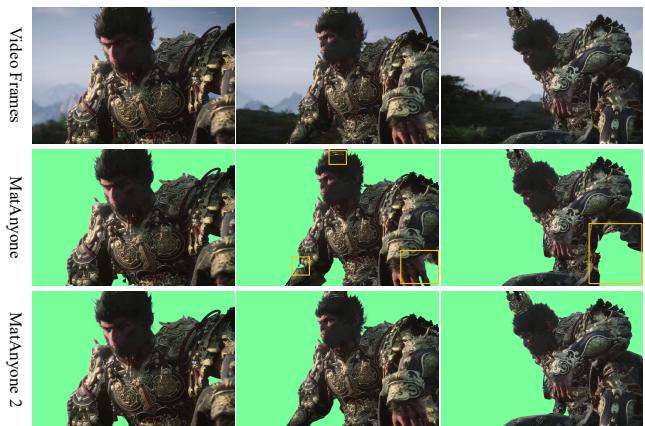  
Figure 7. Effectiveness of the reference-frame strategy. MatAnyone [39] struggles with newly appearing subject regions in long videos, whereas MatAnyone 2, trained with the reference-frame strategy, robustly identifies them.

Effectiveness of Reference-Frame Strategy for Large Variations. With the training sequence length kept unchanged, we adopt the reference-frame training strategy with random dropout augmentation in the data pipeline. As shown in Table 3(d), this yields further improvements, especially in semantic accuracy (MAD and MSE), indicating enhanced semantic robustness without incurring additional memory cost. This improved capability allows the model to better handle large appearance changes across long videos, such as the emergence of new body or clothing parts that do not appear in earlier frames (see Fig. 7).

## 5. Conclusion

We presented MatAnyone 2, a next-generation video matting framework that integrates a learned Matting Quality Evaluator (MQE) for scalable training. The MQE jointly assesses semantic accuracy and boundary detail without ground truth, serving as both an online guidance signal and an offline data selection module. Leveraging MQE, we further constructed VMReal, the first large-scale, real-world video matting dataset with diverse scenes and high-quality annotations. In addition, a reference-frame training strategy was introduced to handle large appearance variations in long videos. Extensive experiments show that MatAnyone 2 achieves leading performance on both synthetic and realworld benchmarks, significantly improving semantic stability, boundary fidelity, and generalization in real scenarios.

Acknowledgement. This research is supported by cash and in-kind funding from NTU S-Lab and industry partner(s).

## References

[1] Andreas Blattmann, Tim Dockhorn, Sumith Kulal, Daniel Mendelevitch, Maciej Kilian, Dominik Lorenz, Yam Levi, Zion English, Vikram Voleti, Adam Letts, et al. Stable Video Diffusion: Scaling latent video diffusion models to large datasets. arXiv preprint, 2023. 3, 6

[2] Huanqia Cai, Fanglei Xue, Lele Xu, and Lili Guo. Trans-Matting: Enhancing transparent objects matting with transformers. In ECCV, 2022. 3

[3] Miaomiao Cai, Simiao Li, Wei Li, Xudong Huang, Hanting Chen, Jie Hu, and Yunhe Wang. DSPO: Direct semantic preference optimization for real-world image super-resolution. arXiv preprint arXiv:2504.15176, 2025. 3

[4] Mikhail Erofeev, Yury Gitman, Dmitriy S Vatolin, Alexey Fedorov, and Jue Wang. Perceptually motivated benchmark for video matting. In BMVC, 2015. 6

[5] Yongtao Ge, Kangyang Xie, Guangkai Xu, Li Ke, Mingyu Liu, Longtao Huang, Hui Xue, Hao Chen, and Chunhua Shen. Generative video matting. In SIGGRAPH, 2025. 1, 2, 3,6,7,8

[6] Wei-Lun Huang and Ming-Sui Lee. End-to-end video matting with trimap propagation. In CVPR, 2023. 6

[7] Wei-Lun Huang and Ming-Sui Lee. End-to-end video matting with trimap propagation. In CVPR, 2023. 1, 2, 3, 6, 7

[8] Chuong Huynh, Seoung Wug Oh, , Abhinav Shrivastava, and Joon-Young Lee. MaGGIe: Masked guided gradual human instance matting. In CVPR, 2024. 1, 2, 3, 6, 7

[9] Zhanghan Ke, Jiayu Sun, Kaican Li, Qiong Yan, and Rynson W.H. Lau. MODNet: Real-time trimap-free portrait matting via objective decomposition. In AAAI, 2022. 2, 6

[10] Alexander Kirillov, Eric Mintun, Nikhila Ravi, Hanzi Mao, Chloe Rolland, Laura Gustafson, Tete Xiao, Spencer Whitehead, Alexander C Berg, Wan-Yen Lo, et al. Segment anything. In ICCV, 2023. 3

[11] Jizhizi Li, Sihan Ma, Jing Zhang, and Dacheng Tao. Privacypreserving portrait matting. In ACMMM, pages 3501–3509, 2021.3,4

[12] Jizhizi Li, Jing Zhang, and Dacheng Tao. Deep automatic natural image matting. In IJCAI, 2021. 3

[13] Jiachen Li, Vidit Goel, Marianna Ohanyan, Shant Navasardyan, Yunchao Wei, and Humphrey Shi. VMFormer: End-to-end video matting with transformer. In WACV, 2024. 2

[14] Jiachen Li, Roberto Henschel, Vidit Goel, Marianna Ohanyan, Shant Navasardyan, and Humphrey Shi. Video instance matting. In WACV, 2024. 3

[15] Jiachen Li, Jitesh Jain, and Humphrey Shi. Matting Anything. In CVPR, 2024. 3

[16] Ruibin Li, Tao Yang, Song Guo, and Lei Zhang. RORem: Training a robust object remover with human-in-the-loop. In CVPR, 2025. 3

[17] Chung-Ching Lin, Jiang Wang, Kun Luo, Kevin Lin, Linjie Li, Lijuan Wang, and Zicheng Liu. Adaptive human matting for dynamic videos. In CVPR, 2023. 1, 2, 3, 6

[18] Shanchuan Lin, Andrey Ryabtsev, Soumyadip Sengupta, Brian L Curless, Steven M Seitz, and Ira Kemelmacher-Shlizerman. Real-time high-resolution background matting. In CVPR, 2021. 3

[19] Shanchuan Lin, Linjie Yang, Imran Saleemi, and Soumyadip Sengupta. Robust high-resolution video matting with temporal guidance. In WACV, 2022. 1, 2, 6, 7, 8

[20] Tsung-Yi Lin, Priya Goyal, Ross Girshick, Kaiming He, and Piotr Dollár. Focal loss for dense object detection. In ICCV, 2017.4

[21] Jie Liu, Gongye Liu, Jiajun Liang, Ziyang Yuan, Xiaokun Liu, Mingwu Zheng, Xiele Wu, Qiulin Wang, Wenyu Qin, Menghan Xia, et al. Improving video generation with human feedback, 2025. NeurIPS, 2025. 3

[22] Wenze Liu, Zixuan Ye, Hao Lu, Zhiguo Cao, and Xiangyu Yue. Training matting models without alpha labels. arXiv preprint arXiv:2408.10539, 2024. 2

[23] Sanghyeon Na, Yonggyu Kim, and Hyunjoon Lee. Boost your human image generation model via direct preference optimization. In CVPR, 2025. 3

[24] Yu Qiao, Yuhao Liu, Xin Yang, Dongsheng Zhou, Mingliang Xu, Qiang Zhang, and Xiaopeng Wei. Attention-guided hierarchical structure aggregation for image matting. In CVPR, 2020.2,3

[25] Haotong Qin, Xianglong Liu, Xudong Ma, Lei Ke, Yulun Zhang, Jie Luo, and Michele Magno. BiVM: Accurate binarized neural network for efficient video matting. IEEE TPAMI, 2025. 2

[26] René Ranftl, Alexey Bochkovskiy, and Vladlen Koltun. Vision transformers for dense prediction. In ICCV, 2021. 6

[27] Nikhila Ravi, Valentin Gabeur, Yuan-Ting Hu, Ronghang Hu, Chaitanya Ryali, Tengyu Ma, Haitham Khedr, Roman Rädle, Chloe Rolland, Laura Gustafson, Eric Mintun, Junting Pan, Kalyan Vasudev Alwala, Nicolas Carion, Chao-Yuan Wu, Ross Girshick, Piotr Dollár, and Christoph Feichtenhofer. SAM 2: Segment anything in images and videos. arXiv preprint arXiv:2408.00714, 2024. 2, 3, 5

[28] Christoph Rhemann, Carsten Rother, Jue Wang, Margrit Gelautz, Pushmeet Kohli, and Pamela Rott. A perceptually motivated online benchmark for image matting. In CVPR, 2009.6

[29] Xiaoyong Shen, Xin Tao, Hongyun Gao, Chao Zhou, and Jiaya Jia. Deep automatic portrait matting. In ECCV, 2016. 2

[30] Oriane Siméoni, Huy V. Vo, Maximilian Seitzer, Federico Baldassarre, Maxime Oquab, Cijo Jose, Vasil Khalidov, Marc Szafraniec, Seungeun Yi, Michaël Ramamonjisoa, Francisco Massa, Daniel Haziza, Luca Wehrstedt, Jianyuan Wang, Timothée Darcet, Théo Moutakanni, Leonel Sentana, Claire Roberts, Andrea Vedaldi, Jamie Tolan, John Brandt Camille Couprie, Julien Mairal, Hervé Jégou, Patrick Labatut, and Piotr Bojanowski. DINOv3. arXiv preprint, 2025. 2,4,6

[31] Bram Wallace, Meihua Dang, Rafael Rafailov, Linqi Zhou, Aaron Lou, Senthil Purushwalkam, Stefano Ermon, Caiming

Xiong, Shafiq Joty, and Nikhil Naik. Diffusion model alignment using direct preference optimization. In CVPR, 2024. 3

[32] Tiantian Wang, Sifei Liu, Yapeng Tian, Kai Li, and Ming-Hsuan Yang. Video matting via consistency-regularized graph neural networks. In ICCV, 2021. 3, 7

[33] Chenfei Wu, Jiahao Li, Jingren Zhou, Junyang Lin, Kaiyuan Gao, Kun Yan, Sheng-ming Yin, Shuai Bai, Xiao Xu, Yilei Chen, et al. Qwen-image technical report. arXiv preprint arXiv:2508.02324, 2025. 3

[34] Rongyuan Wu, Lingchen Sun, Zhengqiang Zhang, Shihao Wang, Tianhe Wu, Qiaosi Yi, Shuai Li, and Lei Zhang. DP2O-SR: Direct perceptual preference optimization for real-world image super-resolution. NeurIPS, 2025.3

[35] Linjie Yang, Yuchen Fan, and Ning Xu. Video instance segmentation. In ICCV, 2019. 3

[36] Lihe Yang, Bingyi Kang, Zilong Huang, Xiaogang Xu, Jiashi Feng, and Hengshuang Zhao. Depth Anything: Unleashing the power of large-scale unlabeled data. In CVPR, 2024. 6

[37] Lihe Yang, Bingyi Kang, Zilong Huang, Zhen Zhao, Xiaogang Xu, Jiashi Feng, and Hengshuang Zhao. Depth Anything V2. In NeurIPS, 2024. 3

[38] Lehan Yang, Jincen Song, Tianlong Wang, Daiqing Qi, Weili Shi, Yuheng Liu, and Sheng Li. VRMDiff: Textguided video referring matting generation of diffusion. arXiv preprint, 2025. 3

[39] Peiqing Yang, Shangchen Zhou, Jixin Zhao, Qingyi Tao, and Chen Change Loy. MatAnyone: Stable video matting with consistent memory propagation. In CVPR, 2025. 1, 2, 3, 4, 5,6, 7,8

[40] Zhuoyi Yang, Jiayan Teng, Wendi Zheng, Ming Ding, Shiyu Huang, Jiazheng Xu, Yuanming Yang, Wenyi Hong, Xiaohan Zhang, Guanyu Feng, et al. CogVideoX: Text-to-video diffusion models with an expert transformer. In ICLR, 2025. 3

[41] Jingfeng Yao, Xinggang Wang, Shusheng Yang, and Baoyuan Wang. ViTMatte: Boosting image matting with pre-trained plain vision transformers. Information Fusion, 2024.3

[42] Jingfeng Yao, Xinggang Wang, Lang Ye, and Wenyu Liu. Matte Anything: Interactive natural image matting with segment anything model. Image and Vision Computing, page 105067, 2024.

[43] Chenyi Zhang, Yiheng Lin, Ting Liu, Xiaochao Qu, Luoqi Liu, Fang Zhao, Yao Zhao, and Yunchao Wei. MattePro: A professional matting model for anything. ht tps : // github.com/ChenyiZhang007/MattePro/tree/ master?tab=readme-ov-file,2025.3,5

[44] Huayu Zhang, Dongyue Wu, Yuanjie Shao, Nong Sang, and Changxin Gao. Object-aware video matting with cross-frame guidance. arXiv preprint, 2025. 2, 3

[45] Yunke Zhang, Lixue Gong, Lubin Fan, Peiran Ren, Qixing Huang, Hujun Bao, and Weiwei Xu. A late fusion cnn for digital matting. In CVPR, 2019. 2

[46] Yunke Zhang, Chi Wang, Miaomiao Cui, Peiran Ren, Xuansong Xie, Xian-Sheng Hua, Hujun Bao, Qixing Huang, and Weiwei Xu. Attention-guided temporally coherent video object matting. In ACMMM, 2021. 3

[47] Chong Zhou, Xiangtai Li, Chen Change Loy, and Bo Dai. EdgeSAM: Prompt-in-the-loop distillation for on-device deployment of sam. arXiv preprint, 2023. 3

[48] Shangchen Zhou, Chongyi Li, Kelvin C. K. Chan, and Chen Change Loy. ProPainter: Improving propagation and transformer for video inpainting. In ICCV, 2023. 6

[49] Bingke Zhu, Yingying Chen, Jinqiao Wang, Si Liu, Bo Zhang, and Ming Tang. Fast deep matting for portrait animation on mobile phone. In ACMMM, 2017. 2

[50] Xueyan Zou, Jianwei Yang, Hao Zhang, Feng Li, Linjie Li, Jianfeng Wang, Lijuan Wang, Jianfeng Gao, and Yong Jae Lee. Segment everything everywhere all at once. In NeurIPS, 2024.3