# VideoMaMa: Mask-Guided Video Matting via Generative Prior

Sangbeom Lim1† Seoung Wug Oh² Jiahui Huang2 Heeji Yoon³

Seungryong Kim³

Joon-Young Lee²

1Korea University 2Adobe Research 3KAIST AI

https://cvlab-kaist.github.io/VideoMaMa

Input Video

Input Mask

VideoMaMa

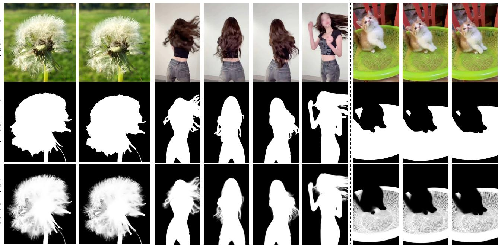  
Model-generated Mask to Matte  
GT Mask to Matte

Figure 1. We introduce Video Mask-to-Matte Model (VideoMaMa), a diffusion-based model that generates high-quality alpha mattes from input binary segmentation masks obtained either from existing models such as SAM2 [31] or from ground-truth segmentation masks in existing datasets such as SA-V [31]. Examples shown highlights our VideoMaMa's ability to capture fine-grained details including motion blur, and intricate boundary structures on natural video footage

## Abstract

Generalizing video matting models to real-world videos remains a significant challenge due to the scarcity of labeled data. To address this, we present Video Mask-to-Matte Model (VideoMaMa) that converts coarse segmentation masks into pixel accurate alpha mattes, by leveraging pretrained video diffusion models. VideoMaMa demonstrates strong zero-shot generalization to real-world footage, even though it is trained solely on synthetic data. Building on this capability, we develop a scalable pseudo-labeling pipeline for large-scale video matting and construct the

Matting Anything in Video (MA-V) dataset, which offers high-quality matting annotations for more than 50K realworld videos spanning diverse scenes and motions. To validate the effectiveness of this dataset, we ine-tune the SAM2 model on MA-V to obtain SAM2-Matte, which outperforms the same model trained on existing matting datasets in terms of robustness on in-the-wild videos. These findings emphasize the importance of large-scale pseudo-labeled video matting and showcase how generative priors and accessible segmentation cues can drive scalable progress in video matting research.

## 1. Introduction

Video matting, the task of extracting foreground objects with pixel-level precision from video, serves as a fundamental component in video editing applications, including background replacement [6, 32, 51], visual composition [3, 48], and relighting [2, 32, 43].

Despite its importance, training a video matting model that performs robustly across diverse real-world videos remains challenging for two key reasons. First, high-quality video matting annotations are extremely scarce. Groundtruth mattes are typically captured in controlled environments such as chroma key studios [26, 52] or with specialized camera setups [5], which makes it difficult to scale annotation efforts and to capture diverse objects, scenes, and camera angles. As a result, existing datasets are often limited to human portraits.

Second, most video matting models are trained on synthetic videos, where foregrounds are composited onto arbitrary backgrounds. Such synthetic compositions often introduce unrealistic artifacts in lighting, motion blur, and temporal coherence. These two factors, limited data diversity and the domain gap between synthetic and real videos, significantly hinder the ability of current models to generalize to real-world footage where complex interactions between foregrounds and backgrounds naturally occur.

In this work, we propose a novel bootstrapping strategy that effectively bridges the gap between synthetic and real-world videos, enabling more robust video matting. We introduce Video Mask-to-Matte Model (VideoMaMa), a diffusion-based model that converts binary segmentation masks into continuous alpha mattes (see Figure 1). Built upon pretrained video diffusion models [1], VideoMaMa demonstrates remarkable zero-shot generalization to realworld videos, even though the model is trained exclusively on synthetic data. This strong generalization ability stems from diffusion priors trained on internet-scale image and video data, which can generate high-quality content across diverse domains [1, 9, 42]. To adapt these priors for video matting while preserving their generative capabilities, we introduce a two-stage training strategy that separately optimizes spatial and temporal layers, along with semantic knowledge injection via DINOv3 [39] features.

To evaluate the robustness of the VideoMaMa model, we conduct experiments on video matting guided by binary masks from diverse sources, including those produced by existing video segmentation models. The results show that VideoMaMa consistently generates high-quality video matting outputs regardless of the input mask type, demonstrating strong robustness. These findings suggest that Video-MaMa can be effectively utilized as a pseudo-labeler for constructing large-scale video matting annotations.

In addition, by leveraging VideoMaMa, we propose a simple but scalable pipeline for constructing large-scale video matting annotations and introduce the Matting Anything in Videos (MA-V) dataset, the first large-scale pseudo video matting dataset built by converting segmentation labels from the SA-V dataset [31]. Unlike existing video matting datasets [8, 14, 26, 49, 52], which rely on synthetic or composited content, MA-V provides high-quality matting annotations for over 50K real-world videos covering diverse scenes, objects, and motion dynamics, as summarized in Table 1. This scalable pipeline demonstrates the potential of leveraging generative priors and segmentation labels, which are considerably easier to obtain than video alpha matte, to efficiently construct large-scale, high-quality video matting datasets.

To validate the effectiveness of large-scale pseudo video matting annotations, we fine-tune the SAM2 [31] model for video matting using MA-V, referred to as SAM2-Matte. Trained without any architectural modifications, the SAM2- Matte model achieves substantially more robust matting performance on in-the-wild videos than the same SAM2 model fine-tuned on existing video matting datasets, as well as other existing video matting methods. The results demonstrate the strong potential of large-scale pseudo annotations to drive advancements in video matting research.

Our contributions can be summarized as follows.

• VideoMaMa: A diffusion-based model that generates realistic video matting annotations from binary masks, enabling scalable matting label creation with easily obtainable segmentation labels.

• MA-V Dataset: The first large-scale, high-quality video matting dataset built on real captured footage, consisting of over 50K diverse videos.

## 2. Related Work

Video matting. Video matting methods can be categorized into auxiliary-free and auxiliary-guided approaches. Auxiliary-free methods [16, 25, 27] typically focus on portrait matting, restricting their applicability to human-centric scenarios. Trimap-guided approaches [13, 37] require manual trimap annotations, limiting their practicality for zeroshot inference. Recent mask-based guidance methods address these limitations: MaGGIe [14] decouples tracking from matting using binary mask tracks, MatAnyone [49] propagates target-assigned matting through a memoryaugmented architecture, and GVM [8] employs diffusion models for portrait matting. Despite these advances, existing methods remain constrained by domain specificity.

Beyond algorithmic limitations, existing datasets also constrain progress. Representative datasets include Video-Matte240K [26] (484 videos), VideoMatting108 [52] (108 videos), and VM800 [49] (826 videos), predominantly focusing on human subjects in controlled settings [8, 40, 45]. Critically, all rely on composition-based generation where foreground objects are composited onto random backgrounds, creating artificial scene compositions. No largescale real video matting dataset exists where foreground and background naturally co-occur.

Diffusion models for perception tasks. Recent advances have demonstrated that diffusion models [1, 20, 34, 42] encode rich priors about natural scenes, motion dynamics, and temporal coherence. Marigold [15] pioneered this direction by finetuning Stable Diffusion for monocular depth estimation, achieving strong zero shot generalization despite training only on synthetic data. This success has extended to semantic segmentation [44, 53] and video depth estimation [11, 38]. These models exhibit remarkable zero shot generalization across perception tasks [7, 10, 11, 46, 53], maintaining strong performance on real data even when trained exclusively on synthetic data, suggesting they can bridge the synthetic to real domain gap. For matting, SD-Matte [12] applies diffusion models to interactive image matting, while GVM [8] focuses on portrait video matting with emphasis on hair details. However, these methods are limited to either single images or specific domains like human portraits, lacking the scale and generality needed for diverse video matting scenarios.

Pseudo-label generation in segmentation/matting has become a key driver of recent progress. In the Segment Anything Model [19, 31], the authors demonstrated that it is possible to create an iterative self-training loop by building a strong segmentation model and bootstrapping it with its own outputs. ZIM [17] trained a converter model that transforms image binary masks into alpha mattes using existing image matting datasets.

Inspired by the recent successes, we address video matting, which presents distinct challenges. Unlike image matting [21, 23, 24, 35] and video object segmentation, where abundant manually annotated ground-truth data [4, 29, 31, 47] enables training strong labeler models, video matting datasets remain scarce and predominantly synthetic. This limitation hinders model generalization to real-world scenarios. To overcome the challenge, we exploit the generative priors of pre-trained video diffusion models and train a robust pseudo-labeler using small-scale synthetic video matting annotations.

## 3. Video Mask-to-Matte Model

## 3.1. Problem Formulation

Video matting is mathematically defined by the alpha compositing equation, $I = \alpha F + ( 1 - \alpha ) B$ , where I is the observed image, F is the foreground, B is the background, and $\alpha \in [ 0 , 1 ]$ is the alpha matte representing pixel-level opacity. Unlike binary segmentation masks $M \in \{ 0 , 1 \}$ , alpha mattes capture fine-grained details such as hair strands, motion blur, and intricate regions, which are critical for realistic video compositing.

There are several ways to specify the target object in video matting. One approach is to predefine the target semantic class, for example human portraits [8, 21], while another is to condition the model on additional signals such as points, boxes, or masks [12, 14, 50].

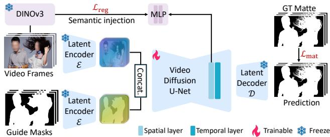  
Figure 2. Overview of VideoMaMa architecture. RGB frames and guide masks are processed through video diffusion U-Net layers to generate high-quality video mattes. Semantic injection with DINO features is applied during training.

We adopt binary segmentation masks as conditioning signals for two critical reasons: (1) masks allow the diffusion model to focus solely on generating fine-grained matting details (e.g., hair strands, motion blur) rather than inferring object boundaries, since shape information is already provided by the mask. This design decouples the challenges of object localization and matte generation, making the pipeline more robust and generalizable and (2) Finally, since binary masks can be obtained through various sources, the applicability of a model can be greatly expanded. In this paper, we demonstrate that VideoMaMa can not only perform video matting in various settings when combined with existing video segmentation models, but also enables the conversion of existing video segmentation datasets into matting datasets.

## 3.2. Architecture Design

We build VideoMaMa on top of Stable Video Diffusion (SVD) [1], a pretrained video diffusion model originally designed for image-to-video generation. By leveraging generative priors, it can generate high-quality video matting annotations that exhibit realistic characteristics such as natural motion blur, proper edge detail, and temporal consistency, effectively transferring the model's learned understanding of video dynamics to the matting task.

We adapt the SVD architecture for mask-guided video matting by introducing mask-based conditioning in the latent space and employing single-step inference for improved efficiency. In addition, we propose a semantic knowledge injection technique that enhances the model's understanding of object boundaries and strengthens temporal consistency when tracking complex objects with fine structural details. An overview of the model is shown in Figure 2.

Latent space formulation. Following modern video diffusion models, we operate in a compressed latent space to alleviate the computational overhead of processing high resolution videos. We leverage a Variational Autoencoder (VAE) [18] for efficient encoding and decoding. All inputs, including video frames $V ~ = ~ \{ T _ { t } \} _ { t = 1 } ^ { T }$ , binary mask track $M = \{ M _ { t } \} _ { t = 1 } ^ { T }$ , and alpha mattes $\overline { { \alpha } } \overset { - } { = } \{ \alpha _ { t } \} _ { t = 1 } ^ { T }$ , are encoded into the same latent space: $z _ { x } = \mathcal { E } ( x ) , \hat { x } = \mathcal { D } ( z _ { x } )$ where E and D denote the encoder and decoder of the VAE, respectively, and x may represent V, M, or α. Since all three modalities share the same spatial dimensions, this unified encoding approach naturally allows them to be processed together in the compressed latent space, reducing memory requirements while preserving spatial correspondence.

Single-step diffusion formulation. We formulate Video-MaMa as a single-timestep generative model that directly synthesizes high-fidelity alpha matte latents $\hat { z } _ { \alpha }$ in a single forward pass, where h and w represent the compressed spatial dimensions and c is the latent channel dimension. Unlike traditional diffusion models that require iterative denoising steps, our model performs direct prediction from noise to clean latents, making it significantly more efficient for large-scale dataset generation.

The generation process takes as input the frame-wise concatenation of video latents $z _ { V } ,$ mask latents $z _ { M }$ , and Gaussian noise $\epsilon \sim \mathcal { N } ( 0 , I )$ along the channel dimension:

$$
\hat { z } _ { \alpha } = \mathcal { F } _ { \mathrm { S V D } } ( \mathrm { c o n c a t } ( z _ { V } , z _ { M } , \epsilon ) ) ,\tag{1}
$$

where $\mathcal { F } _ { \mathrm { S V D } }$ represents our adapted SVD model, and concat(·) denotes a concatenation. We modify SVD's architecture by replacing the original image conditioning input with this concatenated tensor, allowing the model to leverage SVD's strong temporal modeling capabilities while conditioning on both appearance (from $z _ { V } )$ and shape information (from $z _ { M } )$ . The final alpha matte video is obtained by decoding the predicted latents through the VAE decoder: $\hat { \alpha } = \mathcal { D } ( \hat { z } _ { \alpha } )$

## 3.3. Training Recipe

Mask augmentation. While providing binary masks as input conditioning signals simplifies the task for the diffusion model, it also introduces the risk of copy-paste behavior. For objects with simple shapes (e.g., cars or desks) or masks that already contain fine-grained details (e.g., binarized alpha mattes), the model may trivially copy the mask instead of generating realistic matting details by reasoning about the RGB image.

To prevent this, we apply mask augmentation during training to remove fine-grained information from the input masks, forcing the model to infer matting details from the RGB image. Our mask augmentation strategy consists of two operations (see Figure 3): (1) Polygonization: We approximate the mask boundary with a polygon, simplifying the contour and removing fine details. (2) Downsample degradation: We downsample and upsample the mask at the same scale, which effectively removes high-frequency details while preserving the overall shape. These augmentations create a gap between the coarse input mask and the fine-grained target alpha matte, encouraging the model to leverage appearance cues from the RGB video to generate realistic matting details.

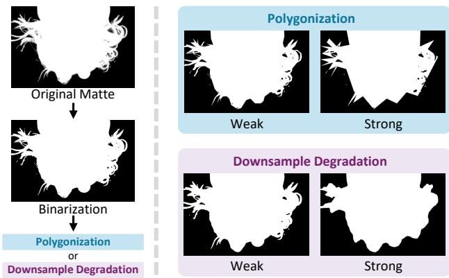  
Figure 3. Examples of mask augmentation methods. Polygonization and downsample degradation are applied at weak and strong augmentation levels.

Two-stage training. For matting tasks, both training and inference resolution are critical. As matting operates at the pixel level with continuous values, downsampling to lower resolutions can degrade fine-grained matting details. However, training video diffusion models at high resolution is computationally prohibitive. To address this challenge, we propose a two-stage training strategy that decomposes the learning process: first training spatial layers at high resolution on single frames to capture fine details, then training temporal layers at lower resolution on video sequences to learn temporal consistency. In the first stage, we freeze the temporal layers of SVD and train only the spatial layers, enabling the model to focus on capturing pixel-level details at high resolution. While this stage allows the model to learn fine-grained features within individual frames, it lacks temporal consistency across video sequences. In the second stage, we freeze the spatial layers to preserve the learned detail-capturing capability and fine-tune only the temporal layers to learn temporal coherence and video-specific characteristics. This decomposed training strategy enables our model to achieve both high-resolution detail and temporal consistency without requiring full high-resolution video training.

Matting loss function. We adopt v-parameterization [36] for single-step generation, where the model is trained to directly convert noise into clean alpha matte latents. The predicted latent $\hat { z } _ { \alpha }$ is decoded to pixel space $\hat { \alpha } = \mathcal { D } ( \hat { z } _ { \alpha } )$ , and the loss is computed at the pixel level:

$$
\begin{array} { r } { \mathcal { L } _ { \operatorname* { m a t } } = \mathbb { E } _ { \alpha , z _ { V } , z _ { M } , \epsilon } \left[ { \sin ( \mathcal { D } ( \hat { z } _ { \alpha } ) , \alpha ) } \right] , } \end{array}\tag{2}
$$

where sim(·, ·) comprises pixel-wise similarity loss terms between the decoded prediction and ground-truth alpha matte. This pixel-level supervision enables direct optimization for visual quality, capturing fine-grained details such as motion blur and intricate boundary structures.

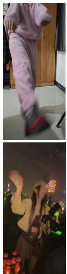  
RGB

  
SA-V

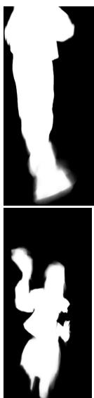  
MA-V

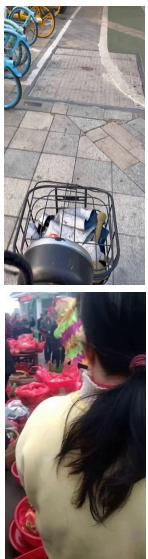  
RGB

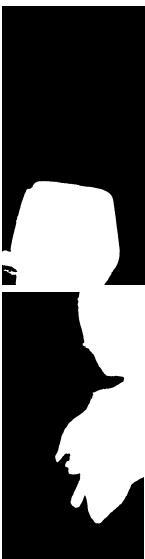  
SA-V

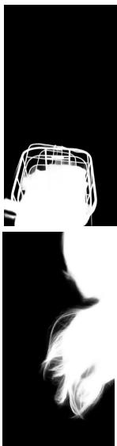  
MA-V

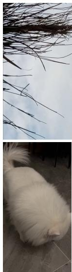  
RGB

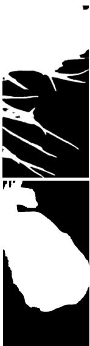  
SA-V

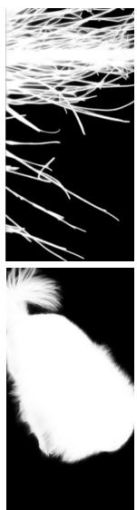  
MA-V  
Figure 4. Qualitative examples from our MA-V dataset. We show RGB frames with our high-quality MA-V annotations and original SA-V [31] masks for comparison. MA-V provides refined alpha mattes for diverse scenarios.

Semantic knowledge injection. While diffusion priors are powerful for generating precise alpha mattes, they struggle with semantic understanding of object boundaries and consistently tracking objects, particularly for complex objects with intricate structures. To address this, we inject semantic knowledge into VideoMaMa by aligning SVD features with robust semantic representations from DINOv3 [39] throughout training.

We first extract DINO features $h _ { \mathrm { d i n o } } = { \mathcal { F } } _ { \mathrm { d i n o } } ( V )$ from the video frames V. Then, we extract intermediate features $h ^ { l }$ from the l-th layer of the diffusion model and project them into the DINO feature space using a learnable MLP $p _ { \phi }$ with parameters φ. We minimize the alignment loss that maximizes patch-wise cosine similarities:

$$
\mathcal { L } _ { \mathrm { r e g } } = - \mathbb { E } _ { \alpha , z _ { V } , z _ { M } , \epsilon , V } \Big [ \mathrm { c o s - s i m } ( h _ { \mathrm { d i n o } } , p _ { \phi } ( h ^ { l } ) ) \Big ] ,\tag{3}
$$

where n indexes patches and cos-sim(·, ·) denotes cosine similarity. This design allows the model to leverage semantic understanding of object categories and structures while maintaining the generative capabilities of the diffusion backbone, enabling more accurate matte generation for challenging cases such as overlapping objects or complex articulated structures.

## 4. Matte Anything in Videos (MA-V) Dataset

The difficulty of obtaining video matting annotations has severely limited existing datasets. As shown in Table 1, prior datasets contain at most hundreds of videos, predominantly focusing on human subjects captured in controlled environments [26, 52] or through manual annotation [21, 22, 30, 41]. While composition-based approaches enable scaling and precise annotations, they create artificial scene compositions that differ fundamentally from natural video footage, limiting model generalization to real world scenarios.

Table 1. Dataset statistics for video matting.
<table><tr><td>Dataset</td><td>Category</td><td># Videos</td><td>Composition Required</td></tr><tr><td>SynHairMan [8]</td><td>Human</td><td>200</td><td>Yes</td></tr><tr><td>VideoMatte240K [26]</td><td>Human</td><td>478</td><td>Yes</td></tr><tr><td>V-HIM2K5 [14]</td><td>Human</td><td>443</td><td>Yes</td></tr><tr><td>VideoMatting108 [52]</td><td>Various</td><td>108</td><td>Yes</td></tr><tr><td>CRGNN [45]</td><td>Various</td><td>60</td><td>Yes</td></tr><tr><td>VM800 [49]</td><td>Human</td><td>826</td><td>Yes</td></tr><tr><td>MA-V (Ours)</td><td>Various</td><td>50,541</td><td>No</td></tr></table>

## 4.1. Dataset construction

To address these limitations, we introduce Matte Anything in Videos (MA-V), created by applying VideoMaMa to annotate SA-V's [31] diverse mask annotations. As shown in Table 1, MA-V provides 50,541 videos captured in natural settings, nearly 50× larger than existing real-video datasets. Unlike prior work that focuses predominantly on humans, MA-V encompasses diverse object categories at multiple scales, from small objects to full scenes. The dataset construction process is straightforward yet effective: we leverage VideoMaMa's ability to generate highquality alpha mattes from binary masks, converting SA-V's segmentation annotations into continuous matting labels while preserving the natural scene context. Critically, MA-V is the first large-scale video matting dataset where both foreground and background naturally co-occur in real captured footage, eliminating the synthetic composition gap that limits previous datasets. Figure 4 illustrates the visual quality and diversity of MA-V compared to SA-V's binary masks, demonstrating how VideoMaMa generates fine-grained matting details including semi-transparent regions, motion blur, and intricate boundary structures regardless of the target category that are absent in the source segmentation masks.

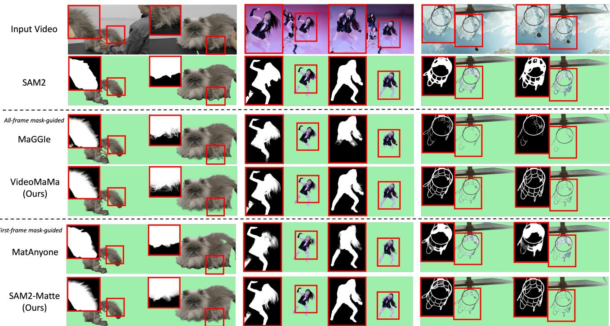  
Figure 5. Qualitative comparison on in-the-wild videos. We evaluate two settings: (1) all-frame mask-guided video matting where VideoMaMa is compared against MaGGIe [14], and (2) first-frame mask-guided matting where SAM2-Matte is compared against MatAnyone [49]. All methods use SAM2 [31] to generate mask inputs.

## 4.2. Fine-tuning SAM2 with MA-V

We finetune SAM2 [31] on our MA-V dataset, referred to as SAM2-Matte hereafter. SAM2, originally designed for binary segmentation, requires minimal adaptation for matting: we apply a sigmoid function after the mask logits to produce continuous alpha values in the range [0,1]. To assess MA-V quality, we also finetune SAM2 on existing video matting datasets and evaluate their performance on standard matting benchmarks.

## 5. Experiments

## 5.1. Experimental Details

Implementation details. We train VideoMaMa based on the Stable Video Diffusion [1] (SVD) model using diverse image and video matting datasets. Our two-stage training strategy employs different resolutions optimized for each stage's objective. In stage 1, we train the spatial layers of SVD on single images at high resolution (1024×1024) to capture fine-grained matting details such as hair strands and intricate boundary structures. We freeze the temporal layers during this stage to focus learning on spatial precision. In stage 2, we freeze the learned spatial layers and train only the temporal layers on video sequences. To balance computational efficiency with temporal modeling, we use 3-frame clips at 704×704 resolution, which enables the model to learn temporal consistency and motion-aware matting characteristics. To inject semantic knowledge, we incorporate features from a frozen DINOv3 [39] encoder, aligning the DINO features with the first upsampling block of the SVD decoder. This integration provides the diffusion model with semantic understanding of object structures while preserving its generative capabilities.

Training details. For both stages, we use a batch size of 64 and a learning rate of $5 \times 1 0 ^ { - 5 }$ with the AdamW optimizer. The training objective, ${ \mathcal { L } } _ { \mathrm { m a t } } .$ combines L1 loss for pixelwise accuracy and Laplacian loss for preserving edge sharpness and boundary details. Each stage is trained for 10,000 iterations until convergence. All experiments are conducted on NVIDIA A100 GPUs with mixed-precision training for efficiency. SAM2-Matte is trained on the combination of existing video matting datasets and MA-V. Details of the existing datasets are provided in the appendix.

## 5.2. Quantitative Evaluations

All-frame mask-guided video matting. We evaluate VideoMaMa following the protocol in [14], where input binary masks for every frame are provided. We use two categories of input masks: (1) Synthetically Degraded Masks through downsampling (8×, 32×) and polygonization (easy, hard), mimicking imperfect user annotations, and (2) Model-Generated Masks from SAM2 [31], representing automatic segmentation pipelines. This diverse set evaluates VideoMaMa's robustness across different mask quality levels.

Table 2. All-frame mask-guided video matting comparison on V-HIM60 and YouTubeMatte benchmarks. We compare VideoMaMa (Ours) against mask-guided matting methods: MaGGIe [14] (video mask-guided) and MGM [50] (image mask-guided). We evaluate on two mask types: Synthetically Degraded Masks including downsampling (8×, 32×) and polygonization with varying difficulty levels, and Model-Generated Masks from SAM2 [31]. Lower values indicate better performance.
<table><tr><td rowspan="2"></td><td colspan="10">V-HIM60 (Hard) MAD↓</td><td colspan="7">YouTubeMatte (1920 × 1080) Gradient ↓</td></tr><tr><td colspan="10"></td><td colspan="7">MAD ↓</td></tr><tr><td>Input Mask</td><td>Input MGM</td><td>MGM-IW</td><td>MaGGIe</td><td>MaGGIe-FT</td><td>Ours</td><td>Input</td><td>MGM</td><td>MGM-IW MaGGIe</td><td>MaGGIe-FT</td><td>Ours Input</td><td>MGM</td><td>MGM-IW</td><td>MaGGIe</td><td>MaGGIe-FT</td><td>Ours Input</td><td>MGM MGM-IW</td><td></td><td>MaGGIe MaGGIe-FT</td></tr><tr><td>Synthetically Degraded Masks</td></tr><tr><td></td><td>2.744</td></tr><tr><td>Downsample 8x</td><td>63.8374</td><td>2.1646</td><td>2.3790</td><td>2.6521</td><td>1.306</td><td>11.127</td><td>16.5609</td><td>3.7015 5.4150</td><td>6.4137</td><td>2.363</td><td>1.946 3.4973</td><td>2.2504</td><td>1.6420</td><td></td><td>1.5311 0.934</td><td>8.034</td><td>4.0822 3.9363</td><td>4.9733</td></tr><tr><td>Downsample 32x</td><td>5.132 79.2273</td><td>2.9092</td><td>2.5375</td><td></td><td>2.8960</td><td>1.461 33.664</td><td>22.2024</td><td>6.3100</td><td>5.9073 7.1486</td><td>2.849</td><td>4.203 3.9061</td><td>2.6610</td><td>1.8171</td><td>1.6897</td><td>1.029</td><td>36.540 5.3603</td><td>5.6704</td><td>5.5547 5.6318 6.1760</td></tr><tr><td>Polygon. (Easy)</td><td>3.636 64.5457</td><td>2.8187</td><td>2.5808</td><td></td><td>3.1009 3.4456</td><td>1.416 1.640</td><td>16.000 17.3675 43.228</td><td>4.5335 5.9860</td><td>5.5572</td><td>6.8035 2.480 7.4698</td><td>3.619 4.1390 9.470</td><td>3.4547 4.2821</td><td>2.2250 2.3111</td><td></td><td>2.5933 2.9929</td><td>1.206 19.155 65.844</td><td>4.8579 5.4951</td><td>5.6773 6.6425</td></tr><tr><td>Polygon. (Hard)</td><td>6.771 75.5501</td><td>3.3274</td><td>2.7771</td><td></td><td></td><td></td><td>20.5516</td><td></td><td>5.9636</td><td>3.024</td><td>4.4549</td><td></td><td></td><td></td><td>1.404</td><td>5.6132</td><td>8.4066</td><td>5.9184 7.7936 3.237</td></tr><tr><td>Model-Generated Masks</td><td></td><td></td><td></td><td></td><td></td><td></td><td></td><td></td><td></td><td></td><td></td><td></td><td></td><td></td><td></td><td></td><td></td><td></td></tr><tr><td>SAM2</td><td>4.666</td><td>66.5221 3.4520</td><td>3.1567</td><td></td><td>3.6435</td><td>2.435 21.960</td><td>18.2103</td><td>5.7615</td><td>6.4121 7.6520</td><td>4.180</td><td>3.569 4.1136</td><td>3.3100</td><td>1.9499</td><td>2.1968</td><td>1.737</td><td>24.729 5.0448</td><td>5.2508 5.7877</td><td>6.3664 3.635</td></tr></table>

Table 3. First-frame mask-guided video matting comparison on V-HIM60 and YouTubeMatte benchmarks. We evaluate video matting performance across different difficulty levels in V-HIM60. The best and second-best results are highlighted.
<table><tr><td rowspan="3">Method</td><td colspan="10">V-HIM60 [14]</td><td colspan="5">YouTubeMatte [49]</td></tr><tr><td colspan="4">Easy</td><td colspan="4">Medium</td><td colspan="4">Hard</td><td colspan="4">1920 × 1080</td></tr><tr><td>MAD</td><td>MAD-T</td><td>MSE</td><td>GRAD</td><td>MAD</td><td>MAD-T</td><td>MSE</td><td>GRAD</td><td>MAD</td><td>MAD-T</td><td>MSE</td><td>GRAD</td><td>MAD</td><td>MAD-T MSE</td><td></td><td>GRAD</td></tr><tr><td>SAM2 [31]</td><td>2.7978</td><td>91.5246</td><td>1.4799</td><td>13.3307</td><td>4.9618</td><td>105.2547</td><td>2.9401</td><td>25.6735</td><td>7.8517</td><td>130.0338</td><td>6.0075</td><td>26.3355</td><td>3.8530</td><td>103.2181</td><td>2.6133</td><td>37.4074</td></tr><tr><td>MatAnyone [49]</td><td>3.5803</td><td>92.8273</td><td>1.9905</td><td>7.0763</td><td>7.1955</td><td>100.0465</td><td>4.7586</td><td>11.4541</td><td>5.7195</td><td>102.4861</td><td>3.4620</td><td>9.8199</td><td>1.9909</td><td>51.0939</td><td>0.7085</td><td>8.9019</td></tr><tr><td>SAM2+VideoMaMa</td><td>1.3539</td><td>40.6830</td><td>0.4063</td><td>2.8876</td><td>2.3132</td><td>49.0329</td><td>0.9335</td><td>4.6944</td><td>2.7757</td><td>53.4392</td><td>1.4428</td><td>4.8276</td><td>1.3559</td><td>35.5064</td><td>0.2940</td><td>3.5742</td></tr><tr><td>SAM2-Matte</td><td>1.3446</td><td>49.0329</td><td>0.2932</td><td>3.1245</td><td>2.2710</td><td>51.8996</td><td>0.6669</td><td>5.2227</td><td>2.6112</td><td>58.7796</td><td>1.0750</td><td>5.0869</td><td>1.2695</td><td>33.5268</td><td>0.2831</td><td>3.4640</td></tr></table>

In Table 2, we compare VideoMaMa against MaG-GIe [14] and MGM [50]. We fine-tune MaGGIe using all training datasets employed by VideoMaMa (denoted as MaGGIe-FT). For MGM, which is an image-based method, we perform inference on each frame independently. We additionally report results for MGM-IW [28]. We report metrics comparing both input masks and generated results against ground-truth alpha mattes. All evaluations use 12- frame sequences.

We adopt standard metrics: MAD for overall accuracy and Gradient error [33] for boundary quality. Results are reported on V-HIM60 Hard [14] and YouTubeMatte 1920× 1080 [49].

VideoMaMa consistently outperforms existing maskguided matting models across both synthetically degraded and model-generated masks. Our evaluation across different mask styles demonstrates that VideoMaMa can handle various types of mask inputs and produce high-quality video mattes consistently.

First-frame mask-guided video matting. In Table 3, we evaluate VideoMaMa and SAM2-Matte following a setting proposed in [49] where a binary mask guidance is provided only for the first frame. For VideoMaMa, the binary mask guidance across all frames is generated by propagating the mask from the first frame using SAM2 [31], denoted as SAM2+VideoMaMa. We also report the score of the binary masks produced by SAM2 to provide a baseline for the improvements achieved by VideoMaMa.

We employ multiple evaluation metrics: MAD for overall semantic accuracy, MSE for pixel-level error, MAD-T (trimap-based MAD) which computes MAD only within the uncertain trimap region derived from the ground-truth alpha map, and Gradient error [33] for assessing boundary detail extraction quality. The trimap-based evaluation is particularly important as it focuses on the challenging boundary regions where precise matting is most critical.

SAM2-Matte trained on the combined dataset surpasses previous state-of-the-art methods, MatAnyone [49], on challenging benchmarks: V-HIM60 Hard [14] and YouTubeMatte [49]. This demonstrates that MA-V provides high-quality training data for video matting models, enabling to extract matting quality and temporal consistency over the video frames. Note that, for VideoMaMa in this experiment, we processed each of the 12-frame segments and merged the results to obtain the complete video matting.

## 5.3. Qualitative Evaluations

To further evaluate the model's performance on real-world videos, we present qualitative comparisons in Figure 5. We categorize the methods into two settings: first-frame maskguided and all-frame mask-guided. The initial binary masks are obtained manually using the SAM2 model. Unlike previous matting methods [14, 49], VideoMaMa and SAM2- Matte not only perform well on human portraits but also generalize to a wide range of object categories and in-thewild video content. Moreover, the high-quality results from SAM2-Matte demonstrate that MA-V's large-scale and diverse annotations effectively enhance video matting performance beyond what existing datasets can achieve.

## 5.4. Ablation Studies

Number of inference frames. We evaluate VideoMaMa's performance across varying numbers of frames. Although trained on maximum 3 frames, VideoMaMa successfully handles diverse frame counts from single frames to 24 frames at inference time. As shown in Table 4, the model maintains consistent performance across different frame counts, demonstrating strong temporal generalization.

Table 4. Ablation study on the number of frame during inference. We report the mask refinement performance in MAD metric on YouTubeMatte dataset [49] with different input masks.
<table><tr><td colspan="2"></td><td colspan="5">Number of Frames per Inference</td></tr><tr><td colspan="2">Mask Input</td><td>24</td><td>18</td><td>12</td><td>6</td><td>1</td></tr><tr><td rowspan="2">Downsample 32x</td><td>Input</td><td>4.2411</td><td>4.2455</td><td>4.2029</td><td>4.1377</td><td>4.1336</td></tr><tr><td>Refined</td><td>1.0237</td><td>1.0272</td><td>1.0292</td><td>1.0418</td><td>1.1024</td></tr><tr><td rowspan="2">Polygon. (Hard)</td><td>Input</td><td>9.5559</td><td>9.6224</td><td>9.4700</td><td>8.7498</td><td>8.5455</td></tr><tr><td>Refined</td><td>1.4472</td><td>1.4847</td><td>1.4042</td><td>1.3382</td><td>1.5598</td></tr><tr><td rowspan="2">SAM2 [31]</td><td>Input</td><td>3.6023</td><td>3.5991</td><td>3.5693</td><td>3.5476</td><td>3.8711</td></tr><tr><td>Refined</td><td>1.6921</td><td>1.7273</td><td>1.7370</td><td>1.7948</td><td>1.8828</td></tr></table>

Table 5. Ablation study on training recipe. We evaluate MAD with different training configurations on YouTubeMatte [49]. Scores for input masks are shown below the each input mask type. Percentages in parentheses indicate the relative improvement (green) or degradation (red) compared to the input score.
<table><tr><td>S1</td><td>S2</td><td>DINO</td><td>Downsample 32x Input: 4.2029</td><td>Polygon. (Hard) Input: 9.4700</td><td>SAM2 Input: 3.5693</td></tr><tr><td>√</td><td>x</td><td>x</td><td>3.7620 (10.49%)</td><td>4.8306 (49.00%)</td><td>4.0496 (-13.46%)</td></tr><tr><td>x</td><td>√</td><td>x</td><td>1.2350 (70.62%)</td><td>2.2372 (76.38%)</td><td>2.3124 (35.21%)</td></tr><tr><td>√</td><td>√</td><td>x</td><td>1.2552 (70.13%)</td><td>1.9975 (78.91%)</td><td>1.9404 (45.64%)</td></tr><tr><td>√</td><td>√</td><td>√</td><td>1.0292 (75.51%)</td><td>1.4042 (85.17%)</td><td>1.7370 (51.34%)</td></tr></table>

Table 6. Ablation study for training data on V-HIM60 Hard [14] and DAVIS val [29], including (a) ED, (B) MA-V, (c) ED + MA-V. ED denotes that existing dataset.
<table><tr><td rowspan="2">Method</td><td colspan="3">V-HIM60 (Hard)</td><td colspan="3">DAVIS</td></tr><tr><td>MAD</td><td>MSE</td><td>GRAD</td><td>J&amp;F</td><td>J</td><td>F</td></tr><tr><td>MatAnyone [49]</td><td>4.6655</td><td>2.5870</td><td>8.8870</td><td>79.7</td><td>76.5</td><td>82.9</td></tr><tr><td>(a) ED</td><td>7.5798</td><td>5.6824</td><td>8.7091</td><td>77.0</td><td>74.1</td><td>80.0</td></tr><tr><td>(b) MA-V</td><td>3.1830</td><td>1.5603</td><td>5.7869</td><td>87.9</td><td>85.2</td><td>90.6</td></tr><tr><td>(c) ED + MA-V</td><td>2.6112</td><td>1.0750</td><td>5.0869</td><td>85.9</td><td>83.5</td><td>88.3</td></tr></table>

Training recipe. We ablate our two-stage training strategy and semantic knowledge injection on YouTubeMatte [49] with four configurations: (1) image only (stage 1), (2) video only (stage 2), (3) two-stage without semantic knowledge, and (4) two-stage training with DINO features. As shown in Table 5, having both stage 1 and stage 2 training stages led to the best results. Adding DINO semantic features further improves performance enabling better object understanding and boundary localization. The results validate that both components are necessary and complementary for optimal performance.

Impact of MA-V Dataset. We assess the impact of MA-V on matting and tracking performance on first-frame maskguided matting task. We evaluate SAM2-Matte trained under different data configurations by comparing (a) existing datasets only (ED), (b) MA-V only, and (c) both combined.

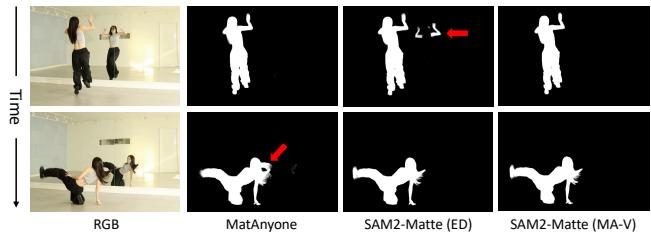  
Figure 6. Comparison on a real video between MatAnyone [49] and SAM2-Matte variants. Red arrows highlight regions where our method achieves the best results.

A detailed list of the existing matting datasets used in this experiment will be included in the appendix.

To validate the impact of MA-V on matting task, we report matting quality metrics on the V-HIM60 (Hard) [14]. As shown in Table 6, Configuration (a) shows limited performance due to the small scale and lack of diversity in existing datasets. Remarkably, (b) significantly outperforms (a) and even surpasses state-of-the-art results, demonstrating the effectiveness of MA-V. When combining the existing matting datasets with MA-V in (c), we achieve the best overall matting quality. We hypothesize that the shared synthetic nature of both the existing matting datasets and V-HIM60 contributes to this improved performance.

We evaluate tracking performance on DAVIS [29] using VOS metrics by binarizing matting results. As shown in Table 6, configuration (b) substantially improves performance over (a), demonstrating the effectiveness of MA-V. Interestingly, adding the existing matting datasets in configuration (c) leads to degraded tracking performance compared to using MA-V alone, suggesting that existing synthetic datasets introduce domain biases that reduce tracking robustness on in-the-wild videos.

In Figure 6, we compare MatAnyone [49] and SAM2- Matte variants. The results show that using MA-V enables robust tracking even along ambiguous boundaries.

## 6. Conclusion

We introduce VideoMaMa, a diffusion-based model that leverages generative priors to perform robust video matting. By exploiting VideoMaMa's strong generalization capability, we construct MA-V, the first large-scale pseudo video matting dataset built on real-world videos, by converting segmentation masks from SA-V. Through comprehensive experiments, we demonstrate that both VideoMaMa and models trained on MA-V (e.g., SAM2-Matte) achieve state-of-the-art performance across diverse video matting benchmarks, validating the effectiveness of our data generation approach. We believe that VideoMaMa and MA-V will significantly contribute to advancing video matting research by providing both a VideoMaMa and a large-scale, high-quality dataset that bridges the synthetic-to-real domain gap.

## Acknowledgements.

This research was supported by Institute of Infor-mation & communications Technology Planning & Evaluation (IITP) grant funded by the Korea government (MSIT) (RS-2019-II190075, RS-2024-00509279, RS-2025-II212068, RS-2023-00227592, RS-2025- 02214479, RS-2024- 00457882, RS-2025-25441838, RS-2025-25441838, RS-2025-02214479, RS-2025-02217259) and the Culture, Sports, and Tourism R&D Program through the Korea Creative Content Agency grant funded by the Ministry of Culture, Sports and Tourism (RS-2024-00345025, RS-2024-00333068, RS-2023-00222280, RS-2023-00266509), and National Research Foundation of Korea (RS-2024- 00346597).

## References

[1] Andreas Blattmann, Tim Dockhorn, Sumith Kulal, Daniel Mendelevitch, Maciej Kilian, Dominik Lorenz, Yam Levi, Zion English, Vikram Voleti, Adam Letts, et al. Stable video diffusion: Scaling latent video diffusion models to large datasets. arXiv preprint arXiv:2311.15127, 2023. 2, 3, 6, 1

[2] Sumit Chaturvedi, Mengwei Ren, Yannick Hold-Geoffroy, Jingyuan Liu, Julie Dorsey, and Zhixin Shu. Synthlight: Portrait relighting with diffusion model by learning to re-render synthetic faces. In Proceedings of the Computer Vision and Pattern Recognition Conference, pages 369–379, 2025. 2

[3] Yusuf Dalva, Yijun Li, Qing Liu, Nanxuan Zhao, Jianming Zhang, Zhe Lin, and Pinar Yanardag. Layerfusion: Harmonized multi-layer text-to-image generation with generative priors. arXiv preprint arXiv:2412.04460, 2024. 2

[4] Henghui Ding, Chang Liu, Shuting He, Xudong Jiang, Philip HS Torr, and Song Bai. Mose: A new dataset for video object segmentation in complex scenes. In Proceedings of the IEEE/CVF international conference on computer vision, pages 20224–20234, 2023. 3

[5] Kenji Enomoto, Scott Cohen, Brian Price, and TJ Rhodes. Polarized color screen matting. In Proceedings of the Computer Vision and Pattern Recognition Conference, pages 391–399, 2025. 2

[6] Wenshuo Gao, Xicheng Lan, and Shuai Yang. Anyportal: Zero-shot consistent video background replacement. In Proceedings of the IEEE/CVF International Conference on Computer Vision, pages 18990–18999, 2025. 2

[7] Gonzalo Martin Garcia, Karim Abou Zeid, Christian Schmidt, Daan De Geus, Alexander Hermans, and Bastian Leibe. Fine-tuning image-conditional diffusion models is easier than you think. In 2025 IEEE/CVF Winter Conference on Applications of Computer Vision (WACV), pages 753– 762. IEEE, 2025. 3

[8] Yongtao Ge, Kangyang Xie, Guangkai Xu, Li Ke, Mingyu Liu, Longtao Huang, Hui Xue, Hao Chen, and Chunhua Shen. Generative video matting. In Proceedings of the Special Interest Group on Computer Graphics and Interac-

tive Techniques Conference Conference Papers, pages 1–10, 2025.2,3,5

[9] Yoav HaCohen, Nisan Chiprut, Benny Brazowski, Daniel Shalem, Dudu Moshe, Eitan Richardson, Eran Levin, Guy Shiran, Nir Zabari, Ori Gordon, Poriya Panet, Sapir Weissbuch, Victor Kulikov, Yaki Bitterman, Zeev Melumian, and Ofir Bibi. Ltx-video: Realtime video latent diffusion. arXiv preprint arXiv:2501.00103, 2024. 2

[10] Jing He, Haodong Li, Wei Yin, Yixun Liang, Leheng Li, Kaiqiang Zhou, Hongbo Zhang, Bingbing Liu, and Ying-Cong Chen. Lotus: Diffusion-based visual foundation model for high-quality dense prediction. arXiv preprint arXiv:2409.18124, 2024. 3

[11] Wenbo Hu, Xiangjun Gao, Xiaoyu Li, Sijie Zhao, Xiaodong Cun, Yong Zhang, Long Quan, and Ying Shan. Depthcrafter: Generating consistent long depth sequences for open-world videos. In Proceedings of the Computer Vision and Pattern Recognition Conference, pages 2005–2015, 2025. 3

[12] Longfei Huang, Yu Liang, Hao Zhang, Jinwei Chen, Wei Dong, Lunde Chen, Wanyu Liu, Bo Li, and Peng-Tao Jiang. Sdmatte: Grafting diffusion models for interactive matting. arXiv preprint arXiv:2508.00443, 2025. 3

[13] Wei-Lun Huang and Ming-Sui Lee. End-to-end video matting with trimap propagation. In Proceedings of the IEEE/CVF Conference on Computer Vision and Pattern Recognition, pages 14337–14347, 2023. 2

[14] Chuong Huynh, Seoung Wug Oh, Abhinav Shrivastava, and Joon-Young Lee. Maggie: Masked guided gradual human instance matting. In Proceedings of the IEEE/CVF Conference on Computer Vision and Pattern Recognition, pages 3870– 3879, 2024. 2, 3, 5, 6, 7, 8

[15] Bingxin Ke, Anton Obukhov, Shengyu Huang, Nando Metzger, Rodrigo Caye Daudt, and Konrad Schindler. Repurposing diffusion-based image generators for monocular depth estimation. In Proceedings of the IEEE/CVF conference on computer vision and pattern recognition, pages 9492–9502, 2024.3

[16] Zhanghan Ke, Jiayu Sun, Kaican Li, Qiong Yan, and Rynson WH Lau. Modnet: Real-time trimap-free portrait matting via objective decomposition. In Proceedings of the AAAI Conference on Artificial Intelligence, pages 1140- 1147, 2022.2

[17] Beomyoung Kim, Chanyong Shin, Joonhyun Jeong, Hyungsik Jung, Se-Yun Lee, Sewhan Chun, Dong-Hyun Hwang, and Joonsang Yu. Zim: Zero-shot image matting for anything. arXiv preprint arXiv:2411.00626, 2024. 3

[18] Diederik P Kingma and Max Welling. Auto-encoding variational bayes. arXiv preprint arXiv:1312.6114, 2013. 4

[19] Alexander Kirillov, Eric Mintun, Nikhila Ravi, Hanzi Mao, Chloe Rolland, Laura Gustafson, Tete Xiao, Spencer Whitehead, Alexander C Berg, Wan-Yen Lo, et al. Segment anything. In Proceedings of the IEEE/CVF international conference on computer vision, pages 4015–4026, 2023. 3

[20] Weijie Kong, Qi Tian, Zijian Zhang, Rox Min, Zuozhuo Dai, Jin Zhou, Jiangfeng Xiong, Xin Li, Bo Wu, Jianwei Zhang, et al. Hunyuanvideo: A systematic framework for large video generative models. arXiv preprint arXiv:2412.03603, 2024. 3

[21] Jizhizi Li, Sihan Ma, Jing Zhang, and Dacheng Tao. Privacypreserving portrait matting. In Proceedings of the 29th ACM international conference on multimedia, pages 3501–3509, 2021.3,5

[22] Jizhizi Li, Jing Zhang, and Dacheng Tao. Deep automatic natural image matting. arXiv preprint arXiv:2107.07235, 2021.5

[23] Jizhizi Li, Jing Zhang, Stephen J Maybank, and Dacheng Tao. Bridging composite and real: towards end-to-end deep image matting. International Journal of Computer Vision, 130(2):246–266, 2022. 3

[24] Jizhizi Li, Jing Zhang, and Dacheng Tao. Referring image matting. In Proceedings of the IEEE Computer Vision and Pattern Recognition, 2023. 3

[25] Jiachen Li, Vidit Goel, Marianna Ohanyan, Shant Navasardyan, Yunchao Wei, and Humphrey Shi. Vmformer: End-to-end video matting with transformer. In Proceedings of the IEEE/CVF Winter Conference on Applications of Computer Vision, pages 6678–6687, 2024. 2

[26] Shanchuan Lin, Andrey Ryabtsev, Soumyadip Sengupta, Brian L Curless, Steven M Seitz, and Ira Kemelmacher-Shlizerman. Real-time high-resolution background matting. In Proceedings of the IEEE/CVF Conference on Computer Vision and Pattern Recognition, pages 8762–8771, 2021. 2, 5

[27] Shanchuan Lin, Linjie Yang, Imran Saleemi, and Soumyadip Sengupta. Robust high-resolution video matting with temporal guidance. In Proceedings of the IEEE/CVF Winter Conference on Applications of Computer Vision, pages 238–247, 2022.2

[28] Kwanyong Park, Sanghyun Woo, Seoung Wug Oh, In So Kweon, and Joon-Young Lee. Mask-guided matting in the wild. In Proceedings of the IEEE/CVF conference on computer vision and pattern recognition, 2023. 7

[29] Jordi Pont-Tuset, Federico Perazzi, Sergi Caelles, Pablo Arbeláez, Alex Sorkine-Hornung, and Luc Van Gool. The 2017 davis challenge on video object segmentation. arXiv preprint arXiv:1704.00675, 2017. 3,8

[30] Yu Qiao, Yuhao Liu, Xin Yang, Dongsheng Zhou, Mingliang Xu, Qiang Zhang, and Xiaopeng Wei. Attention-guided hierarchical structure aggregation for image matting. In The IEEE Conference on Computer Vision and Pattern Recognition (CVPR), 2020. 5

[31] Nikhila Ravi, Valentin Gabeur, Yuan-Ting Hu, Ronghang Hu, Chaitanya Ryali, Tengyu Ma, Haitham Khedr, Roman Rädle, Chloe Rolland, Laura Gustafson, et al. Sam 2: Segment anything in images and videos. arXiv preprint arXiv:2408.00714, 2024. 1, 2, 3, 5, 6, 7, 8

[32] Mengwei Ren, Wei Xiong, Jae Shin Yoon, Zhixin Shu, Jianming Zhang, HyunJoon Jung, Guido Gerig, and He Zhang. Relightful harmonization: Lighting-aware portrait background replacement. In Proceedings of the IEEE/CVF Conference on Computer Vision and Pattern Recognition, pages 6452–6462, 2024. 2

[33] Christoph Rhemann, Carsten Rother, Jue Wang, Margrit Gelautz, Pushmeet Kohli, and Pamela Rott. A perceptually motivated online benchmark for image matting. In 2009

IEEE conference on computer vision and pattern recognition, pages 1826–1833. IEEE, 2009. 7

[34] Robin Rombach, Andreas Blattmann, Dominik Lorenz, Patrick Esser, and Björn Ommer. High-resolution image synthesis with latent diffusion models. In Proceedings of the IEEE/CVF conference on computer vision and pattern recognition, pages 10684–10695, 2022. 3

[35] Fatemeh Saleh, Sadegh Aliakbarian, Charlie Hewitt, Lohit Petikam, Antonio Criminisi, Thomas J Cashman, Tadas Baltrušaitis, et al. David: Data-efficient and accurate vision models from synthetic data. arXiv preprint arXiv:2507.15365, 2025.3

[36] Tim Salimans and Jonathan Ho. Progressive distillation for fast sampling of diffusion models. arXiv preprint arXiv:2202.00512, 2022. 4

[37] Hongje Seong, Seoung Wug Oh, Brian Price, Euntai Kim, and Joon-Young Lee. One-trimap video matting. In European Conference on Computer Vision, pages 430–448. Springer, 2022. 2

[38] Jiahao Shao, Yuanbo Yang, Hongyu Zhou, Youmin Zhang, Yujun Shen, Vitor Guizilini, Yue Wang, Matteo Poggi, and Yiyi Liao. Learning temporally consistent video depth from video diffusion priors. In Proceedings of the Computer Vision and Pattern Recognition Conference, pages 22841– 22852, 2025.3

[39] Oriane Siméoni, Huy V Vo, Maximilian Seitzer, Federico Baldassarre, Maxime Oquab, Cijo Jose, Vasil Khalidov, Marc Szafraniec, Seungeun Yi, Michaël Ramamonjisoa, et al. Dinov3. arXiv preprint arXiv:2508.10104, 2025. 2, 5,6,1

[40] Yanan Sun, Guanzhi Wang, Qiao Gu, Chi-Keung Tang, and Yu-Wing Tai. Deep video matting via spatio-temporal alignment and aggregation. In Proceedings of the IEEE/CVF Conference on Computer Vision and Pattern Recognition, pages 6975–6984, 2021. 2

[41] Yanan Sun, Chi-Keung Tang, and Yu-Wing Tai. Ultrahigh resolution image/video matting with spatio-temporal sparsity. In Proceedings of the IEEE/CVF Conference on Computer Vision and Pattern Recognition (CVPR), pages 14112– 14121,2023.5

[42] Team Wan, Ang Wang, Baole Ai, Bin Wen, Chaojie Mao, Chen-Wei Xie, Di Chen, Feiwu Yu, Haiming Zhao, Jianxiao Yang, et al. Wan: Open and advanced large-scale video generative models. arXiv preprint arXiv:2503.20314, 2025. 2, 3

[43] Junying Wang, Jingyuan Liu, Xin Sun, Krishna Kumar Singh, Zhixin Shu, He Zhang, Jimei Yang, Nanxuan Zhao, Tuanfeng Y Wang, Simon S Chen, et al. Comprehensive relighting: Generalizable and consistent monocular human relighting and harmonization. In Proceedings of the Computer Vision and Pattern Recognition Conference, pages 380–390, 2025.2

[44] Jiepeng Wang, Zhaoqing Wang, Hao Pan, Yuan Liu, Dongdong Yu, Changhu Wang, and Wenping Wang. Mmgen: Unified multi-modal image generation and understanding in one go. arXiv preprint arXiv:2503.20644, 2025. 3

[45] Tiantian Wang, Sifei Liu, Yapeng Tian, Kai Li, and Ming-Hsuan Yang. Video matting via consistency-regularized

graph neural networks. In Proceedings of the IEEE/CVF International Conference on Computer Vision, pages 4902– 4911,2021.2,5

[46] Guangkai Xu, Yongtao Ge, Mingyu Liu, Chengxiang Fan, Kangyang Xie, Zhiyue Zhao, Hao Chen, and Chunhua Shen. What matters when repurposing diffusion models for general dense perception tasks? arXiv preprint arXiv:2403.06090, 2024.3

[47] Ning Xu, Linjie Yang, Yuchen Fan, Dingcheng Yue, Yuchen Liang, Jianchao Yang, and Thomas Huang. Youtube-vos: A large-scale video object segmentation benchmark. arXiv preprint arXiv:1809.03327, 2018. 3

[48] Jinrui Yang, Qing Liu, Yijun Li, Soo Ye Kim, Daniil Pakhomov, Mengwei Ren, Jianming Zhang, Zhe Lin, Cihang Xie, and Yuyin Zhou. Generative image layer decomposition with visual effects. In Proceedings of the Computer Vision and Pattern Recognition Conference, pages 7643–7653, 2025. 2

[49] Peiqing Yang, Shangchen Zhou, Jixin Zhao, Qingyi Tao, and Chen Change Loy. Matanyone: Stable video matting with consistent memory propagation. In Proceedings of the Computer Vision and Pattern Recognition Conference, pages 7299–7308, 2025. 2, 5, 6, 7, 8, 3

[50] Qihang Yu, Jianming Zhang, He Zhang, Yilin Wang, Zhe Lin, Ning Xu, Yutong Bai, and Alan Yuille. Mask guided matting via progressive refinement network. arXiv preprint arXiv:2012.06722, 2020. 3, 7

[51] Jianshu Zeng, Yuxuan Liu, Yutong Feng, Chenxuan Miao, Zixiang Gao, Jiwang Qu, Jianzhang Zhang, Bin Wang, and Kun Yuan. Lumen: Consistent video relighting and harmonious background replacement with video generative models. arXiv preprint arXiv:2508.12945, 2025. 2

[52] Yunke Zhang, Chi Wang, Miaomiao Cui, Peiran Ren, Xuansong Xie, Xian-Sheng Hua, Hujun Bao, Qixing Huang, and Weiwei Xu. Attention-guided temporally coherent video object matting. In Proceedings of the 29th ACM International Conference on Multimedia, pages 5128–5137, 2021. 2, 5

[53] Canyu Zhao, Yanlong Sun, Mingyu Liu, Huanyi Zheng, Muzhi Zhu, Zhiyue Zhao, Hao Chen, Tong He, and Chunhua Shen. Diception: A generalist diffusion model for visual perceptual tasks. arXiv preprint arXiv:2502.17157, 2025. 3